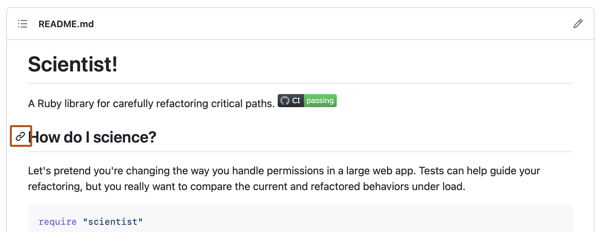

# Source Snapshot: About the repository README file

- **Accessed:** 2026-10-19
- **Type:** official documentation (GitHub Docs)
- **URL:** https://docs.github.com/en/repositories/managing-your-repositorys-settings-and-features/customizing-your-repository/about-readmes
- **Upstream file:** [`github/docs` → `content/repositories/managing-your-repositorys-settings-and-features/customizing-your-repository/about-readmes.md`](https://github.com/github/docs/blob/dae83f7d28f3b8e10015bd6b6d8b72267cedceca/content/repositories/managing-your-repositorys-settings-and-features/customizing-your-repository/about-readmes.md) at commit `dae83f7` (2026-10-16)
- **Version shown:** GitHub.com "Free, Pro & Team" (`fpt`). The page source uses Liquid: `` blocks select text per product version; the site shows the `fpt` branch of each block.
- **Included files:** the published page pulls in text with `` tags and decides `` blocks with feature flags. These files are appended verbatim after the page, under "Included files", from the same commit: [`data/reusables/repositories/about-READMEs.md`](https://github.com/github/docs/blob/dae83f7d28f3b8e10015bd6b6d8b72267cedceca/data/reusables/repositories/about-READMEs.md); [`data/reusables/profile/profile-readme.md`](https://github.com/github/docs/blob/dae83f7d28f3b8e10015bd6b6d8b72267cedceca/data/reusables/profile/profile-readme.md); [`data/reusables/repositories/section-links.md`](https://github.com/github/docs/blob/dae83f7d28f3b8e10015bd6b6d8b72267cedceca/data/reusables/repositories/section-links.md); [`data/reusables/repositories/relative-links.md`](https://github.com/github/docs/blob/dae83f7d28f3b8e10015bd6b6d8b72267cedceca/data/reusables/repositories/relative-links.md)
- **Variables:** `` tags render short values from `data/variables/*.yml`; the values used on this page are listed under "Variable values" at the end.

---

---
title: About the repository README file
shortTitle: About READMEs
intro: 'You can add a README file to your repository to tell other people why your project is useful, what they can do with your project, and how they can use it.'
redirect_from:
  - /articles/section-links-on-readmes-and-blob-pages
  - /articles/relative-links-in-readmes
  - /articles/about-readmes
  - /github/creating-cloning-and-archiving-repositories/about-readmes
  - /github/creating-cloning-and-archiving-repositories/creating-a-repository-on-github/about-readmes
versions:
  fpt: '*'
  ghes: '*'
  ghec: '*'
category:
  - Customize and configure a repository
---
## About READMEs



For more information about providing guidelines for your project, see [AUTOTITLE](/communities/setting-up-your-project-for-healthy-contributions/adding-a-code-of-conduct-to-your-project) and [AUTOTITLE](/communities/setting-up-your-project-for-healthy-contributions).

A README is often the first item a visitor will see when visiting your repository. README files typically include information on:
* What the project does
* Why the project is useful
* How users can get started with the project
* Where users can get help with your project
* Who maintains and contributes to the project

If you put your README file in your repository's hidden `.github`, root, or `docs` directory,  will recognize and automatically surface your README to repository visitors.

If a repository contains more than one README file, then the file shown is chosen from locations in the following order: the `.github` directory, then the repository's root directory, and finally the `docs` directory.

When your README is viewed on GitHub, any content beyond 500 KiB will be truncated.



## Auto-generated table of contents for markdown files

For the rendered view of any Markdown file in a repository, including README files,  will automatically generate a table of contents based on section headings. You can view the table of contents for a README file by clicking the "Outline" menu icon  in the top corner of the rendered page.

## Section links in markdown files and blob pages



For more detailed information about section links, see [Section links](/get-started/writing-on-github/getting-started-with-writing-and-formatting-on-github/basic-writing-and-formatting-syntax#section-links).

## Relative links and image paths in markdown files



## Wikis

A README should only contain information necessary for developers to get started using and contributing to your project. Longer documentation is best suited for wikis. For more information, see [AUTOTITLE](/communities/documenting-your-project-with-wikis/about-wikis).

## Further reading

* [AUTOTITLE](/repositories/working-with-files/managing-files/adding-a-file-to-a-repository)
* [5 tips for making your  profile page accessible](https://github.blog/2023-10-26-5-tips-for-making-your-github-profile-page-accessible/) in the  blog

* [AUTOTITLE](/codespaces/setting-up-your-project-for-codespaces/setting-up-your-repository/facilitating-quick-creation-and-resumption-of-codespaces)


---

## Included files

### `data/reusables/repositories/about-READMEs.md`

````markdown
You can add a README file to a repository to communicate important information about your project. A README, along with a repository license, citation file, contribution guidelines, and a code of conduct, communicates expectations for your project and helps you manage contributions.
````

### `data/reusables/profile/profile-readme.md`

````markdown
If you add a README file to the root of a public repository with the same name as your username, that README will automatically appear on your profile page. You can edit your profile README with  Flavored Markdown to create a personalized section on your profile. For more information, see [AUTOTITLE](/account-and-profile/how-tos/profile-customization/managing-your-profile-readme).
````

### `data/reusables/repositories/section-links.md`

````markdown
You can link directly to any section that has a heading. To view the automatically generated anchor in a rendered file, hover over the section heading to expose the  icon and click the icon to display the anchor in your browser.


````

### `data/reusables/repositories/relative-links.md`

````markdown
You can define relative links and image paths in your rendered files to help readers navigate to other files in your repository.

A relative link is a link that is relative to the current file. For example, if you have a README file in root of your repository, and you have another file in _docs/CONTRIBUTING.md_, the relative link to _CONTRIBUTING.md_ in your README might look like this:

```text
[Contribution guidelines for this project](docs/CONTRIBUTING.md)
```

 will automatically transform your relative link or image path based on whatever branch you're currently on, so that the link or path always works. The path of the link will be relative to the current file. Links starting with `/` will be relative to the repository root. You can use all relative link operands, such as `./` and `../`.

Your link text should be on a single line. The example below will not work.

```markdown
[Contribution
guidelines for this project](docs/CONTRIBUTING.md)
```

Relative links are easier for users who clone your repository. Absolute links may not work in clones of your repository - we recommend using relative links to refer to other files within your repository.
````

## Variable values

From `data/variables/*.yml` at the same commit ([folder](https://github.com/github/docs/tree/dae83f7d28f3b8e10015bd6b6d8b72267cedceca/data/variables)).

| Tag | Value |
|-----|-------|
| `` | GitHub |
| `` | GitHub |
