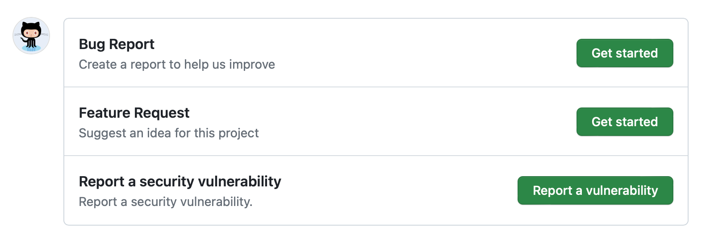

# Source Snapshot: About issue and pull request templates

- **Accessed:** 2026-10-19
- **Type:** official documentation (GitHub Docs)
- **URL:** https://docs.github.com/en/communities/using-templates-to-encourage-useful-issues-and-pull-requests/about-issue-and-pull-request-templates
- **Upstream file:** [`github/docs` → `content/communities/using-templates-to-encourage-useful-issues-and-pull-requests/about-issue-and-pull-request-templates.md`](https://github.com/github/docs/blob/dae83f7d28f3b8e10015bd6b6d8b72267cedceca/content/communities/using-templates-to-encourage-useful-issues-and-pull-requests/about-issue-and-pull-request-templates.md) at commit `dae83f7` (2026-10-16)
- **Version shown:** GitHub.com "Free, Pro & Team" (`fpt`). The page source uses Liquid: `` blocks select text per product version; the site shows the `fpt` branch of each block.
- **Included files:** the published page pulls in text with `` tags and decides `` blocks with feature flags. These files are appended verbatim after the page, under "Included files", from the same commit: [`data/reusables/repositories/issue-template-config.md`](https://github.com/github/docs/blob/dae83f7d28f3b8e10015bd6b6d8b72267cedceca/data/reusables/repositories/issue-template-config.md); [`data/reusables/repositories/valid-community-issues.md`](https://github.com/github/docs/blob/dae83f7d28f3b8e10015bd6b6d8b72267cedceca/data/reusables/repositories/valid-community-issues.md); [`data/reusables/repositories/security-guidelines.md`](https://github.com/github/docs/blob/dae83f7d28f3b8e10015bd6b6d8b72267cedceca/data/reusables/repositories/security-guidelines.md)
- **Variables:** `` tags render short values from `data/variables/*.yml`; the values used on this page are listed under "Variable values" at the end.

---

---
title: About issue and pull request templates
intro: 'With issue and pull request templates, you can customize and standardize the information you''d like contributors to include when they open issues and pull requests in your repository.'
redirect_from:
  - /articles/about-issue-and-pull-request-templates
  - /github/building-a-strong-community/about-issue-and-pull-request-templates
  - /articles/creating-an-issue-template-for-your-repository
  - /articles/manually-creating-a-single-issue-template-for-your-repository
  - /github/building-a-strong-community/manually-creating-a-single-issue-template-for-your-repository
  - /communities/using-templates-to-encourage-useful-issues-and-pull-requests/manually-creating-a-single-issue-template-for-your-repository
versions:
  fpt: '*'
  ghes: '*'
  ghec: '*'
shortTitle: About templates
category:
  - Create issue and pull request templates
---

After you create issue and pull request templates in your repository, contributors can use the templates to open issues or describe the proposed changes in their pull requests according to the repository's contributing guidelines. For more information about adding contributing guidelines to a repository, see [AUTOTITLE](/communities/setting-up-your-project-for-healthy-contributions/setting-guidelines-for-repository-contributors).

You can create default issue and pull request templates for your organization or personal account. For more information, see [AUTOTITLE](/communities/setting-up-your-project-for-healthy-contributions/creating-a-default-community-health-file).

## Issue templates

When you create issue templates for your repository using the issue template builder or with issue forms, contributors can select the appropriate template when they open new issues in the repository.



Issue templates are helpful when you want to provide guidance for opening issues while allowing contributors to specify the content of their issues. If you want contributors to provide specific, structured information when they open issues, issue forms help ensure that you receive your desired information.

Using the template builder, you can specify a title and description for each template, add the template content, and either commit the template to the default branch or open a pull request in the repository. The template builder automatically adds the YAML front matter markup that is required for the template to show on the new issue page. For more information, see [AUTOTITLE](/communities/using-templates-to-encourage-useful-issues-and-pull-requests/configuring-issue-templates-for-your-repository).

With issue forms, you can create templates that have web form fields using the  form schema. When a contributor opens an issue using an issue form, the form inputs are converted to a standard markdown issue comment. You can specify different input types and set inputs as required to help contributors open actionable issues in your repository. For more information, see [AUTOTITLE](/communities/using-templates-to-encourage-useful-issues-and-pull-requests/configuring-issue-templates-for-your-repository#creating-issue-forms) and [AUTOTITLE](/communities/using-templates-to-encourage-useful-issues-and-pull-requests/syntax-for-issue-forms).

 For more information, see [AUTOTITLE](/communities/using-templates-to-encourage-useful-issues-and-pull-requests/configuring-issue-templates-for-your-repository#configuring-the-template-chooser).

Issue templates are stored on the repository's default branch, in a hidden `.github/ISSUE_TEMPLATE` directory. If you create a template in another branch, it will not be available for collaborators to use. Issue template filenames are not case sensitive, and need a _.md_ extension. Issue templates created with issue forms need a _.yml_ extension. 



## Pull request templates

When you add a pull request template to your repository, project contributors will automatically see the template's contents in the pull request body.

You must create templates on the repository's default branch. Templates created in other branches are not available for collaborators to use. You can store your pull request template in the repository's visible root directory, the `docs` folder, or the hidden `.github` directory. Pull request template filenames are not case sensitive, and can have an extension such as _.md_ or _.txt_.

For more information, see [AUTOTITLE](/communities/using-templates-to-encourage-useful-issues-and-pull-requests/creating-a-pull-request-template-for-your-repository).

---

## Included files

### `data/reusables/repositories/issue-template-config.md`

````markdown
You can customize the issue template chooser that people see when creating a new issue in your repository by adding a `config.yml` file to the `.github/ISSUE_TEMPLATE` folder.
````

### `data/reusables/repositories/valid-community-issues.md`

````markdown
To be displayed with a  checkmark in the community profile checklist, issue templates must be located in the `.github/ISSUE_TEMPLATE` folder and contain valid `name:` and `about:` keys in the YAML frontmatter (for issue templates defined in `.md` files) or valid `name:` and `description:` keys (for issue forms defined in `.yml` files).
````

### `data/reusables/repositories/security-guidelines.md`

````markdown
You can create a security policy to give people instructions for reporting security vulnerabilities in your project. For more information, see [AUTOTITLE](/code-security/how-tos/report-and-fix-vulnerabilities/configure-vulnerability-reporting/add-security-policy).
````

## Variable values

From `data/variables/*.yml` at the same commit ([folder](https://github.com/github/docs/tree/dae83f7d28f3b8e10015bd6b6d8b72267cedceca/data/variables)).

| Tag | Value |
|-----|-------|
| `` | GitHub |
