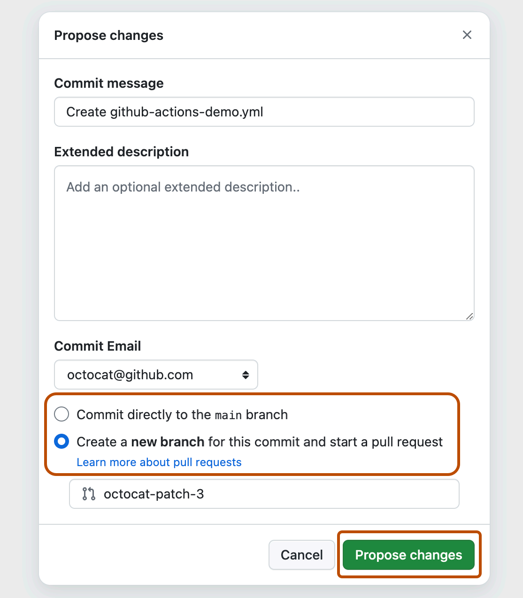
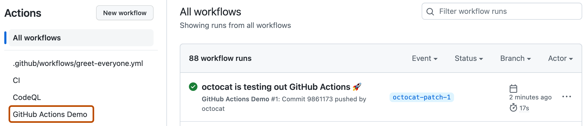
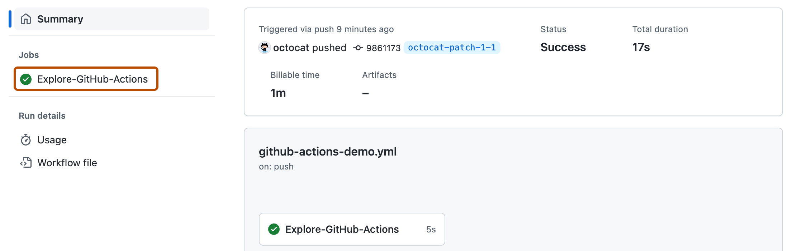
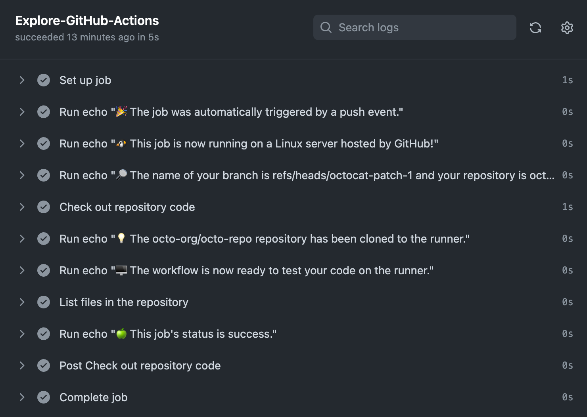
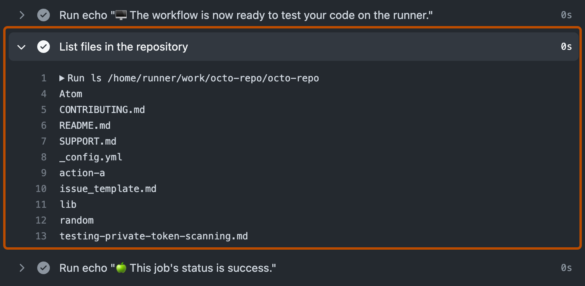
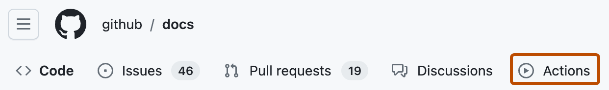

# Source Snapshot: Quickstart for GitHub Actions

- **Accessed:** 2026-10-19
- **Type:** official documentation (GitHub Docs)
- **URL:** https://docs.github.com/en/actions/get-started/quickstart
- **Upstream file:** [`github/docs` → `content/actions/get-started/quickstart.md`](https://github.com/github/docs/blob/dae83f7d28f3b8e10015bd6b6d8b72267cedceca/content/actions/get-started/quickstart.md) at commit `dae83f7` (2026-10-16)
- **Version shown:** GitHub.com "Free, Pro & Team" (`fpt`). The page source uses Liquid: `` blocks select text per product version; the site shows the `fpt` branch of each block.
- **Included files:** the published page pulls in text with `` tags and decides `` blocks with feature flags. These files are appended verbatim after the page, under "Included files", from the same commit: [`data/reusables/actions/enterprise-github-hosted-runners.md`](https://github.com/github/docs/blob/dae83f7d28f3b8e10015bd6b6d8b72267cedceca/data/reusables/actions/enterprise-github-hosted-runners.md); [`data/reusables/actions/about-actions.md`](https://github.com/github/docs/blob/dae83f7d28f3b8e10015bd6b6d8b72267cedceca/data/reusables/actions/about-actions.md); [`data/reusables/actions/workflow-templates-for-more-information.md`](https://github.com/github/docs/blob/dae83f7d28f3b8e10015bd6b6d8b72267cedceca/data/reusables/actions/workflow-templates-for-more-information.md); [`data/reusables/actions/workflow-template-overview.md`](https://github.com/github/docs/blob/dae83f7d28f3b8e10015bd6b6d8b72267cedceca/data/reusables/actions/workflow-template-overview.md); [`data/reusables/actions/workflow-templates-repo-link.md`](https://github.com/github/docs/blob/dae83f7d28f3b8e10015bd6b6d8b72267cedceca/data/reusables/actions/workflow-templates-repo-link.md); [`data/reusables/actions/action-checkout.md`](https://github.com/github/docs/blob/dae83f7d28f3b8e10015bd6b6d8b72267cedceca/data/reusables/actions/action-checkout.md); [`data/reusables/repositories/navigate-to-repo.md`](https://github.com/github/docs/blob/dae83f7d28f3b8e10015bd6b6d8b72267cedceca/data/reusables/repositories/navigate-to-repo.md); [`data/reusables/repositories/actions-tab.md`](https://github.com/github/docs/blob/dae83f7d28f3b8e10015bd6b6d8b72267cedceca/data/reusables/repositories/actions-tab.md); [`data/reusables/actions/onboarding-next-steps.md`](https://github.com/github/docs/blob/dae83f7d28f3b8e10015bd6b6d8b72267cedceca/data/reusables/actions/onboarding-next-steps.md); [`data/features/github-certification.yml`](https://github.com/github/docs/blob/dae83f7d28f3b8e10015bd6b6d8b72267cedceca/data/features/github-certification.yml)
- **Variables:** `` tags render short values from `data/variables/*.yml`; the values used on this page are listed under "Variable values" at the end.

---

---
title: Quickstart for GitHub Actions
intro: Try out the core features of  in minutes.
allowTitleToDifferFromFilename: true
redirect_from:
  - /actions/getting-started-with-github-actions/starting-with-preconfigured-workflow-templates
  - /actions/quickstart
  - /actions/getting-started-with-github-actions
  - /actions/writing-workflows/quickstart
versions:
  fpt: '*'
  ghes: '*'
  ghec: '*'
shortTitle: Quickstart
contentType: get-started
category:
  - Get started with GitHub Actions
---



## Introduction

 You can create workflows that run tests whenever you push a change to your repository, or that deploy merged pull requests to production.

This quickstart guide shows you how to use the user interface of  to add a workflow that demonstrates some of the essential features of .



For an overview of  workflows, see [AUTOTITLE](/actions/concepts/workflows-and-actions/workflows). If you want to learn about the various components that make up , see [AUTOTITLE](/actions/get-started/understand-github-actions).

## Using workflow templates





## Prerequisites

This guide assumes that:
* You have at least a basic knowledge of how to use . If you don't, you'll find it helpful to read some of the articles in the documentation for repositories and pull requests first. For example, see [AUTOTITLE](/repositories/creating-and-managing-repositories/quickstart-for-repositories), [AUTOTITLE](/pull-requests/reference/branches), and [AUTOTITLE](/pull-requests/reference/pull-requests).
* You have a repository on  where you can add files.
* You have access to .

  > [!NOTE] If the ** Actions** tab is not displayed under the name of your repository on , it may be because Actions is disabled for the repository. For more information, see [AUTOTITLE](/repositories/managing-your-repositorys-settings-and-features/enabling-features-for-your-repository/managing-github-actions-settings-for-a-repository).

## Creating your first workflow

1. In your repository on , create a workflow file called `github-actions-demo.yml` in the `.github/workflows` directory. To do this:
   * If the `.github/workflows` directory already exists, navigate to that directory on , click **Add file**, then click **Create new file**, and name the file `github-actions-demo.yml`.
   * If your repository doesn't have a `.github/workflows` directory, go to the main page of the repository on , click **Add file**, then click **Create new file**, and name the file `.github/workflows/github-actions-demo.yml`. This creates the `.github` and `workflows` directories and the `github-actions-demo.yml` file in a single step.

   > [!NOTE]
   > For  to discover any  workflows in your repository, you must save the workflow files in a directory called `.github/workflows`.
   >
   > You can give the workflow file any name you like, but you must use `.yml` or `.yaml` as the file name extension. YAML is a markup language that's commonly used for configuration files.

1. Copy the following YAML contents into the `github-actions-demo.yml` file:

   ```yaml copy
   name: GitHub Actions Demo
   run-name: ${{ github.actor }} is testing out GitHub Actions 🚀
   on: [push]
   jobs:
     Explore-GitHub-Actions:
       runs-on: ubuntu-latest
       steps:
         - run: echo "🎉 The job was automatically triggered by a ${{ github.event_name }} event."
         - run: echo "🐧 This job is now running on a ${{ runner.os }} server hosted by GitHub!"
         - run: echo "🔎 The name of your branch is ${{ github.ref }} and your repository is ${{ github.repository }}."
         - name: Check out repository code
           uses: 
         - run: echo "💡 The ${{ github.repository }} repository has been cloned to the runner."
         - run: echo "🖥️ The workflow is now ready to test your code on the runner."
         - name: List files in the repository
           run: |
             ls ${{ github.workspace }}
         - run: echo "🍏 This job's status is ${{ job.status }}."
   ```

   At this stage you don't need to understand the details of this workflow. For now, you can just copy and paste the contents into the file. After completing this quickstart guide, you can learn about the syntax of workflow files in [AUTOTITLE](/actions/concepts/workflows-and-actions/workflows), and for an explanation of  contexts, such as `${{ github.actor }}` and `${{ github.event_name }}`, see [AUTOTITLE](/actions/reference/workflows-and-actions/contexts).

1. Click **Commit changes**.
1. In the "Propose changes" dialog, select either the option to commit to the default branch or the option to create a new branch and start a pull request. Then click **Commit changes** or **Propose changes**.

   

Committing the workflow file to a branch in your repository triggers the `push` event and runs your workflow.

If you chose to start a pull request, you can continue and create the pull request, but this is not necessary for the purposes of this quickstart because the commit has still been made to a branch and will trigger the new workflow.

## Viewing your workflow results



1. In the left sidebar, click the workflow you want to display, in this example "GitHub Actions Demo."

   

1. From the list of workflow runs, click the name of the run you want to see, in this example "USERNAME is testing out GitHub Actions."
1. In the left sidebar of the workflow run page, under **Jobs**, click the **Explore-GitHub-Actions** job.

   

1. The log shows you how each of the steps was processed. Expand any of the steps to view its details.

   

   For example, you can see the list of files in your repository:

   

The example workflow you just added is triggered each time code is pushed to the branch, and shows you how  can work with the contents of your repository. For an in-depth tutorial, see [AUTOTITLE](/actions/get-started/understand-github-actions).

## Next steps



---

## Included files

### `data/reusables/actions/enterprise-github-hosted-runners.md`

````markdown


> [!NOTE]
>  users should use self-hosted runners. -hosted runners are **not** supported.


````

### `data/reusables/actions/about-actions.md`

````markdown
 is a continuous integration and continuous delivery (CI/CD) platform that allows you to automate your build, test, and deployment pipeline.
````

### `data/reusables/actions/workflow-templates-for-more-information.md`

````markdown
To get started with preconfigured workflows, browse through the list of templates in the [actions/starter-workflows](https://github.com/actions/starter-workflows) repository. For more information, see [AUTOTITLE](/actions/how-tos/write-workflows/use-workflow-templates).
````

### `data/reusables/actions/workflow-template-overview.md`

````markdown
 provides preconfigured workflow templates that you can use as-is or customize to create your own workflow.  analyzes your code and shows you workflow templates that might be useful for your repository. For example, if your repository contains Node.js code, you'll see suggestions for Node.js projects.

These workflow templates are designed to help you get up and running quickly, offering a range of configurations such as:
* CI: [Continuous Integration workflows](https://github.com/actions/starter-workflows/tree/main/ci)
* Deployments: [Deployment workflows](https://github.com/actions/starter-workflows/tree/main/deployments)
* Automation: [Automating workflows](https://github.com/actions/starter-workflows/tree/main/automation)
* Code Scanning: [Code Scanning workflows](https://github.com/actions/starter-workflows/tree/main/code-scanning)
* Pages: [Pages workflows](https://github.com/actions/starter-workflows/tree/main/pages)
````

### `data/reusables/actions/workflow-templates-repo-link.md`

````markdown
Use these workflows as a starting place to build your custom workflow or use them as-is. You can browse the full list of workflow templates in the [actions/starter-workflows](https://github.com/actions/starter-workflows) repository.
````

### `data/reusables/actions/action-checkout.md`

````markdown
actions/checkout@v6
````

### `data/reusables/repositories/navigate-to-repo.md`

````markdown
1. On , navigate to the main page of the repository.
````

### `data/reusables/repositories/actions-tab.md`

````markdown
1. Under your repository name, click ** Actions**.

   
````

### `data/reusables/actions/onboarding-next-steps.md`

````markdown
 can help you automate nearly every aspect of your application development processes. Ready to get started? Here are some helpful resources for taking your next steps with :

* To create a  workflow, see [AUTOTITLE](/actions/how-tos/write-workflows/use-workflow-templates).
* For continuous integration (CI) workflows, see [AUTOTITLE](/actions/tutorials/build-and-test-code).
* For building and publishing packages, see [AUTOTITLE](/actions/tutorials/publish-packages).
* For deploying projects, see [AUTOTITLE](/actions/how-tos/deploy/deploy-to-third-party-platforms).
* For automating tasks and processes on , see [AUTOTITLE](/actions/tutorials/manage-your-work).
* For examples that demonstrate more complex features of , see [AUTOTITLE](/actions/how-tos/write-workflows/choose-what-workflows-do). These detailed examples explain how to test your code on a runner, access the  CLI, and use advanced features such as concurrency and test matrices.
* To certify your proficiency in automating workflows and accelerating development with , earn a  certificate with . For more information, see [AUTOTITLE](/get-started/showcase-your-expertise-with-github-certifications/about-github-certifications).
````

### `data/features/github-certification.yml`

````yaml
# Reference: #12157.
# Documentation for the GitHub Certification program

versions:
  fpt: '*'
  ghec: '*'
````

## Variable values

From `data/variables/*.yml` at the same commit ([folder](https://github.com/github/docs/tree/dae83f7d28f3b8e10015bd6b6d8b72267cedceca/data/variables)).

| Tag | Value |
|-----|-------|
| `` | GitHub Actions |
| `` | GitHub |
| `` | GitHub |
| `` | GitHub Enterprise Server |
| `` | GitHub Certifications |
