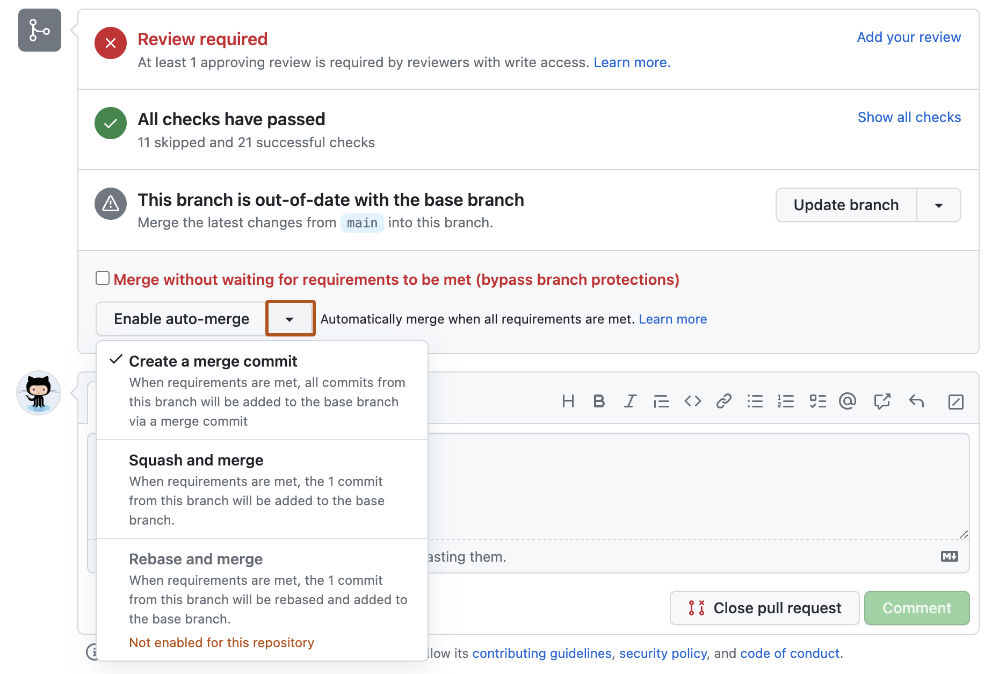

# Source Snapshot: Automatically merging a pull request

- **Accessed:** 2026-10-19
- **Type:** official documentation (GitHub Docs)
- **URL:** https://docs.github.com/en/pull-requests/how-tos/merge-and-close-pull-requests/automatically-merging-a-pull-request
- **Upstream file:** [`github/docs` → `content/pull-requests/how-tos/merge-and-close-pull-requests/automatically-merging-a-pull-request.md`](https://github.com/github/docs/blob/dae83f7d28f3b8e10015bd6b6d8b72267cedceca/content/pull-requests/how-tos/merge-and-close-pull-requests/automatically-merging-a-pull-request.md) at commit `dae83f7` (2026-10-16)
- **Version shown:** GitHub.com "Free, Pro & Team" (`fpt`). The page source uses Liquid: `` blocks select text per product version; the site shows the `fpt` branch of each block.
- **Included files:** the published page pulls in text with `` tags and decides `` blocks with feature flags. These files are appended verbatim after the page, under "Included files", from the same commit: [`data/reusables/gated-features/auto-merge.md`](https://github.com/github/docs/blob/dae83f7d28f3b8e10015bd6b6d8b72267cedceca/data/reusables/gated-features/auto-merge.md); [`data/reusables/gated-features/more-info.md`](https://github.com/github/docs/blob/dae83f7d28f3b8e10015bd6b6d8b72267cedceca/data/reusables/gated-features/more-info.md); [`data/reusables/pull_requests/auto-merge-requires-branch-protection.md`](https://github.com/github/docs/blob/dae83f7d28f3b8e10015bd6b6d8b72267cedceca/data/reusables/pull_requests/auto-merge-requires-branch-protection.md); [`data/reusables/repositories/navigate-to-repo.md`](https://github.com/github/docs/blob/dae83f7d28f3b8e10015bd6b6d8b72267cedceca/data/reusables/repositories/navigate-to-repo.md); [`data/reusables/repositories/sidebar-pr.md`](https://github.com/github/docs/blob/dae83f7d28f3b8e10015bd6b6d8b72267cedceca/data/reusables/repositories/sidebar-pr.md)
- **Variables:** `` tags render short values from `data/variables/*.yml`; the values used on this page are listed under "Variable values" at the end.

---

---
title: Automatically merging a pull request
intro: Enable or disable auto-merge for pull requests to streamline your workflow and automatically merge changes once all requirements are met.
product: ''
versions:
  fpt: '*'
  ghes: '*'
  ghec: '*'
redirect_from:
  - /github/collaborating-with-issues-and-pull-requests/incorporating-changes-from-a-pull-request/automatically-merging-a-pull-request
  - /github/collaborating-with-issues-and-pull-requests/automatically-merging-a-pull-request
  - /github/collaborating-with-pull-requests/incorporating-changes-from-a-pull-request/automatically-merging-a-pull-request
  - /pull-requests/collaborating-with-pull-requests/incorporating-changes-from-a-pull-request/automatically-merging-a-pull-request
shortTitle: Merge PR automatically
category:
  - Merge and close pull requests
contentType: how-tos
---
## About auto-merge

Auto-merge merges a pull request automatically after all required reviews and status checks pass. Before you use auto-merge, it must be enabled for the repository. See [AUTOTITLE](/repositories/configuring-branches-and-merges-in-your-repository/configuring-pull-request-merges/managing-auto-merge-for-pull-requests-in-your-repository).

Auto-merge is disabled if someone without write permissions pushes new changes to the head branch or switches the base branch.

## Enabling auto-merge



People with write permissions to a repository can enable auto-merge for a pull request.



1. In the "Pull Requests" list, click the pull request you want to auto-merge.
1. Optionally, select the  dropdown menu, then click a merge method. See [AUTOTITLE](/pull-requests/reference/pull-request-merges).

   

1. Click **Enable auto-merge**.
   
1. If you chose the merge or squash and merge methods, type a commit message and description and choose the email address you want to author the merge commit.

   > [!NOTE]
   > The email dropdown menu is not available if you have email privacy enabled or if you only have one verified and visible email associated with your  account.

   
   
1. If you chose the merge or squash and merge methods, type a commit message and description.
   
1. Click **Confirm auto-merge**.

## Disabling auto-merge

People with write permissions to a repository and pull request authors can disable auto-merge for a pull request.



1. In the "Pull Requests" list, click the pull request for which you want to disable auto-merge.
1. In the merge box, click **Disable auto-merge**.

---

## Included files

### `data/reusables/gated-features/auto-merge.md`

````markdown
Auto-merge for pull requests is available in public repositories with  and  for organizations, and in public and private repositories with , , , and . 
````

### `data/reusables/gated-features/more-info.md`

````markdown
See [AUTOTITLE](/get-started/learning-about-github/githubs-plans).
````

### `data/reusables/pull_requests/auto-merge-requires-branch-protection.md`

````markdown
> [!NOTE]
> The option to enable auto-merge is shown only on pull requests that cannot be merged immediately. For example, when a branch protection rule enforces "Require pull request reviews before merging" or "Require status checks to pass before merging" and these conditions are not yet met. For more information, see [AUTOTITLE](/repositories/configuring-branches-and-merges-in-your-repository/managing-protected-branches/managing-a-branch-protection-rule).
````

### `data/reusables/repositories/navigate-to-repo.md`

````markdown
1. On , navigate to the main page of the repository.
````

### `data/reusables/repositories/sidebar-pr.md`

````markdown
1. Under your repository name, click ** Pull requests**.
````

## Variable values

From `data/variables/*.yml` at the same commit ([folder](https://github.com/github/docs/tree/dae83f7d28f3b8e10015bd6b6d8b72267cedceca/data/variables)).

| Tag | Value |
|-----|-------|
| `` | GitHub |
| `` | GitHub Free |
| `` | GitHub Free |
| `` | GitHub Pro |
| `` | GitHub Team |
| `` | GitHub Enterprise Cloud |
| `` | GitHub Enterprise Server |
| `` | GitHub |
