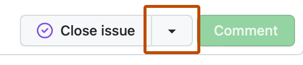
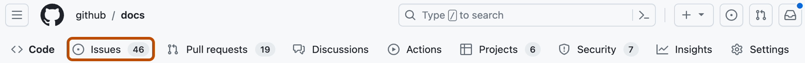

# Source Snapshot: Closing an issue

- **Accessed:** 2026-10-19
- **Type:** official documentation (GitHub Docs)
- **URL:** https://docs.github.com/en/issues/tracking-your-work-with-issues/administering-issues/closing-an-issue
- **Upstream file:** [`github/docs` → `content/issues/tracking-your-work-with-issues/administering-issues/closing-an-issue.md`](https://github.com/github/docs/blob/dae83f7d28f3b8e10015bd6b6d8b72267cedceca/content/issues/tracking-your-work-with-issues/administering-issues/closing-an-issue.md) at commit `dae83f7` (2026-10-16)
- **Version shown:** GitHub.com "Free, Pro & Team" (`fpt`). The page source uses Liquid: `` blocks select text per product version; the site shows the `fpt` branch of each block.
- **Included files:** the published page pulls in text with `` tags and decides `` blocks with feature flags. These files are appended verbatim after the page, under "Included files", from the same commit: [`data/reusables/enterprise-accounts/emu-permission-repo.md`](https://github.com/github/docs/blob/dae83f7d28f3b8e10015bd6b6d8b72267cedceca/data/reusables/enterprise-accounts/emu-permission-repo.md); [`data/reusables/repositories/navigate-to-repo.md`](https://github.com/github/docs/blob/dae83f7d28f3b8e10015bd6b6d8b72267cedceca/data/reusables/repositories/navigate-to-repo.md); [`data/reusables/repositories/sidebar-issues.md`](https://github.com/github/docs/blob/dae83f7d28f3b8e10015bd6b6d8b72267cedceca/data/reusables/repositories/sidebar-issues.md)
- **Variables:** `` tags render short values from `data/variables/*.yml`; the values used on this page are listed under "Variable values" at the end.

---

---
title: Closing an issue
intro: 'You can close an issue when bugs are fixed, feedback is acted on, or to show that work is not planned.'
permissions: 'Anyone can close an issue they opened.<br><br>Repository owners, collaborators on repositories owned by a personal account, and people with triage permissions or greater on repositories owned by an organization can close issues opened by others. '
versions:
  fpt: '*'
  ghes: '*'
  ghec: '*'
shortTitle: Close an issue
redirect_from:
  - /issues/tracking-your-work-with-issues/closing-an-issue
category:
  - Triage and organize issues
---

> [!NOTE]
> You can also close issues automatically with keywords in pull requests and commit messages. For more information, see [AUTOTITLE](/issues/tracking-your-work-with-issues/using-issues/linking-a-pull-request-to-an-issue#linking-a-pull-request-to-an-issue-using-a-keyword).



1. In the list of issues, click the issue you'd like to close.
1. Optionally, to change your reason for closing the issue, next to "Close issue," select , then click a reason.

   
1. Click **Close issue**.

---

## Included files

### `data/reusables/enterprise-accounts/emu-permission-repo.md`

````markdown
 Members of an  can only make changes in repositories that are part of their enterprise. 
````

### `data/reusables/repositories/navigate-to-repo.md`

````markdown
1. On , navigate to the main page of the repository.
````

### `data/reusables/repositories/sidebar-issues.md`

````markdown
1. Under your repository name, click ** Issues**.

   
````

## Variable values

From `data/variables/*.yml` at the same commit ([folder](https://github.com/github/docs/tree/dae83f7d28f3b8e10015bd6b6d8b72267cedceca/data/variables)).

| Tag | Value |
|-----|-------|
| `` | enterprise with managed users |
| `` | GitHub |
