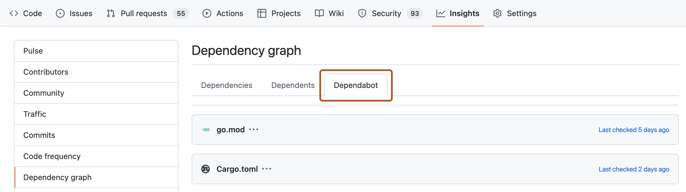

# Source Snapshot: Configuring Dependabot version updates

- **Accessed:** 2026-10-19
- **Type:** official documentation (GitHub Docs)
- **URL:** https://docs.github.com/en/code-security/how-tos/secure-your-supply-chain/secure-your-dependencies/configure-version-updates
- **Upstream file:** [`github/docs` → `content/code-security/how-tos/secure-your-supply-chain/secure-your-dependencies/configure-version-updates.md`](https://github.com/github/docs/blob/dae83f7d28f3b8e10015bd6b6d8b72267cedceca/content/code-security/how-tos/secure-your-supply-chain/secure-your-dependencies/configure-version-updates.md) at commit `dae83f7` (2026-10-16)
- **Version shown:** GitHub.com "Free, Pro & Team" (`fpt`). The page source uses Liquid: `` blocks select text per product version; the site shows the `fpt` branch of each block.
- **Included files:** the published page pulls in text with `` tags and decides `` blocks with feature flags. These files are appended verbatim after the page, under "Included files", from the same commit: [`data/reusables/permissions/dependabot-yml-configure.md`](https://github.com/github/docs/blob/dae83f7d28f3b8e10015bd6b6d8b72267cedceca/data/reusables/permissions/dependabot-yml-configure.md); [`data/reusables/dependabot/enterprise-enable-dependabot.md`](https://github.com/github/docs/blob/dae83f7d28f3b8e10015bd6b6d8b72267cedceca/data/reusables/dependabot/enterprise-enable-dependabot.md); [`data/reusables/repositories/navigate-to-repo.md`](https://github.com/github/docs/blob/dae83f7d28f3b8e10015bd6b6d8b72267cedceca/data/reusables/repositories/navigate-to-repo.md); [`data/reusables/repositories/sidebar-settings.md`](https://github.com/github/docs/blob/dae83f7d28f3b8e10015bd6b6d8b72267cedceca/data/reusables/repositories/sidebar-settings.md); [`data/reusables/repositories/navigate-to-code-security-and-analysis.md`](https://github.com/github/docs/blob/dae83f7d28f3b8e10015bd6b6d8b72267cedceca/data/reusables/repositories/navigate-to-code-security-and-analysis.md); [`data/reusables/dependabot/link-to-yml-config-file.md`](https://github.com/github/docs/blob/dae83f7d28f3b8e10015bd6b6d8b72267cedceca/data/reusables/dependabot/link-to-yml-config-file.md); [`data/reusables/dependabot/check-in-dependabot-yml.md`](https://github.com/github/docs/blob/dae83f7d28f3b8e10015bd6b6d8b72267cedceca/data/reusables/dependabot/check-in-dependabot-yml.md); [`data/reusables/dependabot/private-dependencies-note.md`](https://github.com/github/docs/blob/dae83f7d28f3b8e10015bd6b6d8b72267cedceca/data/reusables/dependabot/private-dependencies-note.md); [`data/features/dependabot-settings-update-37.yml`](https://github.com/github/docs/blob/dae83f7d28f3b8e10015bd6b6d8b72267cedceca/data/features/dependabot-settings-update-37.yml); [`data/features/security-feature-enablement-policies-dependabot.yml`](https://github.com/github/docs/blob/dae83f7d28f3b8e10015bd6b6d8b72267cedceca/data/features/security-feature-enablement-policies-dependabot.yml); [`data/features/security-and-quality-tab.yml`](https://github.com/github/docs/blob/dae83f7d28f3b8e10015bd6b6d8b72267cedceca/data/features/security-and-quality-tab.yml)
- **Variables:** `` tags render short values from `data/variables/*.yml`; the values used on this page are listed under "Variable values" at the end.

---

---
title: Configuring Dependabot version updates
intro: You can configure your repository so that  automatically updates the packages you use.
permissions: ''
redirect_from:
  - /github/administering-a-repository/enabling-and-disabling-version-updates
  - /code-security/supply-chain-security/enabling-and-disabling-version-updates
  - /code-security/supply-chain-security/keeping-your-dependencies-updated-automatically/enabling-and-disabling-version-updates
  - /code-security/supply-chain-security/keeping-your-dependencies-updated-automatically/enabling-and-disabling-dependabot-version-updates
  - /code-security/dependabot/dependabot-version-updates/configuring-dependabot-version-updates
  - /code-security/how-tos/secure-your-supply-chain/secure-your-dependencies/configuring-dependabot-version-updates
versions:
  fpt: '*'
  ghec: '*'
  ghes: '*'
shortTitle: Configure version updates
contentType: how-tos
category:
  - Secure your dependencies
---
<!--Marketing-LINK: From /features/security/software-supply-chain page "About version updates for dependencies".-->


## Enabling 

You enable  by committing a `dependabot.yml` configuration file to your repository.
If you enable the feature in your settings page, GitHub creates a basic file which you can edit, otherwise you can create the file using any file editor.




1. Under "," to the right of "", click **Enable** to open a basic `dependabot.yml` configuration file in the `.github` directory of your repository. 

1. Create a `dependabot.yml` configuration file in the `.github` directory of your repository. You can use the snippet below as a starting point. 


   ```yaml copy
   # To get started with Dependabot version updates, you'll need to specify which
   # package ecosystems to update and where the package manifests are located.

   version: 2
   updates:
   - package-ecosystem: "" # See documentation for possible values
     directory: "/" # Location of package manifests
     schedule:
       interval: "weekly"
   ```

1. Add a `version`. This key is mandatory. The file must start with `version: 2`.
1. Optionally, if you have dependencies in a private registry, add a `registries` section containing authentication details. For more information, see [AUTOTITLE](/code-security/how-tos/secure-your-supply-chain/manage-your-dependency-security/configure-access-to-private-registries).
1. Add an `updates` section, with an entry for each package manager you want  to monitor. This key is mandatory. You use it to configure how  updates the versions or your project's dependencies. Each entry configures the update settings for a particular package manager. For more information, see [AUTOTITLE](/code-security/concepts/supply-chain-security/about-the-dependabot-yml-file) and [AUTOTITLE](/code-security/reference/supply-chain-security/dependabot-options-reference).
1. For each package manager, use:

    * `package-ecosystem` to specify the package manager. For more information about the supported package managers, see [`package-ecosystem`](/code-security/reference/supply-chain-security/dependabot-options-reference#package-ecosystem-).
    * `directories` or `directory` to specify the location of multiple manifest or other definition files. For more information, see [Defining multiple locations for manifest files](/code-security/how-tos/secure-your-supply-chain/manage-your-dependency-security/controlling-dependencies-updated#defining-multiple-locations-for-manifest-files).
    * `schedule.interval` to specify how often to check for new versions.



### Example `dependabot.yml` file

The example `dependabot.yml` file below configures version updates for three package managers: npm, Docker, and . When this file is checked in,  checks the manifest files on the default branch for outdated dependencies. If it finds outdated dependencies, it will raise pull requests against the default branch to update the dependencies.

```yaml copy
# Basic `dependabot.yml` file with
# minimum configuration for three package managers

version: 2
updates:
  # Enable version updates for npm
  - package-ecosystem: "npm"
    # Look for `package.json` and `lock` files in the `root` directory
    directory: "/"
    # Check the npm registry for updates every day (weekdays)
    schedule:
      interval: "daily"

  # Enable version updates for Docker
  - package-ecosystem: "docker"
    # Look for a `Dockerfile` in the `root` directory
    directory: "/"
    # Check for updates once a week
    schedule:
      interval: "weekly"

  # Enable version updates for GitHub Actions
  - package-ecosystem: "github-actions"
    # Workflow files stored in the default location of `.github/workflows`
    # You don't need to specify `/.github/workflows` for `directory`. You can use `directory: "/"`.
    directory: "/"
    schedule:
      interval: "weekly"
```

In the example above, if the Docker dependencies were very outdated, you might want to start with a `daily` schedule until the dependencies are up-to-date, and then drop back to a weekly schedule.

## Enabling version updates on forks

If you want to enable version updates on forks, there's an extra step. Version updates are not automatically enabled on forks when a `dependabot.yml` configuration file is present. This ensures that fork owners don't unintentionally enable version updates when they pull changes including a `dependabot.yml` configuration file from the original repository.

On a fork, you also need to explicitly enable .




1. Under "," to the right of "," click **Enable** to allow  to initiate version updates.

## Receiving updates for indirect dependencies

By default, only direct dependencies that are explicitly defined in a manifest are kept up to date by . You can choose to receive updates for indirect dependencies defined in lock files. For more information, see [AUTOTITLE](/code-security/how-tos/secure-your-supply-chain/manage-your-dependency-security/controlling-dependencies-updated#allowing-specific-dependencies-to-be-updated).

## Enabling access to private dependencies



Additionally,  doesn't support private  dependencies for all package managers. For more information, see [AUTOTITLE](/code-security/reference/supply-chain-security/supported-ecosystems-and-repositories) and [AUTOTITLE](/get-started/learning-about-github/github-language-support).

## Checking the status of version updates

After you enable version updates, the **Dependabot** tab in the dependency graph for the repository is populated. This tab shows which package managers  is configured to monitor and when  last checked for new versions.



For information, see [AUTOTITLE](/code-security/how-tos/secure-your-supply-chain/manage-your-dependency-security/list-configured-dependencies).

## Disabling 

You can disable version updates entirely by deleting the `dependabot.yml` file from your repository. More usually, you want to disable updates temporarily for one or more dependencies, or package managers.

* Package managers: disable by setting `open-pull-requests-limit: 0` or by commenting out the relevant `package-ecosystem` in the configuration file.
* Specific dependencies: disable by adding `ignore` attributes for packages or applications that you want to exclude from updates.

When you disable dependencies, you can use wild cards to match a set of related libraries. You can also specify which versions to exclude. This is particularly useful if you need to block updates to a library, pending work to support a breaking change to its API, but want to get any security fixes to the version you use.

### Example disabling version updates for some dependencies

The example `dependabot.yml` file below includes examples of the different ways to disable updates to some dependencies, while allowing other updates to continue.

```yaml
# `dependabot.yml` file with updates
# disabled for Docker and limited for npm

version: 2
updates:
  # Configuration for Dockerfile
  - package-ecosystem: "docker"
    directory: "/"
    schedule:
      interval: "weekly"
      # Disable all pull requests for Docker dependencies
    open-pull-requests-limit: 0

  # Configuration for npm
  - package-ecosystem: "npm"
    directory: "/"
    schedule:
      interval: "weekly"
    ignore:
      # Ignore updates to packages that start with 'aws'
      # Wildcards match zero or more arbitrary characters
      - dependency-name: "aws*"
      # Ignore some updates to the 'express' package
      - dependency-name: "express"
        # Ignore only new versions for 4.x and 5.x
        versions: ["4.x", "5.x"]
      # For all packages, ignore all patch updates
      - dependency-name: "*"
        update-types: ["version-update:semver-patch"]
```

For more information about checking for existing ignore preferences, see [AUTOTITLE](/code-security/reference/supply-chain-security/dependabot-options-reference#ignore--).

---

## Included files

### `data/reusables/permissions/dependabot-yml-configure.md`

````markdown
Users with **write** access
````

### `data/reusables/dependabot/enterprise-enable-dependabot.md`

````markdown


> [!NOTE]
> Your site administrator must set up  for  before you can use this feature. For more information, see [AUTOTITLE](/admin/configuring-settings/configuring-github-connect/enabling-dependabot-for-your-enterprise).
>
> You may not be able to enable or disable  if an enterprise owner has set a policy at the enterprise level. For more information, see [AUTOTITLE](/admin/enforcing-policies/enforcing-policies-for-your-enterprise/enforcing-policies-for-code-security-and-analysis-for-your-enterprise).



````

### `data/reusables/repositories/navigate-to-repo.md`

````markdown
1. On , navigate to the main page of the repository.
````

### `data/reusables/repositories/sidebar-settings.md`

````markdown
1. Under your repository name, click ** Settings**. If you cannot see the "Settings" tab, select the **** dropdown menu, then click **Settings**.

   
````

### `data/reusables/repositories/navigate-to-code-security-and-analysis.md`

````markdown
1. In the "Security and qualitySecurity" section of the sidebar, click ** **.
````

### `data/reusables/dependabot/link-to-yml-config-file.md`

````markdown
For information about the options you can use to customize how  maintains your repositories, see [AUTOTITLE](/code-security/reference/supply-chain-security/dependabot-options-reference).
````

### `data/reusables/dependabot/check-in-dependabot-yml.md`

````markdown
1. Check the `dependabot.yml` configuration file in to the `.github` directory of the repository.
````

### `data/reusables/dependabot/private-dependencies-note.md`

````markdown
When running security or version updates, some ecosystems must be able to resolve all dependencies from their source to verify that updates have been successful. If your manifest or lock files contain any private dependencies,  must be able to access the location at which those dependencies are hosted. Organization owners can grant  access to private repositories containing dependencies for a project within the same organization. For more information, see [AUTOTITLE](/organizations/keeping-your-organization-secure/managing-security-settings-for-your-organization/managing-security-and-analysis-settings-for-your-organization#allowing-dependabot-to-access-private-or-internal-dependencies). You can configure access to private registries in a repository's `dependabot.yml` configuration file. For more information, see [AUTOTITLE](/code-security/how-tos/secure-your-supply-chain/manage-your-dependency-security/configure-access-to-private-registries).
````

### `data/features/dependabot-settings-update-37.yml`

````yaml
# Reference: Issue #7044 Update repository settings for Dependabot to include shortcut for Version updates
versions:
  fpt: '*'
  ghec: '*'
````

### `data/features/security-feature-enablement-policies-dependabot.yml`

````yaml
# Reference: #10253. Related issue: #7661.
# Improvement issue to fix versioning for enforcing a policy for Dependabot.
versions:
  ghec: '*'
  ghes: '>=3.9'
````

### `data/features/security-and-quality-tab.yml`

````yaml
# Reference: #60482.
# Documentation for renaming the Security tab to "Security and quality".
versions:
  fpt: '*'
  ghec: '*'
````

## Variable values

From `data/variables/*.yml` at the same commit ([folder](https://github.com/github/docs/tree/dae83f7d28f3b8e10015bd6b6d8b72267cedceca/data/variables)).

| Tag | Value |
|-----|-------|
| `` | Dependabot |
| `` | Dependabot version updates |
| `` | GitHub Actions |
| `` | GitHub |
| `` | Dependabot updates |
| `` | your GitHub Enterprise Server instanceGitHub.com |
| `` |  |
