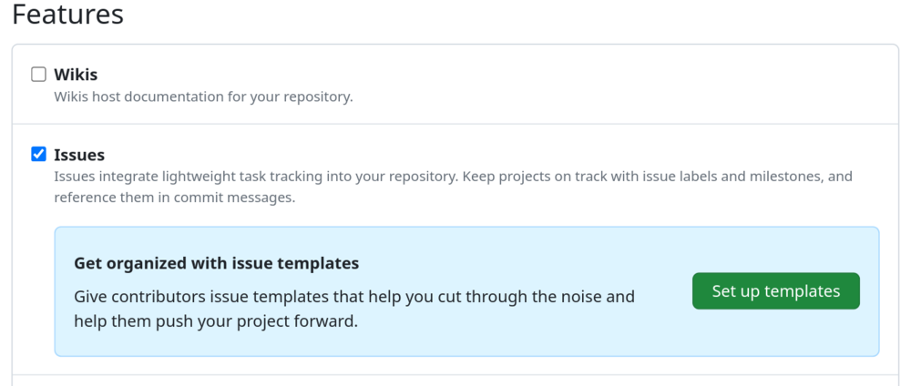
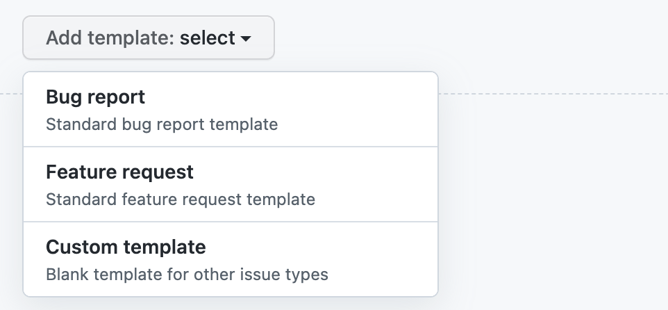
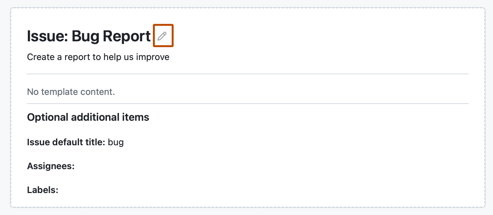
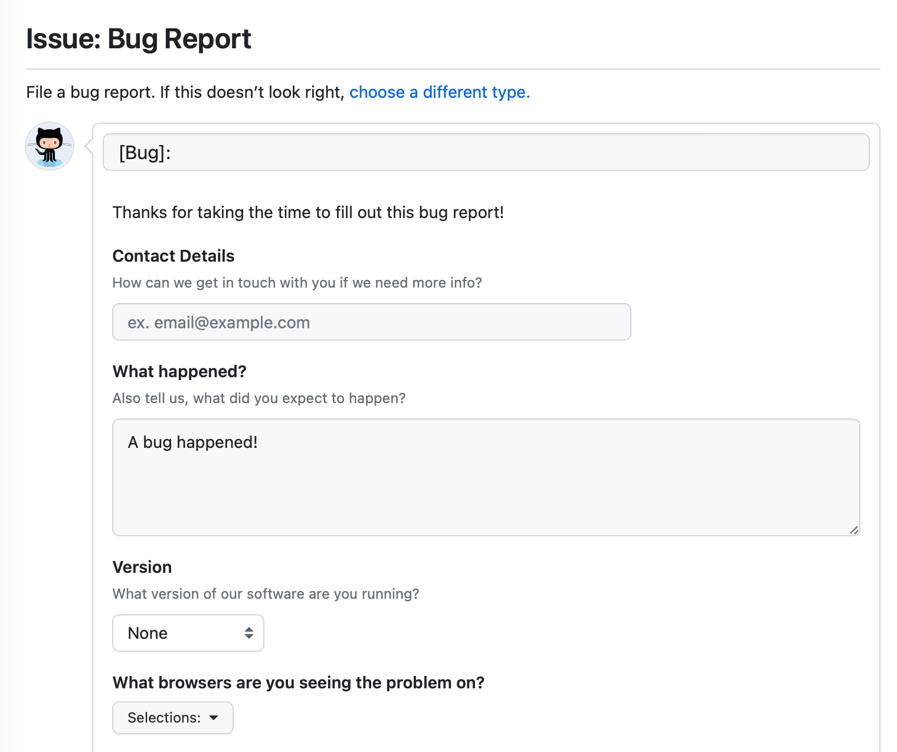

# Source Snapshot: Configuring issue templates for your repository

- **Accessed:** 2026-10-19
- **Type:** official documentation (GitHub Docs)
- **URL:** https://docs.github.com/en/communities/using-templates-to-encourage-useful-issues-and-pull-requests/configuring-issue-templates-for-your-repository
- **Upstream file:** [`github/docs` → `content/communities/using-templates-to-encourage-useful-issues-and-pull-requests/configuring-issue-templates-for-your-repository.md`](https://github.com/github/docs/blob/dae83f7d28f3b8e10015bd6b6d8b72267cedceca/content/communities/using-templates-to-encourage-useful-issues-and-pull-requests/configuring-issue-templates-for-your-repository.md) at commit `dae83f7` (2026-10-16)
- **Version shown:** GitHub.com "Free, Pro & Team" (`fpt`). The page source uses Liquid: `` blocks select text per product version; the site shows the `fpt` branch of each block.
- **Included files:** the published page pulls in text with `` tags and decides `` blocks with feature flags. These files are appended verbatim after the page, under "Included files", from the same commit: [`data/reusables/repositories/default-issue-templates.md`](https://github.com/github/docs/blob/dae83f7d28f3b8e10015bd6b6d8b72267cedceca/data/reusables/repositories/default-issue-templates.md); [`data/reusables/repositories/navigate-to-repo.md`](https://github.com/github/docs/blob/dae83f7d28f3b8e10015bd6b6d8b72267cedceca/data/reusables/repositories/navigate-to-repo.md); [`data/reusables/repositories/sidebar-settings.md`](https://github.com/github/docs/blob/dae83f7d28f3b8e10015bd6b6d8b72267cedceca/data/reusables/repositories/sidebar-settings.md); [`data/reusables/community/issue-forms-beta.md`](https://github.com/github/docs/blob/dae83f7d28f3b8e10015bd6b6d8b72267cedceca/data/reusables/community/issue-forms-beta.md); [`data/reusables/actions/learn-more-about-yaml.md`](https://github.com/github/docs/blob/dae83f7d28f3b8e10015bd6b6d8b72267cedceca/data/reusables/actions/learn-more-about-yaml.md); [`data/reusables/community/issue-forms-sample.md`](https://github.com/github/docs/blob/dae83f7d28f3b8e10015bd6b6d8b72267cedceca/data/reusables/community/issue-forms-sample.md); [`data/reusables/repositories/issue-template-config.md`](https://github.com/github/docs/blob/dae83f7d28f3b8e10015bd6b6d8b72267cedceca/data/reusables/repositories/issue-template-config.md); [`data/reusables/files/add-file.md`](https://github.com/github/docs/blob/dae83f7d28f3b8e10015bd6b6d8b72267cedceca/data/reusables/files/add-file.md); [`data/reusables/files/write_commit_message.md`](https://github.com/github/docs/blob/dae83f7d28f3b8e10015bd6b6d8b72267cedceca/data/reusables/files/write_commit_message.md); [`data/reusables/files/choose_commit_branch.md`](https://github.com/github/docs/blob/dae83f7d28f3b8e10015bd6b6d8b72267cedceca/data/reusables/files/choose_commit_branch.md); [`data/reusables/files/propose_new_file.md`](https://github.com/github/docs/blob/dae83f7d28f3b8e10015bd6b6d8b72267cedceca/data/reusables/files/propose_new_file.md); [`data/features/issue-form-upload.yml`](https://github.com/github/docs/blob/dae83f7d28f3b8e10015bd6b6d8b72267cedceca/data/features/issue-form-upload.yml)
- **Variables:** `` tags render short values from `data/variables/*.yml`; the values used on this page are listed under "Variable values" at the end.

---

---
title: Configuring issue templates for your repository
intro: You can customize the templates that are available for contributors to use when they open new issues in your repository.
redirect_from:
  - /github/building-a-strong-community/creating-issue-templates-for-your-repository
  - /articles/configuring-issue-templates-for-your-repository
  - /github/building-a-strong-community/configuring-issue-templates-for-your-repository
versions:
  fpt: '*'
  ghec: '*'
  ghes: '*'
shortTitle: Configure
category:
  - Create issue and pull request templates
---



## Creating issue templates



1. In the "Features" section, under **Issues**, click **Set up templates**. You may need to enable **Issues** and refresh the page before you can see the button.

   
1. Use the **Add template** dropdown menu, and click on the type of template you'd like to create.

   
1. To preview or edit the template before committing it to the repository, next to the template, click **Preview and edit**.
1. To edit the template, click , and type in the fields to edit their contents.

   
1. To automatically set a default issue title, assign the issue to people with read access to the repository, or apply labels to issues raised from the template, use the fields under "Optional additional information." You can also add these details in the issue template with `title`, `labels`, `type`, or `assignees` in a YAML frontmatter format.
    > [!NOTE]
    > The template name must be more than 3 characters.

1. When you're finished editing and previewing your template, click **Propose changes** in the upper right corner of the page.
1. In the "Commit message" field, type a commit message describing your changes.
1. Below the commit message fields, select whether to commit your template directly to the default branch, or to create a new branch and open a pull request. For more information about pull requests, see [AUTOTITLE](/pull-requests/reference/pull-requests).
1. Click **Commit changes**. Once these changes are merged into the default branch, the template will be available for contributors to use when they open new issues in the repository.

## Creating issue forms



With issue forms, you can create issue templates that have customizable web form fields. You can encourage contributors to include specific, structured information by using issue forms in your repository. 

Issue forms support several field types, including text inputs, dropdowns, checkboxes, and file uploads. Issue forms are written in YAML using the  form schema. For more information, see [AUTOTITLE](/communities/using-templates-to-encourage-useful-issues-and-pull-requests/syntax-for-githubs-form-schema). 

To use an issue form in your repository, you must create a new file and add it to the `.github/ISSUE_TEMPLATE` folder in your repository.

Here is an example of an issue form configuration file.



> [!NOTE]
> The `name` field must be more than 3 characters. If it's not, the template won't be shown when creating an issue.

Here is the rendered version of the issue form.



1. Choose a repository where you want to create an issue form. You can use an existing repository that you have write access to, or you can create a new repository. For more information about creating a repository, see [AUTOTITLE](/repositories/creating-and-managing-repositories/creating-a-new-repository).
1. In your repository, create a file called `.github/ISSUE_TEMPLATE/FORM-NAME.yml`, replacing `FORM-NAME` with the name for your issue form. For more information about creating new files on GitHub, see [AUTOTITLE](/repositories/working-with-files/managing-files/creating-new-files).
1. In the body of the new file, type the contents of your issue form. For more information, see [AUTOTITLE](/communities/using-templates-to-encourage-useful-issues-and-pull-requests/syntax-for-issue-forms).
1. Commit your file to the default branch of your repository. For more information, see [AUTOTITLE](/repositories/working-with-files/managing-files/creating-new-files).

## Configuring the template chooser



You can encourage contributors to use issue templates by setting `blank_issues_enabled` to `false`. If you set `blank_issues_enabled` to `true`, everyone with access to the repository will see the **Blank issue** option in the template chooser. When `blank_issues_enabled` is set to `false`, users with write access or above (Write, Maintain, or Admin roles) will still see the **Blank issue** option in the template chooser, labeled **Maintainers only**. Contributors with Read or Triage roles will only see the configured templates.

If you prefer to receive certain reports outside of , you can direct people to external sites with `contact_links`.

Here is an example _config.yml_ file.

```yaml copy
blank_issues_enabled: false
contact_links:
  - name: 
    url: https://github.com/orgs/community/discussions
    about: Please ask and answer questions here.
  - name:  Security Bug Bounty
    url: https://bounty.github.com/
    about: Please report security vulnerabilities here.
```

Your configuration file will customize the template chooser when the file is merged into the repository's default branch.



1. In the file name field, type `.github/ISSUE_TEMPLATE/config.yml`.
1. In the body of the new file, type the contents of your configuration file.




## Changing the order of templates

You can set the order in which your issue templates will appear in the template chooser by making changes to the template filenames. The templates in `.github/ISSUE_TEMPLATE` are listed alphanumerically and grouped by filetype, with YAML files appearing before Markdown files.

To control the order of your templates, prefix the filenames with a number. For example: `1-bug.yml`, `2-feature-request.yml`, and `3-epic.yml`.

If you have 10 or more templates, alphanumeric ordering means that `11-bug.yml` will be positioned between `1-feature.yml` and `2-support.yml`. You can keep your intended ordering by prefixing your numeric filenames with an additional `0`. For example: `01-feature.yml`, `02-support.yml`, and `11-bug.yml`.

## Further reading

* [AUTOTITLE](/communities/using-templates-to-encourage-useful-issues-and-pull-requests/about-issue-and-pull-request-templates)

---

## Included files

### `data/reusables/repositories/default-issue-templates.md`

````markdown
You can create default issue templates and a default configuration file for issue templates for your organization or personal account. For more information, see [AUTOTITLE](/communities/setting-up-your-project-for-healthy-contributions/creating-a-default-community-health-file).
````

### `data/reusables/repositories/navigate-to-repo.md`

````markdown
1. On , navigate to the main page of the repository.
````

### `data/reusables/repositories/sidebar-settings.md`

````markdown
1. Under your repository name, click ** Settings**. If you cannot see the "Settings" tab, select the **** dropdown menu, then click **Settings**.

   
````

### `data/reusables/community/issue-forms-beta.md`

````markdown
> [!NOTE]
> Issue forms are currently in  and subject to change.
````

### `data/reusables/actions/learn-more-about-yaml.md`

````markdown
If you're new to YAML and want to learn more, see [Learn YAML in Y minutes](https://learnxinyminutes.com/docs/yaml/).
````

### `data/reusables/community/issue-forms-sample.md`

````markdown
```yaml copy
name: Bug Report
description: File a bug report.
title: "[Bug]: "
labels: ["bug", "triage"]
projects: ["octo-org/1", "octo-org/44"]
assignees:
  - octocat
type: bug
body:
  - type: markdown
    attributes:
      value: |
        Thanks for taking the time to fill out this bug report!
  - type: input
    id: contact
    attributes:
      label: Contact Details
      description: How can we get in touch with you if we need more info?
      placeholder: ex. email@example.com
    validations:
      required: false
  - type: textarea
    id: what-happened
    attributes:
      label: What happened?
      description: Also tell us, what did you expect to happen?
      placeholder: Tell us what you see!
      value: "A bug happened!"
    validations:
      required: true
  - type: dropdown
    id: version
    attributes:
      label: Version
      description: What version of our software are you running?
      options:
        - 1.0.2 (Default)
        - 1.0.3 (Edge)
      default: 0
    validations:
      required: true
  - type: dropdown
    id: browsers
    attributes:
      label: What browsers are you seeing the problem on?
      multiple: true
      options:
        - Firefox
        - Chrome
        - Safari
        - Microsoft Edge
  - type: textarea
    id: logs
    attributes:
      label: Relevant log output
      description: Please copy and paste any relevant log output. This will be automatically formatted into code, so no need for backticks.
      render: shell
  - type: checkboxes
    id: terms
    attributes:
      label: Code of Conduct
      description: By submitting this issue, you agree to follow our [Code of Conduct](https://example.com).
      options:
        - label: I agree to follow this project's Code of Conduct
          required: true
  - type: upload
    id: screenshots
    attributes:
      label: Upload screenshots
      description: If applicable, add screenshots to help explain your problem.
    validations:
      required: false
```
````

### `data/reusables/repositories/issue-template-config.md`

````markdown
You can customize the issue template chooser that people see when creating a new issue in your repository by adding a `config.yml` file to the `.github/ISSUE_TEMPLATE` folder.
````

### `data/reusables/files/add-file.md`

````markdown
1. Above the list of files, select the **Add file**  dropdown menu, then click ** Create new file**.

   Alternatively, you can click  in the file tree view on the left.

   
````

### `data/reusables/files/write_commit_message.md`

````markdown
1. Click **Commit changes...**

1. In the "Commit message" field, type a short, meaningful commit message that describes the change you made to the file. You can attribute the commit to more than one author in the commit message. For more information, see [AUTOTITLE](/pull-requests/how-tos/commit-changes/creating-a-commit-with-multiple-authors).
````

### `data/reusables/files/choose_commit_branch.md`

````markdown
1. Below the commit message fields, decide whether to add your commit to the current branch or to a new branch. If your current branch is the default branch, you should choose to create a new branch for your commit and then create a pull request. For more information, see [AUTOTITLE](/pull-requests/how-tos/create-pull-requests/creating-a-pull-request).

   
````

### `data/reusables/files/propose_new_file.md`

````markdown
1. Click **Commit changes** or **Propose changes**.
````

### `data/features/issue-form-upload.yml`

````yaml
# Reference: https://github.com/github/releases/issues/7534
# File upload field in issue forms
versions:
  fpt: '*'
  ghec: '*'
  ghes: '>= 3.21'
````

## Variable values

From `data/variables/*.yml` at the same commit ([folder](https://github.com/github/docs/tree/dae83f7d28f3b8e10015bd6b6d8b72267cedceca/data/variables)).

| Tag | Value |
|-----|-------|
| `` | GitHub |
| `` | GitHub |
| `` | GitHub Community Support |
| `` | public preview |
