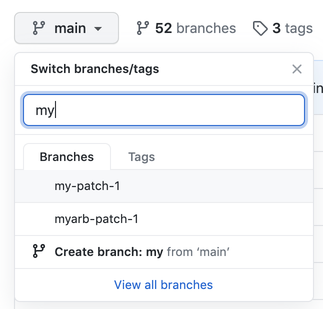
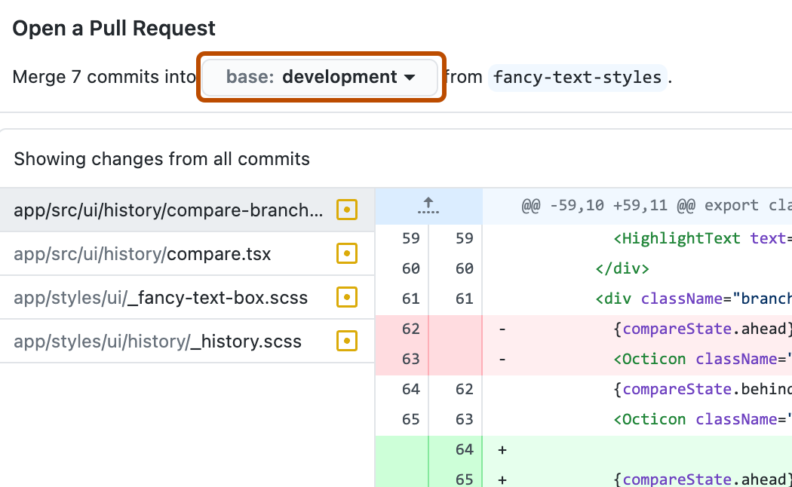
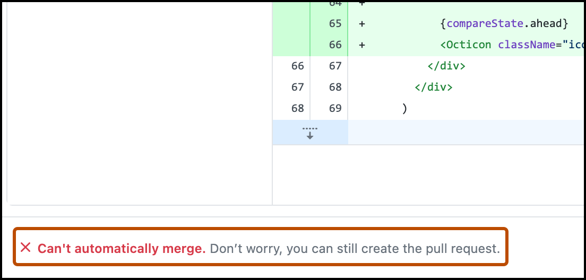
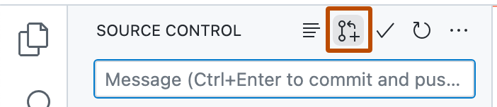
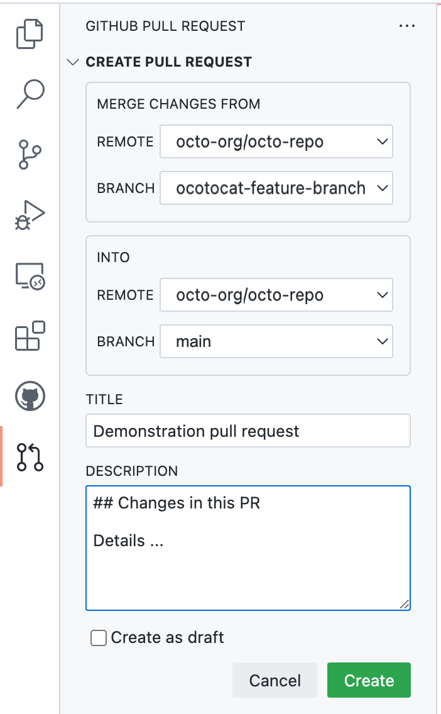
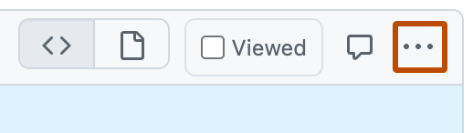
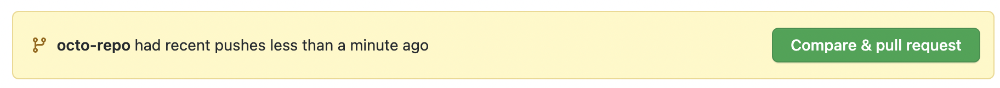

# Source Snapshot: Creating a pull request

- **Accessed:** 2026-10-19
- **Type:** official documentation (GitHub Docs)
- **URL:** https://docs.github.com/en/pull-requests/how-tos/create-pull-requests/creating-a-pull-request
- **Upstream file:** [`github/docs` → `content/pull-requests/how-tos/create-pull-requests/creating-a-pull-request.md`](https://github.com/github/docs/blob/dae83f7d28f3b8e10015bd6b6d8b72267cedceca/content/pull-requests/how-tos/create-pull-requests/creating-a-pull-request.md) at commit `dae83f7` (2026-10-16)
- **Version shown:** GitHub.com "Free, Pro & Team" (`fpt`). The page source uses Liquid: `` blocks select text per product version; the site shows the `fpt` branch of each block.
- **Included files:** the published page pulls in text with `` tags and decides `` blocks with feature flags. These files are appended verbatim after the page, under "Included files", from the same commit: [`data/reusables/enterprise-accounts/emu-permission-propose.md`](https://github.com/github/docs/blob/dae83f7d28f3b8e10015bd6b6d8b72267cedceca/data/reusables/enterprise-accounts/emu-permission-propose.md); [`data/reusables/pull_requests/perms-to-open-pull-request.md`](https://github.com/github/docs/blob/dae83f7d28f3b8e10015bd6b6d8b72267cedceca/data/reusables/pull_requests/perms-to-open-pull-request.md); [`data/reusables/pull_requests/close-issues-using-keywords.md`](https://github.com/github/docs/blob/dae83f7d28f3b8e10015bd6b6d8b72267cedceca/data/reusables/pull_requests/close-issues-using-keywords.md); [`data/reusables/repositories/navigate-to-repo.md`](https://github.com/github/docs/blob/dae83f7d28f3b8e10015bd6b6d8b72267cedceca/data/reusables/repositories/navigate-to-repo.md); [`data/reusables/repositories/new-pull-request.md`](https://github.com/github/docs/blob/dae83f7d28f3b8e10015bd6b6d8b72267cedceca/data/reusables/repositories/new-pull-request.md); [`data/reusables/repositories/pr-title-description.md`](https://github.com/github/docs/blob/dae83f7d28f3b8e10015bd6b6d8b72267cedceca/data/reusables/repositories/pr-title-description.md); [`data/reusables/repositories/create-pull-request.md`](https://github.com/github/docs/blob/dae83f7d28f3b8e10015bd6b6d8b72267cedceca/data/reusables/repositories/create-pull-request.md); [`data/reusables/repositories/asking-for-review.md`](https://github.com/github/docs/blob/dae83f7d28f3b8e10015bd6b6d8b72267cedceca/data/reusables/repositories/asking-for-review.md); [`data/reusables/cli/cli-learn-more.md`](https://github.com/github/docs/blob/dae83f7d28f3b8e10015bd6b6d8b72267cedceca/data/reusables/cli/cli-learn-more.md); [`data/reusables/repositories/changed-files.md`](https://github.com/github/docs/blob/dae83f7d28f3b8e10015bd6b6d8b72267cedceca/data/reusables/repositories/changed-files.md)
- **Variables:** `` tags render short values from `data/variables/*.yml`; the values used on this page are listed under "Variable values" at the end.

---

---
title: Creating a pull request
intro: Create a pull request to propose changes to the code in a repository.
permissions: 'Anyone with read access to a repository can create a pull request.<br>'
redirect_from:
  - /github/collaborating-with-issues-and-pull-requests/proposing-changes-to-your-work-with-pull-requests/creating-a-pull-request
  - /articles/creating-a-pull-request
  - /github/collaborating-with-issues-and-pull-requests/creating-a-pull-request
  - /pull-requests/collaborating-with-pull-requests/proposing-changes-to-your-work-with-pull-requests/creating-a-pull-request
versions:
  fpt: '*'
  ghes: '*'
  ghec: '*'
shortTitle: Create a pull request
category:
  - Create pull requests
contentType: how-tos
---

If you want to create a new branch for your pull request but don't have write permissions to the repository, you can fork the repository first. See [AUTOTITLE](/pull-requests/how-tos/create-pull-requests/creating-a-pull-request-from-a-fork) and [AUTOTITLE](/pull-requests/reference/forks).

When you create your pull request, you can specify which branch you want to merge your changes into. Pull requests can only be opened between two different branches.





## Creating the pull request




1. In the "Branch" menu, choose the branch that contains your commits.

   


1. Use the _base_ branch dropdown menu to select the branch where you want to merge your changes. Then, use the _compare_ branch dropdown menu to choose the topic branch where you made your changes.





After your pull request has been reviewed, it can be merged into the repository. See [AUTOTITLE](/pull-requests/how-tos/merge-and-close-pull-requests/merging-a-pull-request).







To create a pull request, use the `gh pr create` subcommand.

```shell
gh pr create
```

To assign a pull request to an individual, use the `--assignee` or `-a` flags. You can use `@me` to self-assign the pull request.

```shell
gh pr create --assignee "@octocat"
```

To specify the branch into which you want the pull request merged, use the `--base` or `-B` flags. To specify the branch that contains commits for your pull request, use the `--head` or `-H` flags.

```shell
gh pr create --base my-base-branch --head my-changed-branch
```

To include a title and body for the new pull request, use the `--title` and `--body` flags.

```shell
gh pr create --title "The bug is fixed" --body "Everything works again"
```

To mark a pull request as a draft, use the `--draft` flag.

```shell
gh pr create --draft
```

To add labels or milestones to the new pull request, use the `--label` and `--milestone` flags.

```shell
gh pr create --label "bug,help wanted" --milestone octocat-milestone
```

To add the new pull request to a specific project, use the `--project` flag.

```shell
gh pr create --project octocat-project
```

To assign an individual or team as reviewers, use the `--reviewer` flag.

```shell
gh pr create --reviewer monalisa,hubot --reviewer myorg/team-name
```

To create the pull request in your default web browser, use the `--web` flag.

```shell
gh pr create --web
```





1. Click **Preview Pull Request**.  opens a preview dialog that shows the diff of the changes between your current branch and the base branch.

   Alternatively, to go straight to  to create your pull request, select the dropdown icon and click **Create Pull Request**.

1. Confirm that the branch in the **base:** dropdown menu is the branch where you want to merge your changes.

   

    tells you whether the current branch can be automatically merged into the base branch.

   

1. Click **Create Pull Request**.  opens your default browser and takes you to .









1. After you commit changes to your local copy of the repository, click the **Create Pull Request** icon.

1. Check that the local branch and repository you're merging from, and the remote branch and repository you're merging into, are correct. Then, give the pull request a title and a description.

1. Click **Create**.

For more information on creating pull requests in , see [AUTOTITLE](/codespaces/developing-in-a-codespace/using-github-codespaces-for-pull-requests).





## Making changes to files in your pull request

After you open your pull request, you can continue changing files by adding new commits to your head branch.



You can also make changes to files on the  website.

1. On , navigate to a pull request in a repository.

1. Scroll down to the file you want to make changes to.
   * If the pull request has a lot of files, you can use the filter to locate the file.
1. Above the file you want to change, click .
   
1. In the menu, click **Edit file**.
1. Make your changes in the editor. When you commit your change, choose to commit directly back to your head branch.



## Further reading

* [AUTOTITLE](/pull-requests/how-tos/create-pull-requests/creating-a-pull-request-from-a-fork)
* [AUTOTITLE](/pull-requests/how-tos/create-pull-requests/keeping-your-pull-request-in-sync-with-the-base-branch)
* [AUTOTITLE](/pull-requests/how-tos/create-pull-requests/changing-the-base-branch-of-a-pull-request)
* [AUTOTITLE](/issues/tracking-your-work-with-issues/using-issues/creating-an-issue)
* [AUTOTITLE](/issues/tracking-your-work-with-issues/using-issues/assigning-issues-and-pull-requests-to-other-github-users)
* [AUTOTITLE](/get-started/writing-on-github)

---

## Included files

### `data/reusables/enterprise-accounts/emu-permission-propose.md`

````markdown
 Members of an  can only propose changes in repositories that are part of their enterprise. 
````

### `data/reusables/pull_requests/perms-to-open-pull-request.md`

````markdown


> [!NOTE]
> To open a pull request in a public repository, you must have write access to the head or the source branch or, for organization-owned repositories, you must be a member of the organization that owns the repository to open a pull request.


````

### `data/reusables/pull_requests/close-issues-using-keywords.md`

````markdown
You can link a pull request to an issue to show that a fix is in progress and automatically close the issue when the pull request is merged. For more information, see [AUTOTITLE](/issues/tracking-your-work-with-issues/using-issues/linking-a-pull-request-to-an-issue).
````

### `data/reusables/repositories/navigate-to-repo.md`

````markdown
1. On , navigate to the main page of the repository.
````

### `data/reusables/repositories/new-pull-request.md`

````markdown
1. Above the list of files, in the yellow banner, click **Compare & pull request** to create a pull request for the associated branch.

   
````

### `data/reusables/repositories/pr-title-description.md`

````markdown
1. Type a title and description for your pull request.
````

### `data/reusables/repositories/create-pull-request.md`

````markdown
1. To create a pull request that is ready for review, click **Create Pull Request**.
To create a draft pull request, use the drop-down and select **Create Draft Pull Request**, then click **Draft Pull Request**. If you are the member of an organization, you may need to request access to draft pull requests from an organization owner. See [AUTOTITLE](/pull-requests/reference/pull-requests#draft-pull-requests).
````

### `data/reusables/repositories/asking-for-review.md`

````markdown
> [!TIP]
> After you create a pull request, you can ask a specific person to review your proposed changes. See [AUTOTITLE](/pull-requests/how-tos/create-pull-requests/requesting-a-pull-request-review).
````

### `data/reusables/cli/cli-learn-more.md`

````markdown
> [!NOTE]
> To learn more about , see [AUTOTITLE](/github-cli/github-cli/about-github-cli).
````

### `data/reusables/repositories/changed-files.md`

````markdown
1. On the pull request, click ** Files changed**.

   
````

## Variable values

From `data/variables/*.yml` at the same commit ([folder](https://github.com/github/docs/tree/dae83f7d28f3b8e10015bd6b6d8b72267cedceca/data/variables)).

| Tag | Value |
|-----|-------|
| `` | GitHub Desktop |
| `` | GitHub |
| `` | GitHub Codespaces |
| `` | GitHub |
| `` | enterprise with managed users |
| `` | GitHub CLI |
