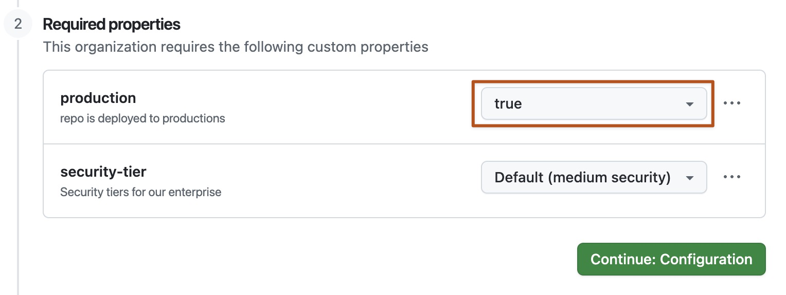
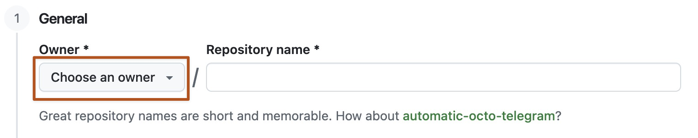
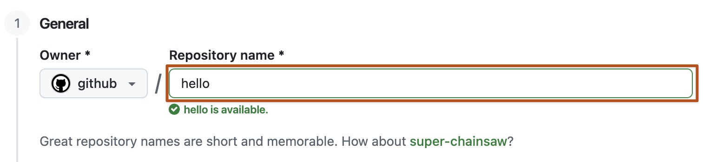

# Source Snapshot: Creating a new repository

- **Accessed:** 2026-10-19
- **Type:** official documentation (GitHub Docs)
- **URL:** https://docs.github.com/en/repositories/creating-and-managing-repositories/creating-a-new-repository
- **Upstream file:** [`github/docs` → `content/repositories/creating-and-managing-repositories/creating-a-new-repository.md`](https://github.com/github/docs/blob/dae83f7d28f3b8e10015bd6b6d8b72267cedceca/content/repositories/creating-and-managing-repositories/creating-a-new-repository.md) at commit `dae83f7` (2026-10-16)
- **Version shown:** GitHub.com "Free, Pro & Team" (`fpt`). The page source uses Liquid: `` blocks select text per product version; the site shows the `fpt` branch of each block.
- **Included files:** the published page pulls in text with `` tags and decides `` blocks with feature flags. These files are appended verbatim after the page, under "Included files", from the same commit: [`data/reusables/repositories/create_new.md`](https://github.com/github/docs/blob/dae83f7d28f3b8e10015bd6b6d8b72267cedceca/data/reusables/repositories/create_new.md); [`data/reusables/repositories/owner-drop-down.md`](https://github.com/github/docs/blob/dae83f7d28f3b8e10015bd6b6d8b72267cedceca/data/reusables/repositories/owner-drop-down.md); [`data/reusables/repositories/repo-name.md`](https://github.com/github/docs/blob/dae83f7d28f3b8e10015bd6b6d8b72267cedceca/data/reusables/repositories/repo-name.md); [`data/reusables/repositories/choose-repo-visibility.md`](https://github.com/github/docs/blob/dae83f7d28f3b8e10015bd6b6d8b72267cedceca/data/reusables/repositories/choose-repo-visibility.md); [`data/reusables/repositories/select-marketplace-apps.md`](https://github.com/github/docs/blob/dae83f7d28f3b8e10015bd6b6d8b72267cedceca/data/reusables/repositories/select-marketplace-apps.md); [`data/reusables/repositories/create-repo.md`](https://github.com/github/docs/blob/dae83f7d28f3b8e10015bd6b6d8b72267cedceca/data/reusables/repositories/create-repo.md); [`data/features/custom-properties-on-create.yml`](https://github.com/github/docs/blob/dae83f7d28f3b8e10015bd6b6d8b72267cedceca/data/features/custom-properties-on-create.yml); [`data/features/copilot.yml`](https://github.com/github/docs/blob/dae83f7d28f3b8e10015bd6b6d8b72267cedceca/data/features/copilot.yml)
- **Variables:** `` tags render short values from `data/variables/*.yml`; the values used on this page are listed under "Variable values" at the end.

---

---
title: Creating a new repository
intro: You can create a new repository on your personal account or any organization where you have sufficient permissions.
redirect_from:
  - /creating-a-repo
  - /articles/creating-a-repository-in-an-organization
  - /articles/creating-a-new-organization-repository
  - /articles/creating-a-new-repository
  - /articles/creating-an-internal-repository
  - /github/setting-up-and-managing-your-enterprise-account/creating-an-internal-repository
  - /github/creating-cloning-and-archiving-repositories/creating-an-internal-repository
  - /github/creating-cloning-and-archiving-repositories/creating-a-new-repository
  - /github/creating-cloning-and-archiving-repositories/creating-a-repository-on-github/creating-a-new-repository
versions:
  fpt: '*'
  ghes: '*'
  ghec: '*'
category:
  - Create and set up a repository
---

> [!TIP]
> Owners can restrict repository creation permissions in an organization. For more information, see [AUTOTITLE](/organizations/managing-organization-settings/restricting-repository-creation-in-your-organization).

> [!TIP]
> You can also create a repository using the . For more information, see [`gh repo create`](https://cli.github.com/manual/gh_repo_create) in the  documentation.

## Creating a new repository from the web UI


1. Optionally, to create a repository with the directory structure and files of an existing repository, select the **Choose a template** dropdown menu and click a template repository. You'll see template repositories that are owned by you and organizations you're a member of or that you've used before. For more information, see [AUTOTITLE](/repositories/creating-and-managing-repositories/creating-a-repository-from-a-template).
1. Optionally, if you chose to use a template, to include the directory structure and files from all branches in the template, and not just the default branch, select **Include all branches**.



1. If custom properties are required for repository creation, set the required properties for the repository. Setting custom properties may affect the validity of your chosen repository name as well as the available repository visibility. For more information, see [AUTOTITLE](/organizations/managing-organization-settings/managing-custom-properties-for-repositories-in-your-organization).

   


1. If you're not using a template, there are a number of optional items you can pre-populate your repository with. If you're importing an existing repository to , don't choose any of these options, as you may introduce a merge conflict. You can add or create new files using the user interface or choose to add new files using the command line later. For more information, see [AUTOTITLE](/migrations/importing-source-code/using-the-command-line-to-import-source-code/importing-an-external-git-repository-using-the-command-line), [AUTOTITLE](/repositories/working-with-files/managing-files/adding-a-file-to-a-repository#adding-a-file-to-a-repository-using-the-command-line), and [AUTOTITLE](/pull-requests/how-tos/merge-and-close-pull-requests).
    * You can create a README, which is a document describing your project. For more information, see [AUTOTITLE](/repositories/managing-your-repositorys-settings-and-features/customizing-your-repository/about-readmes).
    * You can create a _.gitignore_ file, which is a set of ignore rules. For more information, see [AUTOTITLE](/get-started/git-basics/ignoring-files).
    * You can choose to add a software license for your project. For more information, see [AUTOTITLE](/repositories/managing-your-repositorys-settings-and-features/customizing-your-repository/licensing-a-repository).


1. Optionally, if you have access to , enter a prompt for  to use to populate your repository. After the repository is created,  will open a draft pull request, write the code requested, then request review from you. For more information, see [AUTOTITLE](/copilot/concepts/agents/cloud-agent/about-cloud-agent).

1. At the bottom of the resulting Quick Setup page, under "Import code from an old repository", you can choose to import a project to your new repository. To do so, click **Import code**.


## Creating a new repository from a URL query

You can use query parameters to pre-fill form fields when creating a new repository. Query parameters are optional parts of a URL you can customize to share a specific web page view, such as search filter results or an issue template on . To specify values for the predefined query parameters, you must match the key and value pair.

Pre-filling form fields with a URL query may be useful if you often want to create repositories with the same default settings. For example, a teacher may want each student in a class to create a repository in their personal account with the same name, description and visibility. Using a URL query, the teacher can create a link that pre-fills the repository name, description and visibility fields and share it with the whole class.

You must have the proper permissions for any action to use the equivalent query parameter. For example, you must have permission to create a repository in an organization to specify the organization as the repository owner in a query parameter. For more information, see [AUTOTITLE](/organizations/managing-user-access-to-your-organizations-repositories/managing-repository-roles/repository-roles-for-an-organization).

If you create an invalid URL using query parameters, or if you don’t have the proper permissions, the invalid query parameters will be ignored and the rest of the URL will function as normal. If you create a URL that exceeds the server limit, the URL will return a `414 URI Too Long` error page.

| Query parameter | Example | Valid values |
| ---  | --- | --- |
| `name` | `https:///new?name=test-repo&owner=avocado-corp` creates a repository called "test-repo" owned by the "avocado-corp" organization. | Any valid repository name. Spaces must be replaced with `+` or `%20`. |
| `description` | `https:///new?description=An+exciting+repository&visibility=private&owner=octocat` creates a repo with the description "An exciting repository" with private visibility owned by @octocat. | Any string. Spaces must be replaced with `+` or `%20`. |
| `visibility` | `https:///new?visibility=private` creates a repository with private visibility. | `public`<br> `private`<br>`internal` |
| `owner` | `https:///new?owner=avocado-corp&visibility=public` creates a public repository owned by the "avocado-corp" organization. | Any valid organization name or username. Alternatively, while signed in use `@me` to specify your user account as the owner. |
| `template_owner` and `template_name` | `https:///new?owner=avocado-corp&template_owner=avocado-corp&template_name=octo-repo` creates a repository owned by the "avocado-corp" using the avocado-corp's template "octo-repo". | The username of the template owner and the name of the repository template. |



## Creating a new repository from 

You can create a new repository from  in  with the Model Context Protocol (MCP). For more information, see [AUTOTITLE](/copilot/how-tos/copilot-in-your-ide/customize-copilot/extend-copilot-with-tools-and-context/extend-copilot-chat-with-mcp).


## Further reading

* [AUTOTITLE](/code-security/getting-started/quickstart-for-securing-your-repository)
* [AUTOTITLE](/organizations/managing-user-access-to-your-organizations-repositories)
* [Open Source Guides](https://opensource.guide/)
* []()

---

## Included files

### `data/reusables/repositories/create_new.md`

````markdown
1. In the upper-right corner of any page, select , then click **New repository**.

   
````

### `data/reusables/repositories/owner-drop-down.md`

````markdown
1. Use the **Owner** dropdown menu to select the account you want to own the repository.
   
````

### `data/reusables/repositories/repo-name.md`

````markdown
1. Type a name for your repository and an optional description. The repository name must not exceed 100 characters, and can only contain ASCII letters, digits, and the characters `.`, `-`, and `_`.

   
````

### `data/reusables/repositories/choose-repo-visibility.md`

````markdown
1. Choose a repository visibility. For more information, see [AUTOTITLE](/repositories/creating-and-managing-repositories/about-repositories#about-repository-visibility).
````

### `data/reusables/repositories/select-marketplace-apps.md`

````markdown

1. Optionally, if the personal account or organization in which you're creating uses any  from , select any apps you'd like to use in the repository.

````

### `data/reusables/repositories/create-repo.md`

````markdown
1. Click **Create repository**.
````

### `data/features/custom-properties-on-create.yml`

````yaml
# Reference: #15332
# Allows actors with the ability to create repos to be required to enter custom properties on repo creation.
versions:
  ghec: '*'
  ghes: '>= 3.16'
````

### `data/features/copilot.yml`

````yaml
versions:
  fpt: '*'
  ghec: '*'
````

## Variable values

From `data/variables/*.yml` at the same commit ([folder](https://github.com/github/docs/tree/dae83f7d28f3b8e10015bd6b6d8b72267cedceca/data/variables)).

| Tag | Value |
|-----|-------|
| `` | GitHub CLI |
| `` | GitHub |
| `` | Copilot cloud agent |
| `` | Copilot |
| `` | GitHub |
| `` | github.comHOSTNAME |
| `` | Copilot Chat |
| `` | Visual Studio Code |
| `` | GitHub Skills |
| `` | https://skills.github.com/ |
| `` | GitHub Apps |
| `` | GitHub Marketplace |
