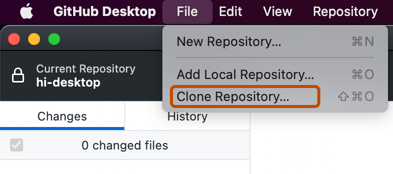
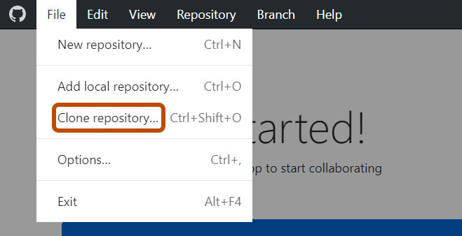
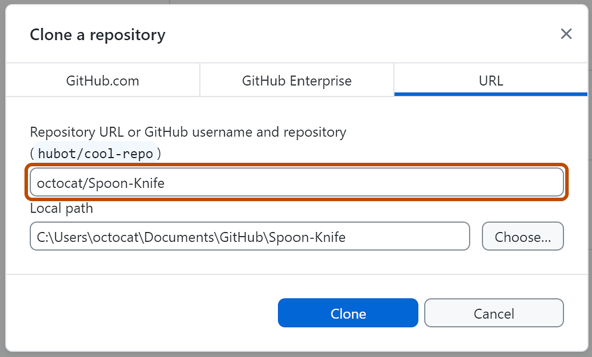
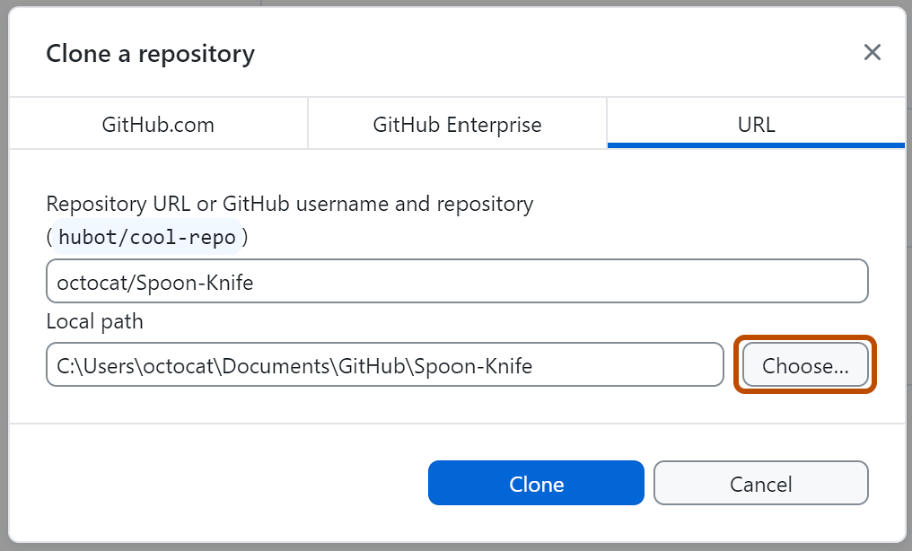
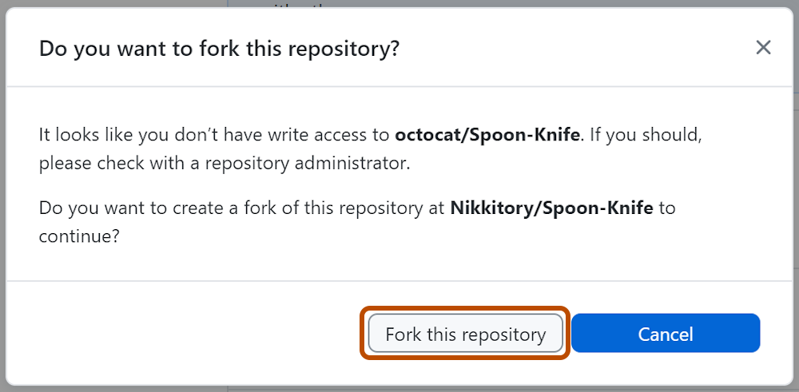
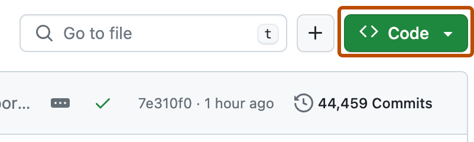
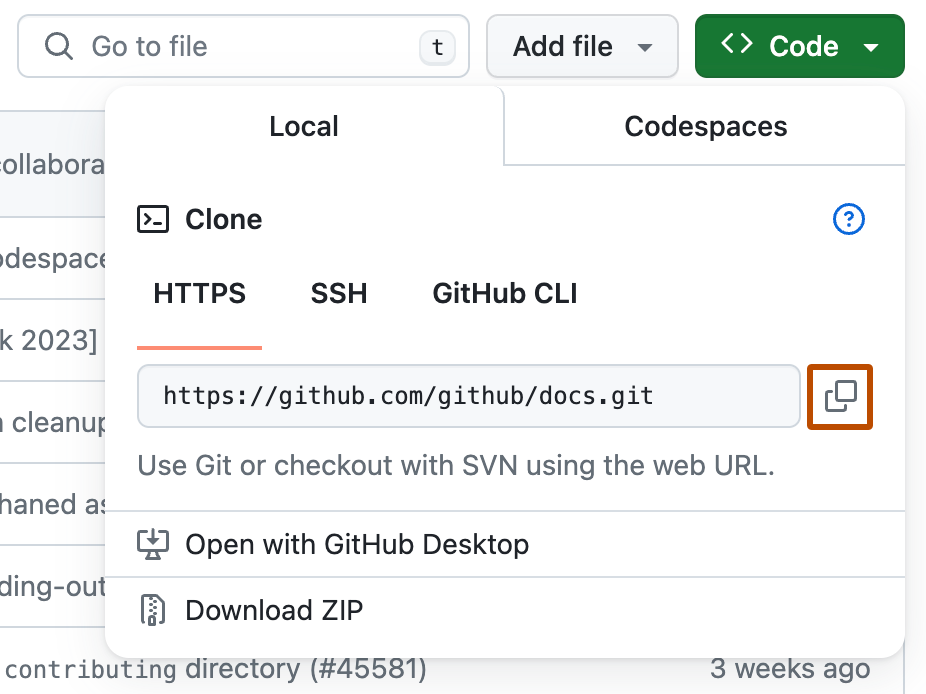

# Source Snapshot: Fork a repository

- **Accessed:** 2026-10-19
- **Type:** official documentation (GitHub Docs)
- **URL:** https://docs.github.com/en/pull-requests/how-tos/work-with-forks/fork-a-repo
- **Upstream file:** [`github/docs` → `content/pull-requests/how-tos/work-with-forks/fork-a-repo.md`](https://github.com/github/docs/blob/dae83f7d28f3b8e10015bd6b6d8b72267cedceca/content/pull-requests/how-tos/work-with-forks/fork-a-repo.md) at commit `dae83f7` (2026-10-16)
- **Version shown:** GitHub.com "Free, Pro & Team" (`fpt`). The page source uses Liquid: `` blocks select text per product version; the site shows the `fpt` branch of each block.
- **Included files:** the published page pulls in text with `` tags and decides `` blocks with feature flags. These files are appended verbatim after the page, under "Included files", from the same commit: [`data/reusables/enterprise-accounts/emu-permission-fork.md`](https://github.com/github/docs/blob/dae83f7d28f3b8e10015bd6b6d8b72267cedceca/data/reusables/enterprise-accounts/emu-permission-fork.md); [`data/reusables/cli/cli-learn-more.md`](https://github.com/github/docs/blob/dae83f7d28f3b8e10015bd6b6d8b72267cedceca/data/reusables/cli/cli-learn-more.md); [`data/reusables/desktop/forking-a-repo.md`](https://github.com/github/docs/blob/dae83f7d28f3b8e10015bd6b6d8b72267cedceca/data/reusables/desktop/forking-a-repo.md); [`data/reusables/desktop/choose-clone-repository.md`](https://github.com/github/docs/blob/dae83f7d28f3b8e10015bd6b6d8b72267cedceca/data/reusables/desktop/choose-clone-repository.md); [`data/reusables/desktop/cloning-location-url-tab.md`](https://github.com/github/docs/blob/dae83f7d28f3b8e10015bd6b6d8b72267cedceca/data/reusables/desktop/cloning-location-url-tab.md); [`data/reusables/desktop/cloning-repository-url.md`](https://github.com/github/docs/blob/dae83f7d28f3b8e10015bd6b6d8b72267cedceca/data/reusables/desktop/cloning-repository-url.md); [`data/reusables/desktop/choose-local-path-url-tab.md`](https://github.com/github/docs/blob/dae83f7d28f3b8e10015bd6b6d8b72267cedceca/data/reusables/desktop/choose-local-path-url-tab.md); [`data/reusables/desktop/click-clone.md`](https://github.com/github/docs/blob/dae83f7d28f3b8e10015bd6b6d8b72267cedceca/data/reusables/desktop/click-clone.md); [`data/reusables/desktop/create-fork-prompt.md`](https://github.com/github/docs/blob/dae83f7d28f3b8e10015bd6b6d8b72267cedceca/data/reusables/desktop/create-fork-prompt.md); [`data/reusables/desktop/fork-type-prompt.md`](https://github.com/github/docs/blob/dae83f7d28f3b8e10015bd6b6d8b72267cedceca/data/reusables/desktop/fork-type-prompt.md); [`data/reusables/repositories/copy-clone-url.md`](https://github.com/github/docs/blob/dae83f7d28f3b8e10015bd6b6d8b72267cedceca/data/reusables/repositories/copy-clone-url.md); [`data/reusables/command_line/change-current-directory-clone.md`](https://github.com/github/docs/blob/dae83f7d28f3b8e10015bd6b6d8b72267cedceca/data/reusables/command_line/change-current-directory-clone.md); [`data/reusables/repositories/you-can-fork.md`](https://github.com/github/docs/blob/dae83f7d28f3b8e10015bd6b6d8b72267cedceca/data/reusables/repositories/you-can-fork.md); [`data/reusables/getting-started/create-a-repository.md`](https://github.com/github/docs/blob/dae83f7d28f3b8e10015bd6b6d8b72267cedceca/data/reusables/getting-started/create-a-repository.md); [`data/reusables/getting-started/being-social.md`](https://github.com/github/docs/blob/dae83f7d28f3b8e10015bd6b6d8b72267cedceca/data/reusables/getting-started/being-social.md); [`data/reusables/support/connect-in-the-forum-bootcamp.md`](https://github.com/github/docs/blob/dae83f7d28f3b8e10015bd6b6d8b72267cedceca/data/reusables/support/connect-in-the-forum-bootcamp.md)
- **Variables:** `` tags render short values from `data/variables/*.yml`; the values used on this page are listed under "Variable values" at the end.

---

---
title: Fork a repository
allowTitleToDifferFromFilename: true
redirect_from:
  - /fork-a-repo
  - /forking
  - /articles/fork-a-repo
  - /github/getting-started-with-github/fork-a-repo
  - /github/getting-started-with-github/quickstart/fork-a-repo
  - /get-started/quickstart/fork-a-repo
  - /pull-requests/collaborating-with-pull-requests/working-with-forks/fork-a-repo
intro: Fork a repository on  to propose changes, collaborate on projects, and manage your own copy of the codebase.
permissions: ''
versions:
  fpt: '*'
  ghes: '*'
  ghec: '*'
shortTitle: Fork a repository
category:
  - Work with forks
contentType: how-tos
---
## About forks

Forking a repository lets you propose changes to a project without affecting the upstream repository. See [AUTOTITLE](/pull-requests/get-started/about-forks).

## Prerequisites

If you haven't already, set up Git and authentication with  from Git. See [AUTOTITLE](/get-started/git-basics/set-up-git).

## Forking a repository



You might fork a project to propose changes to the upstream repository. In this case, it's good practice to sync your fork with the upstream repository regularly. To do this, you'll need to use Git on the command line. You can practice setting the upstream repository using the same [octocat/Spoon-Knife](https://github.com/octocat/Spoon-Knife) repository you just forked.

1. On , navigate to the [octocat/Spoon-Knife](https://github.com/octocat/Spoon-Knife) repository.
1. In the top-right corner of the page, click **Fork**.

   
1. Under "Owner," select the dropdown menu and click an owner for the forked repository.
1. By default, forks are named the same as their upstream repositories. Optionally, in the "Repository name" field, type a different name to distinguish your fork.
1. Optionally, in the "Description" field, type a description of your fork.
1. Optionally, select **Copy the DEFAULT branch only**.

   For many forking scenarios, such as contributing to open-source projects, you only need to copy the default branch. If you do not select this option, all branches will be copied into the new fork.
1. Click **Create fork**.

> [!NOTE]
> If you want to copy additional branches from the upstream repository, you can do so from the **Branches** page. See [AUTOTITLE](/pull-requests/how-tos/commit-changes/managing-branches-within-your-repository).







To create a fork of a repository, use the `gh repo fork` subcommand.

```shell
gh repo fork REPOSITORY
```

To create the fork in an organization, use the `--org` flag.

```shell
gh repo fork REPOSITORY --org "octo-org"
```





You can fork a repository on  or in . For information about forking on , see [the web browser version of this article](/pull-requests/how-tos/work-with-forks/fork-a-repo?tool=webui).







## Cloning your forked repository

You now have a fork of the Spoon-Knife repository, but you do not have the files from that repository on your computer.

1. On , navigate to **your fork** of the Spoon-Knife repository.

1. Open your terminal or Git Bash.

1. Type `git clone`, then paste the URL you copied earlier. It will look like this, with your  username instead of `YOUR-USERNAME`:

   ```shell
   git clone https:///YOUR-USERNAME/Spoon-Knife
   ```

1. Press **Enter**. Git creates your local clone.

   ```shell
   $ git clone https:///YOUR-USERNAME/Spoon-Knife
   > Cloning into `Spoon-Knife`...
   > remote: Counting objects: 10, done.
   > remote: Compressing objects: 100% (8/8), done.
   > remote: Total 10 (delta 1), reused 10 (delta 1)
   > Unpacking objects: 100% (10/10), done.
   ```





## Cloning your forked repository

You now have a fork of the Spoon-Knife repository, but you do not have the files from that repository on your computer.



To create a clone of your fork, use the `--clone` flag.

```shell
gh repo fork REPOSITORY --clone=true
```



## Configuring Git to sync your fork with the upstream repository

When you fork a project to propose changes to the upstream repository, you can configure Git to pull changes from the upstream repository into the local clone of your fork.



1. On , navigate to the [octocat/Spoon-Knife](https://github.com/octocat/Spoon-Knife) repository.

1. Open your terminal or Git Bash.
1. Change to the directory for the fork you cloned.
    * To go to your home directory, type just `cd` with no other text.
    * To list the files and folders in your current directory, type `ls`.
    * To go into one of your listed directories, type `cd YOUR-LISTED-DIRECTORY`.
    * To go up one directory, type `cd ..`.
1. Type `git remote -v` and press **Enter**. You will see the remote repository currently configured for your fork.

   ```shell
   $ git remote -v
   > origin  https:///YOUR-USERNAME/YOUR-FORK.git (fetch)
   > origin  https:///YOUR-USERNAME/YOUR-FORK.git (push)
   ```

1. Type `git remote add upstream`, then paste the URL you copied in Step 3 and press **Enter**. It will look like this:

   ```shell
   git remote add upstream https:///ORIGINAL-OWNER/Spoon-Knife.git
   ```

1. To verify the new upstream repository you specified for your fork, type `git remote -v` again. You should see the URL for your fork as `origin` and the URL for the upstream repository as `upstream`.

   ```shell
   $ git remote -v
   > origin    https:///YOUR-USERNAME/YOUR-FORK.git (fetch)
   > origin    https:///YOUR-USERNAME/YOUR-FORK.git (push)
   > upstream  https:///ORIGINAL-OWNER/ORIGINAL-REPOSITORY.git (fetch)
   > upstream  https:///ORIGINAL-OWNER/ORIGINAL-REPOSITORY.git (push)
   ```

You can now keep your fork synced with the upstream repository with a few Git commands. See [AUTOTITLE](/pull-requests/how-tos/work-with-forks/syncing-a-fork).







To configure a remote repository for the forked repository, use the `--remote` flag.

```shell
gh repo fork REPOSITORY --remote=true
```

To specify the remote repository's name, use the `--remote-name` flag.

```shell
gh repo fork REPOSITORY --remote-name "main-remote-repo"
```



### Editing a fork

You can make any changes to a fork, including:

* **Creating branches:** [_Branches_](/pull-requests/how-tos/commit-changes/managing-branches-within-your-repository) allow you to build new features or test out ideas without putting your main project at risk.
* **Opening pull requests:** If you want to contribute back to the upstream repository, you can submit a pull request to ask the original author to pull your fork into their repository. See [AUTOTITLE](/pull-requests/how-tos/create-pull-requests/creating-a-pull-request-from-a-fork).

## Find another repository to fork

Fork a repository to start contributing to a project. 

For more information about when you can fork a repository, see [AUTOTITLE](/pull-requests/reference/forks).

You can browse [Explore ](https://github.com/explore) to find projects and start contributing to open source repositories. See [AUTOTITLE](/get-started/exploring-projects-on-github/finding-ways-to-contribute-to-open-source-on-github).



## Next steps

You have now forked a repository, practiced cloning your fork, and configured an upstream repository.

* For more information about using Git on the command line to clone and sync changes, see [AUTOTITLE](/get-started/git-basics/set-up-git).

* You can also create a new repository to store your projects and share the code on . 

* 

* 

---

## Included files

### `data/reusables/enterprise-accounts/emu-permission-fork.md`

````markdown
Members of an  cannot fork repositories from outside of the enterprise or fork internal repositories.
````

### `data/reusables/cli/cli-learn-more.md`

````markdown
> [!NOTE]
> To learn more about , see [AUTOTITLE](/github-cli/github-cli/about-github-cli).
````

### `data/reusables/desktop/forking-a-repo.md`

````markdown
In , if you clone a repository that you do not have write access to, and then attempt to push a change to the repository, a fork will be created for you.








````

### `data/reusables/desktop/choose-clone-repository.md`

````markdown
1. In the **File** menu, click **Clone Repository**.

   

   

   

   

   

   
````

### `data/reusables/desktop/cloning-location-url-tab.md`

````markdown
1. Click the tab that corresponds to the location of the repository you want to clone. In this example, we click on the URL tab.

   
````

### `data/reusables/desktop/cloning-repository-url.md`

````markdown
1. Enter the url or path of the repository you want to clone.

   
````

### `data/reusables/desktop/choose-local-path-url-tab.md`

````markdown
1. To select the local directory into which you want to clone the repository, next to the "Local Path" field, click **Choose...** and navigate to the directory.

   
````

### `data/reusables/desktop/click-clone.md`

````markdown
1. At the bottom of the "Clone a Repository" window, click **Clone**.
  
````

### `data/reusables/desktop/create-fork-prompt.md`

````markdown
1. To create a fork, attempt to push a change to the repository. For example, create a new branch and publish it. A prompt will appear asking if you want to fork this repository.

   
````

### `data/reusables/desktop/fork-type-prompt.md`

````markdown
1. Read the information in the "How are you planning to use this fork?" window.
   * If you plan to use this fork for contributing to the original upstream repository, click **To contribute to the parent project**.
   * If you plan to use this fork for a project not connected to the upstream, click **For my own purposes**.
1. Click **Continue**.
````

### `data/reusables/repositories/copy-clone-url.md`

````markdown
1. Above the list of files, click ** Code**.

   

1. Copy the URL for the repository.

   * To clone the repository using HTTPS, under "HTTPS", click .
   * To clone the repository using an SSH key, including a certificate issued by your organization's SSH certificate authority, click **SSH**, then click .
   * To clone a repository using , click ****, then click .
  
     
````

### `data/reusables/command_line/change-current-directory-clone.md`

````markdown
1. Change the current working directory to the location where you want the cloned directory.
````

### `data/reusables/repositories/you-can-fork.md`

````markdown

Generally, you can fork any public repository to your personal account or to an organization where you have permission to create repositories, unless you're a member of an .

Forking of private and internal repositories is governed by repository, organization, and enterprise policies. With the most permissive policies:

* You can fork a private repository to your personal account or to an organization where you have permission to create repositories, including an organization in another enterprise.
* You can fork an internal repository to your personal account or to an organization in the same enterprise as the upstream repository. You can never fork an internal repository to an organization in another enterprise.


You can fork a private or internal repository to your personal account or to an organization on  where you have permission to create repositories, provided that the settings for the repository and your enterprise policies allow forking.

Generally, you can fork any public repository to your personal account or to an organization where you have permission to create repositories.


You can fork any public repository:

* To your personal account
* To an organization where you have permission to create repositories

If you have access to a private repository and the owner permits forking, you can fork the repository:

* To your personal account
* To an organization on  where you have permission to create repositories

You cannot fork a private repository to an organization using . For more information about  and , see [AUTOTITLE](/get-started/learning-about-github/githubs-plans).

````

### `data/reusables/getting-started/create-a-repository.md`

````markdown
Creating a repository for your project allows you to store code in . This provides a backup of your work that you can choose to share with other developers. For more information, see [AUTOTITLE](/repositories/creating-and-managing-repositories/quickstart-for-repositories).
````

### `data/reusables/getting-started/being-social.md`

````markdown
Each repository on  is owned by a person or an organization. You can interact with the people, repositories, and organizations by connecting and following them on . For more information, see [AUTOTITLE](/get-started/exploring-projects-on-github/discovering-projects-on-github).
````

### `data/reusables/support/connect-in-the-forum-bootcamp.md`

````markdown
 has a great support community where you can ask for help and talk to people from around the world. Join the conversation on [](https://github.com/orgs/community/discussions).
````

## Variable values

From `data/variables/*.yml` at the same commit ([folder](https://github.com/github/docs/tree/dae83f7d28f3b8e10015bd6b6d8b72267cedceca/data/variables)).

| Tag | Value |
|-----|-------|
| `` | GitHub |
| `` | your GitHub Enterprise Server instanceGitHub.com |
| `` | GitHub |
| `` | GitHub.com |
| `` | GitHub Desktop |
| `` | github.comHOSTNAME |
| `` | enterprise with managed users |
| `` | GitHub CLI |
| `` | GitHub Team |
| `` | GitHub Free |
| `` | GitHub Community |
