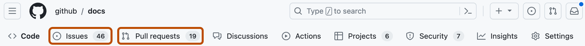
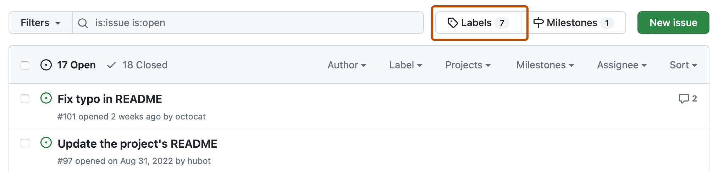

# Source Snapshot: Managing labels

- **Accessed:** 2026-10-19
- **Type:** official documentation (GitHub Docs)
- **URL:** https://docs.github.com/en/issues/using-labels-and-milestones-to-track-work/managing-labels
- **Upstream file:** [`github/docs` → `content/issues/using-labels-and-milestones-to-track-work/managing-labels.md`](https://github.com/github/docs/blob/dae83f7d28f3b8e10015bd6b6d8b72267cedceca/content/issues/using-labels-and-milestones-to-track-work/managing-labels.md) at commit `dae83f7` (2026-10-16)
- **Version shown:** GitHub.com "Free, Pro & Team" (`fpt`). The page source uses Liquid: `` blocks select text per product version; the site shows the `fpt` branch of each block.
- **Included files:** the published page pulls in text with `` tags and decides `` blocks with feature flags. These files are appended verbatim after the page, under "Included files", from the same commit: [`data/reusables/enterprise-accounts/emu-permission-repo.md`](https://github.com/github/docs/blob/dae83f7d28f3b8e10015bd6b6d8b72267cedceca/data/reusables/enterprise-accounts/emu-permission-repo.md); [`data/reusables/repositories/navigate-to-repo.md`](https://github.com/github/docs/blob/dae83f7d28f3b8e10015bd6b6d8b72267cedceca/data/reusables/repositories/navigate-to-repo.md); [`data/reusables/repositories/sidebar-issue-pr.md`](https://github.com/github/docs/blob/dae83f7d28f3b8e10015bd6b6d8b72267cedceca/data/reusables/repositories/sidebar-issue-pr.md); [`data/reusables/project-management/labels.md`](https://github.com/github/docs/blob/dae83f7d28f3b8e10015bd6b6d8b72267cedceca/data/reusables/project-management/labels.md); [`data/reusables/project-management/name-label.md`](https://github.com/github/docs/blob/dae83f7d28f3b8e10015bd6b6d8b72267cedceca/data/reusables/project-management/name-label.md); [`data/reusables/project-management/label-description.md`](https://github.com/github/docs/blob/dae83f7d28f3b8e10015bd6b6d8b72267cedceca/data/reusables/project-management/label-description.md); [`data/reusables/project-management/label-color-randomizer.md`](https://github.com/github/docs/blob/dae83f7d28f3b8e10015bd6b6d8b72267cedceca/data/reusables/project-management/label-color-randomizer.md); [`data/reusables/project-management/create-label.md`](https://github.com/github/docs/blob/dae83f7d28f3b8e10015bd6b6d8b72267cedceca/data/reusables/project-management/create-label.md); [`data/reusables/project-management/edit-label.md`](https://github.com/github/docs/blob/dae83f7d28f3b8e10015bd6b6d8b72267cedceca/data/reusables/project-management/edit-label.md); [`data/reusables/project-management/save-label.md`](https://github.com/github/docs/blob/dae83f7d28f3b8e10015bd6b6d8b72267cedceca/data/reusables/project-management/save-label.md); [`data/reusables/project-management/delete-label.md`](https://github.com/github/docs/blob/dae83f7d28f3b8e10015bd6b6d8b72267cedceca/data/reusables/project-management/delete-label.md)
- **Variables:** `` tags render short values from `data/variables/*.yml`; the values used on this page are listed under "Variable values" at the end.

---

---
title: Managing labels
intro: You can classify issues, pull requests, and discussionsissues and pull requests by creating, editing, applying, and deleting labels.
permissions: ''
redirect_from:
  - /github/managing-your-work-on-github/managing-your-work-with-issues-and-pull-requests/managing-labels
  - /articles/managing-Labels
  - /articles/labeling-issues-and-pull-requests
  - /github/managing-your-work-on-github/labeling-issues-and-pull-requests
  - /articles/about-labels
  - /github/managing-your-work-on-github/about-labels
  - /articles/creating-and-editing-labels-for-issues-and-pull-requests
  - /articles/creating-a-label
  - /github/managing-your-work-on-github/creating-a-label
  - /articles/customizing-issue-labels
  - /articles/applying-labels-to-issues-and-pull-requests
  - /github/managing-your-work-on-github/applying-labels-to-issues-and-pull-requests
  - /articles/editing-a-label
  - /github/managing-your-work-on-github/editing-a-label
  - /articles/deleting-a-label
  - /github/managing-your-work-on-github/deleting-a-label
  - /github/managing-your-work-on-github/managing-labels
versions:
  fpt: '*'
  ghes: '*'
  ghec: '*'
contentType: how-tos
category:
  - Triage and organize issues
---
## About labels

You can manage your work on  by creating labels to categorize issues, pull requests, and discussionsissues and pull requests. You can apply labels in the repository the label was created in. Once a label exists, you can use the label on any issue, pull request, or discussionissue or pull request within that repository. Addition, modification, or deletion of labels in one repository has no effect on labels belonging to other repositories.

## About default labels

 provides default labels in every new repository. You can use these default labels to help create a standard workflow in a repository.

Label | Description
---  | ---
`accessibility` | Indicates a barrier affecting people with disabilities
`bug` | Indicates an unexpected problem or unintended behavior
`documentation` | Indicates a need for improvements or additions to documentation
`duplicate` | Indicates similar issues, pull requests, or discussionsissues or pull requests
`enhancement` | Indicates new feature requests
`good first issue` | Indicates a good issue for first-time contributors
`help wanted` | Indicates that a maintainer wants help on an issue or pull request
`invalid` | Indicates that an issue, pull request, or discussionissue or pull request is no longer relevant
`question` | Indicates that an issue, pull request, or discussionissue or pull request needs more information
`wontfix` | Indicates that work won't continue on an issue, pull request, or discussionissue or pull request

Default labels are included in every new repository when the repository is created, but you can edit or delete the labels later.

Issues with the `good first issue` label are used to populate the repository's `contribute` page. For an example of a `contribute` page, see [github/docs/contribute](https://github.com/github/docs/contribute).

Organization owners can customize the default labels for repositories in their organization. For more information, see [AUTOTITLE](/organizations/managing-organization-settings/managing-default-labels-for-repositories-in-your-organization).

## Creating a label

Anyone with write access to a repository can create a label.




1. To the right of the search field, click **New label**.





## Applying a label

Anyone with triage access to a repository can apply and dismiss labels.

1. Navigate to the issue, pull request, or discussionissue or pull request.
1. In the right sidebar, click **Labels**, then click a label.

## Editing a label

Anyone with write access to a repository can edit existing labels.










## Deleting a label

Anyone with write access to a repository can delete existing labels.

Deleting a label will remove the label from issues and pull requests.






## Further reading

* [AUTOTITLE](/issues/tracking-your-work-with-issues/using-issues/filtering-and-searching-issues-and-pull-requests)
* [AUTOTITLE](/organizations/managing-organization-settings/managing-default-labels-for-repositories-in-your-organization)
* [AUTOTITLE](/communities/setting-up-your-project-for-healthy-contributions/encouraging-helpful-contributions-to-your-project-with-labels)
* [AUTOTITLE](/get-started/writing-on-github/getting-started-with-writing-and-formatting-on-github/basic-writing-and-formatting-syntax#using-emojis)

---

## Included files

### `data/reusables/enterprise-accounts/emu-permission-repo.md`

````markdown
 Members of an  can only make changes in repositories that are part of their enterprise. 
````

### `data/reusables/repositories/navigate-to-repo.md`

````markdown
1. On , navigate to the main page of the repository.
````

### `data/reusables/repositories/sidebar-issue-pr.md`

````markdown
1. Under your repository name, click ** Issues** or ** Pull requests**.

   
````

### `data/reusables/project-management/labels.md`

````markdown
1. Above the list of issues or pull requests, click **Labels**.

   
````

### `data/reusables/project-management/name-label.md`

````markdown
1. Under "Label name", type a name for your label.
````

### `data/reusables/project-management/label-description.md`

````markdown
1. Under "Description", type a description to help others understand and use your label.
````

### `data/reusables/project-management/label-color-randomizer.md`

````markdown
1. Optionally, to customize the color of your label, edit the hexadecimal number, or, for another random selection, click .
````

### `data/reusables/project-management/create-label.md`

````markdown
  1. To save the new label, click **Create label**.
````

### `data/reusables/project-management/edit-label.md`

````markdown
  1. In the labels list, to the right of the label you want to edit, click **Edit**.
````

### `data/reusables/project-management/save-label.md`

````markdown
  1. Click **Save changes**.
````

### `data/reusables/project-management/delete-label.md`

````markdown
  1. In the labels list, to the right of the label you want to delete, click **Delete**.
````

## Variable values

From `data/variables/*.yml` at the same commit ([folder](https://github.com/github/docs/tree/dae83f7d28f3b8e10015bd6b6d8b72267cedceca/data/variables)).

| Tag | Value |
|-----|-------|
| `` | GitHub |
| `` | enterprise with managed users |
| `` | GitHub |
