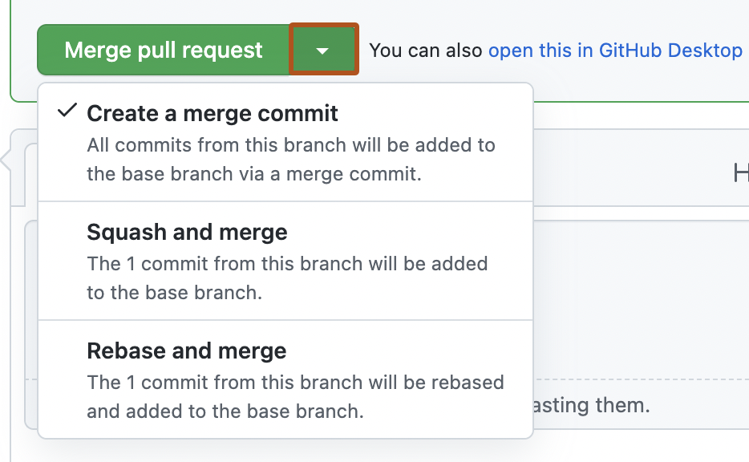
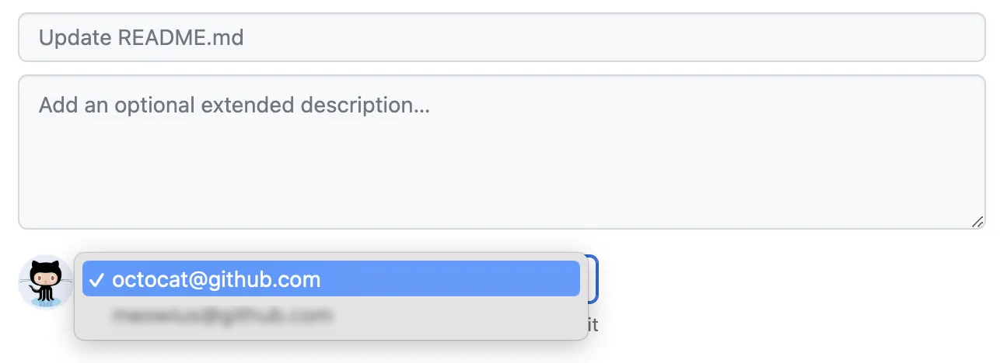

# Source Snapshot: Merging a pull request

- **Accessed:** 2026-10-19
- **Type:** official documentation (GitHub Docs)
- **URL:** https://docs.github.com/en/pull-requests/how-tos/merge-and-close-pull-requests/merging-a-pull-request
- **Upstream file:** [`github/docs` → `content/pull-requests/how-tos/merge-and-close-pull-requests/merging-a-pull-request.md`](https://github.com/github/docs/blob/dae83f7d28f3b8e10015bd6b6d8b72267cedceca/content/pull-requests/how-tos/merge-and-close-pull-requests/merging-a-pull-request.md) at commit `dae83f7` (2026-10-16)
- **Version shown:** GitHub.com "Free, Pro & Team" (`fpt`). The page source uses Liquid: `` blocks select text per product version; the site shows the `fpt` branch of each block.
- **Included files:** the published page pulls in text with `` tags and decides `` blocks with feature flags. These files are appended verbatim after the page, under "Included files", from the same commit: [`data/reusables/repositories/rulesets-alternative.md`](https://github.com/github/docs/blob/dae83f7d28f3b8e10015bd6b6d8b72267cedceca/data/reusables/repositories/rulesets-alternative.md); [`data/reusables/pull_requests/you-can-auto-merge.md`](https://github.com/github/docs/blob/dae83f7d28f3b8e10015bd6b6d8b72267cedceca/data/reusables/pull_requests/you-can-auto-merge.md); [`data/reusables/pull_requests/retargeted-on-branch-deletion.md`](https://github.com/github/docs/blob/dae83f7d28f3b8e10015bd6b6d8b72267cedceca/data/reusables/pull_requests/retargeted-on-branch-deletion.md); [`data/reusables/pull_requests/close-issues-using-keywords.md`](https://github.com/github/docs/blob/dae83f7d28f3b8e10015bd6b6d8b72267cedceca/data/reusables/pull_requests/close-issues-using-keywords.md); [`data/reusables/repositories/sidebar-pr.md`](https://github.com/github/docs/blob/dae83f7d28f3b8e10015bd6b6d8b72267cedceca/data/reusables/repositories/sidebar-pr.md); [`data/reusables/pull_requests/default-commit-message-squash-merge.md`](https://github.com/github/docs/blob/dae83f7d28f3b8e10015bd6b6d8b72267cedceca/data/reusables/pull_requests/default-commit-message-squash-merge.md); [`data/reusables/files/choose-commit-email.md`](https://github.com/github/docs/blob/dae83f7d28f3b8e10015bd6b6d8b72267cedceca/data/reusables/files/choose-commit-email.md); [`data/reusables/cli/cli-learn-more.md`](https://github.com/github/docs/blob/dae83f7d28f3b8e10015bd6b6d8b72267cedceca/data/reusables/cli/cli-learn-more.md); [`data/features/squash-merge-email.yml`](https://github.com/github/docs/blob/dae83f7d28f3b8e10015bd6b6d8b72267cedceca/data/features/squash-merge-email.yml)
- **Variables:** `` tags render short values from `data/variables/*.yml`; the values used on this page are listed under "Variable values" at the end.

---

---
title: Merging a pull request
intro: Merge pull requests into the upstream branch, choose merge methods, and meet repository requirements like reviews or status checks.
redirect_from:
  - /github/collaborating-with-issues-and-pull-requests/incorporating-changes-from-a-pull-request/merging-a-pull-request
  - /articles/merging-a-pull-request
  - /github/collaborating-with-issues-and-pull-requests/merging-a-pull-request
  - /github/collaborating-with-pull-requests/incorporating-changes-from-a-pull-request/merging-a-pull-request
  - /pull-requests/collaborating-with-pull-requests/incorporating-changes-from-a-pull-request/merging-a-pull-request
versions:
  fpt: '*'
  ghes: '*'
  ghec: '*'
shortTitle: Merge a pull request
category:
  - Merge and close pull requests
contentType: how-tos
---
## About pull request merges

Merge a pull request when the proposed changes are ready and any repository requirements are satisfied. You can't merge a draft pull request.

Repository rules or branch protection may require reviews, status checks, or an up-to-date branch before merging. See [AUTOTITLE](/repositories/configuring-branches-and-merges-in-your-repository/managing-protected-branches/about-protected-branches).





If the base branch requires a merge queue, the available merge options differ from those described here. See [AUTOTITLE](/pull-requests/how-tos/merge-and-close-pull-requests/merging-a-pull-request-with-a-merge-queue).

If the pull request has merge conflicts, or if you want to test changes first, [check out the pull request locally](/pull-requests/how-tos/review-pull-requests/checking-out-pull-requests-locally).

The repository may automatically delete the head branch after merging. See [AUTOTITLE](/repositories/configuring-branches-and-merges-in-your-repository/configuring-pull-request-merges/managing-the-automatic-deletion-of-branches).

> [!NOTE]
> 

Pull requests use [the `--no-ff` option](https://git-scm.com/docs/git-merge#_fast_forward_merge), except squashed or rebased pull requests, which use fast-forward merging.



If you don't want to merge the changes, you can [close the pull request](/pull-requests/how-tos/merge-and-close-pull-requests/closing-a-pull-request).

## Merging a pull request




1. In the "Pull Requests" list, click the pull request you want to merge.
1. Scroll down to the bottom of the pull request. Depending on the merge options enabled for your repository, choose a merge method:

    * [Merge all commits into the base branch](/pull-requests/reference/pull-request-merges) by clicking **Merge pull request**. If the option is not shown, click the merge dropdown menu and select **Create a merge commit**.

      

    * [Squash the commits into one commit](/pull-requests/reference/pull-request-merges#squash-and-merge-your-commits) by clicking the merge dropdown menu, selecting **Squash and merge**, and then clicking **Squash and merge**.

    * [Rebase the commits individually onto the base branch](/pull-requests/reference/pull-request-merges#rebase-and-merge-your-commits) by clicking the merge dropdown menu, selecting **Rebase and merge**, and then clicking **Rebase and merge**.

    > [!NOTE]
    > Rebase and merge will always update the committer information and create new commit SHAs. See [About pull request merges](/pull-requests/reference/pull-request-merges#rebase-and-merge-your-commits).

1. If prompted, type a commit message, or accept the default message.

   


   > [!NOTE]
   > The email selector is not available for rebase merges, which do not create a merge commit. For squash merges, the email selector is only shown if you are the pull request author and you have more than one email address associated with your account., or for squash merges, which credit the user who created the pull request as the author of the squashed commit.

1. Click **Confirm merge**, **Confirm squash and merge**, or **Confirm rebase and merge**.
1. Optionally, [delete the branch](/repositories/configuring-branches-and-merges-in-your-repository/managing-branches-in-your-repository/deleting-and-restoring-branches-in-a-pull-request). This keeps the list of branches in your repository tidy.







To merge a pull request, use the `gh pr merge` subcommand. Replace `pull-request` with the number, URL, or head branch of the pull request.

```shell
gh pr merge PULL-REQUEST
```

Follow the interactive prompts to complete the merge. See [AUTOTITLE](/pull-requests/reference/pull-request-merges).

Alternatively, you can use flags to skip the interactive prompts. For example, this command squashes the commits into a single commit with the commit message "my squash commit", merges the squashed commit into the base branch, and then deletes the local and remote branch.

```shell
gh pr merge 523 --squash --body "my squash commit" --delete-branch
```



## Further reading

* [AUTOTITLE](/pull-requests/how-tos/merge-and-close-pull-requests/reverting-a-pull-request)
* [AUTOTITLE](/desktop/working-with-your-remote-repository-on-github-or-github-enterprise/syncing-your-branch-in-github-desktop) using 
* [AUTOTITLE](/pull-requests/reference/pull-request-merges)
* [AUTOTITLE](/pull-requests/how-tos/merge-and-close-pull-requests)

---

## Included files

### `data/reusables/repositories/rulesets-alternative.md`

````markdown
As an alternative to branch protection rules, you can create rulesets. Rulesets have a few advantages over branch protection rules, such as statuses, and better discoverability without requiring admin access. You can also apply multiple rulesets at the same time. For more information, see [AUTOTITLE](/repositories/configuring-branches-and-merges-in-your-repository/managing-rulesets/about-rulesets).
````

### `data/reusables/pull_requests/you-can-auto-merge.md`

````markdown
You can configure a pull request to merge automatically when all merge requirements are met. For more information, see [AUTOTITLE](/pull-requests/how-tos/merge-and-close-pull-requests/automatically-merging-a-pull-request).
````

### `data/reusables/pull_requests/retargeted-on-branch-deletion.md`

````markdown
If you delete a head branch after its pull request has been merged,  checks for any open pull requests in the same repository that specify the deleted branch as their base branch.  automatically updates any such pull requests, changing their base branch to the merged pull request's base branch.
````

### `data/reusables/pull_requests/close-issues-using-keywords.md`

````markdown
You can link a pull request to an issue to show that a fix is in progress and automatically close the issue when the pull request is merged. For more information, see [AUTOTITLE](/issues/tracking-your-work-with-issues/using-issues/linking-a-pull-request-to-an-issue).
````

### `data/reusables/repositories/sidebar-pr.md`

````markdown
1. Under your repository name, click ** Pull requests**.
````

### `data/reusables/pull_requests/default-commit-message-squash-merge.md`

````markdown
For information about the default commit messages for squash merges, see [AUTOTITLE](/pull-requests/reference/pull-request-merges#merge-message-for-a-squash-merge).
````

### `data/reusables/files/choose-commit-email.md`

````markdown

1. If you have more than one email address associated with your account on , click the email address drop-down menu and select the email address to use as the Git author email address. Only verified email addresses appear in this drop-down menu. If you enabled email address privacy, then a no-reply will be the default commit author email address. For more information about the exact form the no-reply email address can take, see [AUTOTITLE](/account-and-profile/how-tos/email-preferences/setting-your-commit-email-address).

    

````

### `data/reusables/cli/cli-learn-more.md`

````markdown
> [!NOTE]
> To learn more about , see [AUTOTITLE](/github-cli/github-cli/about-github-cli).
````

### `data/features/squash-merge-email.yml`

````yaml
# Reference: #7932
# Show/choose commit author email address when squash merging a pull request
versions:
  fpt: '*'
  ghec: '*'
````

## Variable values

From `data/variables/*.yml` at the same commit ([folder](https://github.com/github/docs/tree/dae83f7d28f3b8e10015bd6b6d8b72267cedceca/data/variables)).

| Tag | Value |
|-----|-------|
| `` | GitHub Desktop |
| `` | GitHub |
| `` | GitHub CLI |
