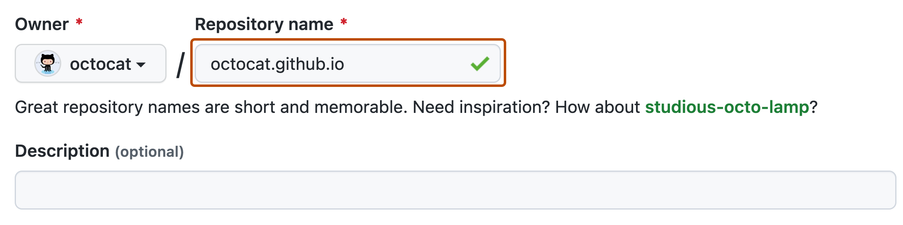

# Source Snapshot: Quickstart for GitHub Pages

- **Accessed:** 2026-10-19
- **Type:** official documentation (GitHub Docs)
- **URL:** https://docs.github.com/en/pages/quickstart
- **Upstream file:** [`github/docs` → `content/pages/quickstart.md`](https://github.com/github/docs/blob/dae83f7d28f3b8e10015bd6b6d8b72267cedceca/content/pages/quickstart.md) at commit `dae83f7` (2026-10-16)
- **Version shown:** GitHub.com "Free, Pro & Team" (`fpt`). The page source uses Liquid: `` blocks select text per product version; the site shows the `fpt` branch of each block.
- **Included files:** the published page pulls in text with `` tags and decides `` blocks with feature flags. These files are appended verbatim after the page, under "Included files", from the same commit: [`data/reusables/gated-features/pages.md`](https://github.com/github/docs/blob/dae83f7d28f3b8e10015bd6b6d8b72267cedceca/data/reusables/gated-features/pages.md); [`data/reusables/gated-features/more-info.md`](https://github.com/github/docs/blob/dae83f7d28f3b8e10015bd6b6d8b72267cedceca/data/reusables/gated-features/more-info.md); [`data/reusables/repositories/create_new.md`](https://github.com/github/docs/blob/dae83f7d28f3b8e10015bd6b6d8b72267cedceca/data/reusables/repositories/create_new.md); [`data/reusables/repositories/choose-repo-visibility.md`](https://github.com/github/docs/blob/dae83f7d28f3b8e10015bd6b6d8b72267cedceca/data/reusables/repositories/choose-repo-visibility.md); [`data/reusables/repositories/initialize-with-readme.md`](https://github.com/github/docs/blob/dae83f7d28f3b8e10015bd6b6d8b72267cedceca/data/reusables/repositories/initialize-with-readme.md); [`data/reusables/repositories/create-repo.md`](https://github.com/github/docs/blob/dae83f7d28f3b8e10015bd6b6d8b72267cedceca/data/reusables/repositories/create-repo.md); [`data/reusables/repositories/sidebar-settings.md`](https://github.com/github/docs/blob/dae83f7d28f3b8e10015bd6b6d8b72267cedceca/data/reusables/repositories/sidebar-settings.md); [`data/reusables/pages/sidebar-pages.md`](https://github.com/github/docs/blob/dae83f7d28f3b8e10015bd6b6d8b72267cedceca/data/reusables/pages/sidebar-pages.md)
- **Variables:** `` tags render short values from `data/variables/*.yml`; the values used on this page are listed under "Variable values" at the end.

---

---
title: Quickstart for GitHub Pages
intro: You can use  to showcase open source projects, host a blog, or even share your résumé. This guide will help get you started on creating your next website.
allowTitleToDifferFromFilename: true
versions:
  fpt: '*'
  ghes: '*'
  ghec: '*'
shortTitle: Quickstart
product: ''
category:
  - Set up a GitHub Pages site
contentType: get-started
---

## Introduction

In this guide, you'll create a user site at `<username>.github.io`.

## Creating your website


1. Enter `username.github.io` as the repository name. Replace `username` with your  username. For example, if your username is `octocat`, the repository name should be `octocat.github.io`.
   





1. Under "Build and deployment", under "Source", select **Deploy from a branch**.
1. Under "Build and deployment", under "Branch", use the branch dropdown menu and select a publishing source.
   
1. Optionally, open the `README.md` file of your repository. The `README.md` file is where you will write the content for your site. You can edit the file or keep the default content for now.
1. Visit `username.github.io` to view your new website. Note that it can take up to 10 minutes for changes to your site to publish after you push the changes to .

## Changing the title and description

By default, the title of your site is `username.github.io`. You can change the title by editing the `_config.yml` file in your repository. You can also add a description for your site.

1. Click the **Code** tab of your repository.
1. In the file list, check whether `_config.yml` exists. If it does not exist, create a new file named `_config.yml`.
1. In the file list, click `_config.yml` to open the file.
1. Click  to edit the file.
1. The `_config.yml` file already contains a line that specifies the theme for your site. Add a new line with `title:` followed by the title you want. Add a new line with `description:` followed by the description you want. For example:

   ```yaml
   theme: jekyll-theme-minimal
   title: Octocat's homepage
   description: Bookmark this to keep an eye on my project updates!
   ```

1. When you are finished editing the file, click **Commit changes**.

## Next steps

You've successfully created, personalized, and published your first  website, but there's so much more to explore! Here are some helpful resources for taking your next steps with :

* [AUTOTITLE](/pages/setting-up-a-github-pages-site-with-jekyll/adding-content-to-your-github-pages-site-using-jekyll#about-content-in-jekyll-sites): This guide explains how to add additional pages to your site.
* [AUTOTITLE](/pages/configuring-a-custom-domain-for-your-github-pages-site): You can host your site on 's `github.io` domain or your own custom domain.

---

## Included files

### `data/reusables/gated-features/pages.md`

````markdown
 is available in public repositories with  and  for organizations, and in public and private repositories with , , , and . 
````

### `data/reusables/gated-features/more-info.md`

````markdown
See [AUTOTITLE](/get-started/learning-about-github/githubs-plans).
````

### `data/reusables/repositories/create_new.md`

````markdown
1. In the upper-right corner of any page, select , then click **New repository**.

   
````

### `data/reusables/repositories/choose-repo-visibility.md`

````markdown
1. Choose a repository visibility. For more information, see [AUTOTITLE](/repositories/creating-and-managing-repositories/about-repositories#about-repository-visibility).
````

### `data/reusables/repositories/initialize-with-readme.md`

````markdown
1. Toggle **Add README** to **On**.
````

### `data/reusables/repositories/create-repo.md`

````markdown
1. Click **Create repository**.
````

### `data/reusables/repositories/sidebar-settings.md`

````markdown
1. Under your repository name, click ** Settings**. If you cannot see the "Settings" tab, select the **** dropdown menu, then click **Settings**.

   
````

### `data/reusables/pages/sidebar-pages.md`

````markdown
1. In the "Code, planning, and automation" "Code and automation" section of the sidebar, click ** Pages**.
````

## Variable values

From `data/variables/*.yml` at the same commit ([folder](https://github.com/github/docs/tree/dae83f7d28f3b8e10015bd6b6d8b72267cedceca/data/variables)).

| Tag | Value |
|-----|-------|
| `` | GitHub Pages |
| `` | GitHub |
| `` | GitHub |
| `` | GitHub Free |
| `` | GitHub Free |
| `` | GitHub Pro |
| `` | GitHub Team |
| `` | GitHub Enterprise Cloud |
| `` | GitHub Enterprise Server |
