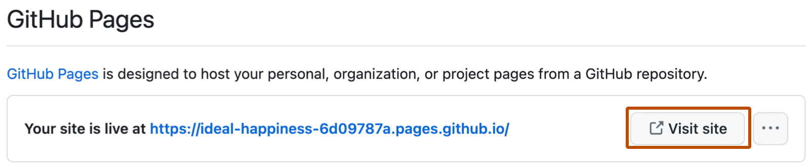

# Source Snapshot: Changing the visibility of your GitHub Pages site

- **Accessed:** 2026-10-19
- **Type:** official documentation (GitHub Docs)
- **URL:** https://docs.github.com/en/enterprise-cloud@latest/pages/getting-started-with-github-pages/changing-the-visibility-of-your-github-pages-site
- **Upstream file:** [`github/docs` → `content/pages/getting-started-with-github-pages/changing-the-visibility-of-your-github-pages-site.md`](https://github.com/github/docs/blob/dae83f7d28f3b8e10015bd6b6d8b72267cedceca/content/pages/getting-started-with-github-pages/changing-the-visibility-of-your-github-pages-site.md) at commit `dae83f7` (2026-10-16)
- **Version shown:** GitHub Enterprise Cloud (this page has no Free, Pro & Team version).
- **Included files:** the published page pulls in text with `` tags and decides `` blocks with feature flags. These files are appended verbatim after the page, under "Included files", from the same commit: [`data/reusables/pages/privately-publish-ghec-only.md`](https://github.com/github/docs/blob/dae83f7d28f3b8e10015bd6b6d8b72267cedceca/data/reusables/pages/privately-publish-ghec-only.md); [`data/reusables/enterprise/link-to-ghec-trial.md`](https://github.com/github/docs/blob/dae83f7d28f3b8e10015bd6b6d8b72267cedceca/data/reusables/enterprise/link-to-ghec-trial.md); [`data/reusables/pages/navigate-site-repo.md`](https://github.com/github/docs/blob/dae83f7d28f3b8e10015bd6b6d8b72267cedceca/data/reusables/pages/navigate-site-repo.md); [`data/reusables/repositories/sidebar-settings.md`](https://github.com/github/docs/blob/dae83f7d28f3b8e10015bd6b6d8b72267cedceca/data/reusables/repositories/sidebar-settings.md); [`data/reusables/pages/sidebar-pages.md`](https://github.com/github/docs/blob/dae83f7d28f3b8e10015bd6b6d8b72267cedceca/data/reusables/pages/sidebar-pages.md); [`data/reusables/pages/twenty-minutes-to-publish.md`](https://github.com/github/docs/blob/dae83f7d28f3b8e10015bd6b6d8b72267cedceca/data/reusables/pages/twenty-minutes-to-publish.md)
- **Variables:** `` tags render short values from `data/variables/*.yml`; the values used on this page are listed under "Variable values" at the end.

---

---
title: Changing the visibility of your GitHub Pages site
intro: You can manage access control for your project site by publishing the site publicly or privately.
versions:
  ghec: '*'
permissions: 'People with admin access to a repository can change the visibility of a  site.'
redirect_from:
  - /github/working-with-github-pages/changing-the-visibility-of-your-github-pages-site
shortTitle: Change visibility of site
category:
  - Managing a GitHub Pages site
---

## About access control for  sites

With access control for , you can restrict access to your project site by publishing the site privately. A privately published site can only be accessed by people with read access to the repository the site is published from. You can use privately published sites to share your internal documentation or knowledge base with members of your enterprise.



If your enterprise uses ,  sites can only be published as private, and all  sites are only accessible to other enterprise members. For more information about , see [AUTOTITLE](/pages/getting-started-with-github-pages/github-pages-limits#limits-for-enterprise-managed-users).

If your organization uses  without , you can choose to publish your project sites privately or publicly to anyone on the internet.

Access control is available for project sites that are published from a private or internal repository that are owned by the organization. You cannot manage access control for an organization site. For more information about the types of  sites, see [AUTOTITLE](/pages/getting-started-with-github-pages/what-is-github-pages#types-of-github-pages-sites).

## About subdomains for privately published sites

Privately published sites are available at a different subdomain than publicly published sites. This ensures that your  site is secure from the moment it's published:

* We automatically secure every subdomain of `*.pages.github.io` with a TLS certificate, and enforce HSTS to ensure that browsers always serve the page over HTTPS.
* We use a unique subdomain for the privately published site to ensure that other repositories in your organization cannot publish content on the same origin as the site. This protects your site from [cookie tossing](https://github.blog/2013-04-09-yummy-cookies-across-domains/). This is also why we don't host  sites on the `github.com` domain.

You can see your site's unique subdomain in the "Pages" tab of your repository settings. If you're using a static site generator configured to build the site with the repository name as a path, you may need to update the settings for the static site generator when changing the site to private. For more information, see [AUTOTITLE](/pages/configuring-a-custom-domain-for-your-github-pages-site/managing-a-custom-domain-for-your-github-pages-site#configuring-a-subdomain) or the documentation for your static site generator.

To use a shorter and more memorable domain for your privately published site, you can configure a custom domain. For more information, see [AUTOTITLE](/pages/configuring-a-custom-domain-for-your-github-pages-site).

## Changing the visibility of your  site




1. Under "", select the ** visibility** dropdown menu, then select a visibility.
1. To see your published site, under "", click ** Visit site**.

   

  

---

## Included files

### `data/reusables/pages/privately-publish-ghec-only.md`

````markdown
> [!NOTE]
> To publish a  site privately, your organization must use . 
````

### `data/reusables/enterprise/link-to-ghec-trial.md`

````markdown
For more information about how you can try  for free, see [Setting up a trial of ](/admin/overview/setting-up-a-trial-of-github-enterprise-cloud).
````

### `data/reusables/pages/navigate-site-repo.md`

````markdown
1. On , navigate to your site's repository.
````

### `data/reusables/repositories/sidebar-settings.md`

````markdown
1. Under your repository name, click ** Settings**. If you cannot see the "Settings" tab, select the **** dropdown menu, then click **Settings**.

   
````

### `data/reusables/pages/sidebar-pages.md`

````markdown
1. In the "Code, planning, and automation" "Code and automation" section of the sidebar, click ** Pages**.
````

### `data/reusables/pages/twenty-minutes-to-publish.md`

````markdown
> [!NOTE]
> It can take up to 10 minutes for changes to your site to publish after you push the changes to . If you don't see your  site changes reflected in your browser after an hour, see [AUTOTITLE](/pages/setting-up-a-github-pages-site-with-jekyll/about-jekyll-build-errors-for-github-pages-sites).
````

## Variable values

From `data/variables/*.yml` at the same commit ([folder](https://github.com/github/docs/tree/dae83f7d28f3b8e10015bd6b6d8b72267cedceca/data/variables)).

| Tag | Value |
|-----|-------|
| `` | GitHub Pages |
| `` | Enterprise Managed Users |
| `` | GitHub Enterprise Cloud |
| `` | GitHub |
