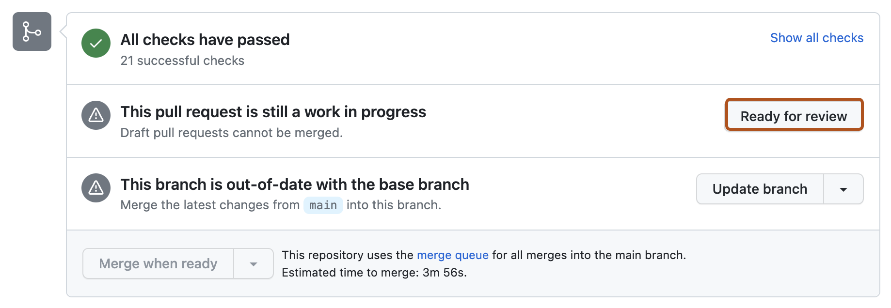

# Source Snapshot: Changing the stage of a pull request

- **Accessed:** 2026-10-19
- **Type:** official documentation (GitHub Docs)
- **URL:** https://docs.github.com/en/pull-requests/how-tos/create-pull-requests/changing-the-stage-of-a-pull-request
- **Upstream file:** [`github/docs` → `content/pull-requests/how-tos/create-pull-requests/changing-the-stage-of-a-pull-request.md`](https://github.com/github/docs/blob/dae83f7d28f3b8e10015bd6b6d8b72267cedceca/content/pull-requests/how-tos/create-pull-requests/changing-the-stage-of-a-pull-request.md) at commit `dae83f7` (2026-10-16)
- **Version shown:** GitHub.com "Free, Pro & Team" (`fpt`). The page source uses Liquid: `` blocks select text per product version; the site shows the `fpt` branch of each block.
- **Included files:** the published page pulls in text with `` tags and decides `` blocks with feature flags. These files are appended verbatim after the page, under "Included files", from the same commit: [`data/reusables/pull_requests/mark-ready-review.md`](https://github.com/github/docs/blob/dae83f7d28f3b8e10015bd6b6d8b72267cedceca/data/reusables/pull_requests/mark-ready-review.md); [`data/reusables/repositories/sidebar-pr.md`](https://github.com/github/docs/blob/dae83f7d28f3b8e10015bd6b6d8b72267cedceca/data/reusables/repositories/sidebar-pr.md)
- **Variables:** `` tags render short values from `data/variables/*.yml`; the values used on this page are listed under "Variable values" at the end.

---

---
title: Changing the stage of a pull request
intro: Mark a draft pull request as ready for review or convert an open pull request back to a draft to manage your workflow effectively.
permissions: People with write permissions to a repository and pull request authors can change the stage of a pull request.
redirect_from:
  - /github/collaborating-with-issues-and-pull-requests/proposing-changes-to-your-work-with-pull-requests/changing-the-stage-of-a-pull-request
  - /articles/changing-the-stage-of-a-pull-request
  - /github/collaborating-with-issues-and-pull-requests/changing-the-stage-of-a-pull-request
  - /github/collaborating-with-pull-requests/proposing-changes-to-your-work-with-pull-requests/changing-the-stage-of-a-pull-request
  - /pull-requests/collaborating-with-pull-requests/proposing-changes-to-your-work-with-pull-requests/changing-the-stage-of-a-pull-request
versions:
  fpt: '*'
  ghes: '*'
  ghec: '*'
shortTitle: Draft pull requests
category:
  - Create pull requests
contentType: how-tos
---
## Marking a pull request as ready for review



> [!TIP]
> You can also mark a pull request as ready for review using the . See [`gh pr ready`](https://cli.github.com/manual/gh_pr_ready) in the  documentation.


1. In the "Pull requests" list, click the pull request you want to mark as ready for review.
1. In the merge box, click **Ready for review**.

   

## Converting a pull request to a draft

You can convert a pull request to a draft at any time. For example, if you accidentally opened a pull request instead of a draft, or if you've received feedback on your pull request that you need to address, you can convert the pull request to a draft to indicate further changes are needed.

No one can merge the pull request until you mark the pull request as ready for review again. People who are already subscribed to notifications for the pull request will not be unsubscribed when you convert the pull request to a draft.


1. In the "Pull requests" list, click the pull request you want to convert to a draft.
1. In the right sidebar, under "Reviewers," click **Convert to draft**.

   

1. Click **Convert to draft**.

## Further reading

* [AUTOTITLE](/pull-requests/reference/pull-requests)

---

## Included files

### `data/reusables/pull_requests/mark-ready-review.md`

````markdown
When you're ready to get feedback on your pull request, you can mark your draft pull request as ready for review. Marking a pull request as ready for review will request reviews from any code owners.
````

### `data/reusables/repositories/sidebar-pr.md`

````markdown
1. Under your repository name, click ** Pull requests**.
````

## Variable values

From `data/variables/*.yml` at the same commit ([folder](https://github.com/github/docs/tree/dae83f7d28f3b8e10015bd6b6d8b72267cedceca/data/variables)).

| Tag | Value |
|-----|-------|
| `` | GitHub CLI |
