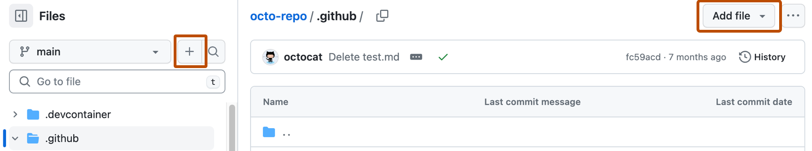

# Source Snapshot: Creating a pull request template for your repository

- **Accessed:** 2026-10-19
- **Type:** official documentation (GitHub Docs)
- **URL:** https://docs.github.com/en/communities/using-templates-to-encourage-useful-issues-and-pull-requests/creating-a-pull-request-template-for-your-repository
- **Upstream file:** [`github/docs` → `content/communities/using-templates-to-encourage-useful-issues-and-pull-requests/creating-a-pull-request-template-for-your-repository.md`](https://github.com/github/docs/blob/dae83f7d28f3b8e10015bd6b6d8b72267cedceca/content/communities/using-templates-to-encourage-useful-issues-and-pull-requests/creating-a-pull-request-template-for-your-repository.md) at commit `dae83f7` (2026-10-16)
- **Version shown:** GitHub.com "Free, Pro & Team" (`fpt`). The page source uses Liquid: `` blocks select text per product version; the site shows the `fpt` branch of each block.
- **Included files:** the published page pulls in text with `` tags and decides `` blocks with feature flags. These files are appended verbatim after the page, under "Included files", from the same commit: [`data/reusables/repositories/navigate-to-repo.md`](https://github.com/github/docs/blob/dae83f7d28f3b8e10015bd6b6d8b72267cedceca/data/reusables/repositories/navigate-to-repo.md); [`data/reusables/files/add-file.md`](https://github.com/github/docs/blob/dae83f7d28f3b8e10015bd6b6d8b72267cedceca/data/reusables/files/add-file.md); [`data/reusables/files/write_commit_message.md`](https://github.com/github/docs/blob/dae83f7d28f3b8e10015bd6b6d8b72267cedceca/data/reusables/files/write_commit_message.md); [`data/reusables/files/choose_commit_branch.md`](https://github.com/github/docs/blob/dae83f7d28f3b8e10015bd6b6d8b72267cedceca/data/reusables/files/choose_commit_branch.md); [`data/reusables/files/propose_new_file.md`](https://github.com/github/docs/blob/dae83f7d28f3b8e10015bd6b6d8b72267cedceca/data/reusables/files/propose_new_file.md)
- **Variables:** `` tags render short values from `data/variables/*.yml`; the values used on this page are listed under "Variable values" at the end.

---

---
title: Creating a pull request template for your repository
intro: 'When you add a pull request template to your repository, project contributors will automatically see the template''s contents in the pull request body.'
redirect_from:
  - /articles/creating-a-pull-request-template-for-your-repository
  - /github/building-a-strong-community/creating-a-pull-request-template-for-your-repository
versions:
  fpt: '*'
  ghes: '*'
  ghec: '*'
shortTitle: Create a PR template
category:
  - Create issue and pull request templates
---

For more information, see [AUTOTITLE](/communities/using-templates-to-encourage-useful-issues-and-pull-requests/about-issue-and-pull-request-templates).

You can create a _PULL_REQUEST_TEMPLATE/_ subdirectory in any of the supported folders to contain multiple pull request templates, and use the `template` query parameter to specify the template that will fill the pull request body. For more information, see [AUTOTITLE](/pull-requests/reference/using-query-parameters-to-create-a-pull-request).

You can create default pull request templates for your organization or personal account. For more information, see [AUTOTITLE](/communities/setting-up-your-project-for-healthy-contributions/creating-a-default-community-health-file).

## Adding a pull request template



1. In the file name field:
    * To make your pull request template visible in the repository's root directory, name the pull request template `pull_request_template.md`.
    * To make your pull request template visible in the repository's `docs` directory, name the pull request template `docs/pull_request_template.md`.
    * To store your file in a hidden directory, name the pull request template `.github/pull_request_template.md`.
    * To create multiple pull request templates and use the `template` query parameter to specify a template to fill the pull request body, type _.github/PULL_REQUEST_TEMPLATE/_, then the name of your pull request template. For example, `.github/PULL_REQUEST_TEMPLATE/pull_request_template.md`. You can also store multiple pull request templates in a `PULL_REQUEST_TEMPLATE` subdirectory within the root or `docs/` directories. For more information, see [AUTOTITLE](/pull-requests/reference/using-query-parameters-to-create-a-pull-request).
1. In the body of the new file, add your pull request template. This template could consist of asking to include:
    * A [reference to a related issue](/get-started/writing-on-github/getting-started-with-writing-and-formatting-on-github/basic-writing-and-formatting-syntax#referencing-issues-and-pull-requests) in your repository.
    * A description of the changes proposed in the pull request.
    * [@mentions](/get-started/writing-on-github/getting-started-with-writing-and-formatting-on-github/basic-writing-and-formatting-syntax#mentioning-people-and-teams) of the person or team responsible for reviewing proposed changes.

 Templates are available to collaborators when they are merged into the repository's default branch.


## Further reading

* [AUTOTITLE](/communities/using-templates-to-encourage-useful-issues-and-pull-requests/about-issue-and-pull-request-templates)
* [AUTOTITLE](/issues/tracking-your-work-with-issues/using-issues/creating-an-issue)
* [AUTOTITLE](/pull-requests/how-tos/create-pull-requests/creating-a-pull-request)

---

## Included files

### `data/reusables/repositories/navigate-to-repo.md`

````markdown
1. On , navigate to the main page of the repository.
````

### `data/reusables/files/add-file.md`

````markdown
1. Above the list of files, select the **Add file**  dropdown menu, then click ** Create new file**.

   Alternatively, you can click  in the file tree view on the left.

   
````

### `data/reusables/files/write_commit_message.md`

````markdown
1. Click **Commit changes...**

1. In the "Commit message" field, type a short, meaningful commit message that describes the change you made to the file. You can attribute the commit to more than one author in the commit message. For more information, see [AUTOTITLE](/pull-requests/how-tos/commit-changes/creating-a-commit-with-multiple-authors).
````

### `data/reusables/files/choose_commit_branch.md`

````markdown
1. Below the commit message fields, decide whether to add your commit to the current branch or to a new branch. If your current branch is the default branch, you should choose to create a new branch for your commit and then create a pull request. For more information, see [AUTOTITLE](/pull-requests/how-tos/create-pull-requests/creating-a-pull-request).

   
````

### `data/reusables/files/propose_new_file.md`

````markdown
1. Click **Commit changes** or **Propose changes**.
````

## Variable values

From `data/variables/*.yml` at the same commit ([folder](https://github.com/github/docs/tree/dae83f7d28f3b8e10015bd6b6d8b72267cedceca/data/variables)).

| Tag | Value |
|-----|-------|
| `` | GitHub |
