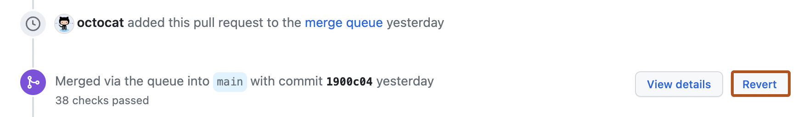

# Source Snapshot: Reverting a pull request

- **Accessed:** 2026-10-19
- **Type:** official documentation (GitHub Docs)
- **URL:** https://docs.github.com/en/pull-requests/how-tos/merge-and-close-pull-requests/reverting-a-pull-request
- **Upstream file:** [`github/docs` → `content/pull-requests/how-tos/merge-and-close-pull-requests/reverting-a-pull-request.md`](https://github.com/github/docs/blob/dae83f7d28f3b8e10015bd6b6d8b72267cedceca/content/pull-requests/how-tos/merge-and-close-pull-requests/reverting-a-pull-request.md) at commit `dae83f7` (2026-10-16)
- **Version shown:** GitHub.com "Free, Pro & Team" (`fpt`). The page source uses Liquid: `` blocks select text per product version; the site shows the `fpt` branch of each block.
- **Included files:** the published page pulls in text with `` tags and decides `` blocks with feature flags. These files are appended verbatim after the page, under "Included files", from the same commit: [`data/reusables/repositories/sidebar-pr.md`](https://github.com/github/docs/blob/dae83f7d28f3b8e10015bd6b6d8b72267cedceca/data/reusables/repositories/sidebar-pr.md)
- **Variables:** `` tags render short values from `data/variables/*.yml`; the values used on this page are listed under "Variable values" at the end.

---

---
title: Reverting a pull request
intro: Create a new pull request to revert a previously merged pull request and address merge conflicts if they arise.
redirect_from:
  - /github/collaborating-with-issues-and-pull-requests/incorporating-changes-from-a-pull-request/reverting-a-pull-request
  - /github/collaborating-with-pull-requests/incorporating-changes-from-a-pull-request/reverting-a-pull-request
  - /articles/reverting-a-pull-request
  - /github/collaborating-with-issues-and-pull-requests/reverting-a-pull-request
  - /pull-requests/collaborating-with-pull-requests/incorporating-changes-from-a-pull-request/reverting-a-pull-request
versions:
  fpt: '*'
  ghes: '*'
  ghec: '*'
shortTitle: Revert a pull request
category:
  - Merge and close pull requests
contentType: how-tos
---
## About reverting a pull request

Reverting a merged pull request creates a new pull request that reverts the original merge commit. You must have [write permissions](/organizations/managing-user-access-to-your-organizations-repositories/managing-repository-roles/repository-roles-for-an-organization) in the repository.

## Reverting a pull request

> [!NOTE]
> You may need to revert individual commits if reverting the pull request causes merge conflicts or if the original pull request was not merged on . See [Git revert](https://git-scm.com/docs/git-revert.html) in the Git documentation.


1. In the "Pull Requests" list, click the pull request you want to revert.
1. Near the bottom of the pull request, click **Revert**. If the **Revert** option isn't displayed, you need to ask the repository administrator for write permissions.

   

1. Merge the resulting pull request. See [AUTOTITLE](/pull-requests/how-tos/merge-and-close-pull-requests/merging-a-pull-request).

---

## Included files

### `data/reusables/repositories/sidebar-pr.md`

````markdown
1. Under your repository name, click ** Pull requests**.
````

## Variable values

From `data/variables/*.yml` at the same commit ([folder](https://github.com/github/docs/tree/dae83f7d28f3b8e10015bd6b6d8b72267cedceca/data/variables)).

| Tag | Value |
|-----|-------|
| `` | GitHub |
