# Source Snapshot: Reviewing proposed changes in a pull request

- **Accessed:** 2026-10-19
- **Type:** official documentation (GitHub Docs)
- **URL:** https://docs.github.com/en/pull-requests/how-tos/review-pull-requests/reviewing-proposed-changes-in-a-pull-request
- **Upstream file:** [`github/docs` → `content/pull-requests/how-tos/review-pull-requests/reviewing-proposed-changes-in-a-pull-request.md`](https://github.com/github/docs/blob/dae83f7d28f3b8e10015bd6b6d8b72267cedceca/content/pull-requests/how-tos/review-pull-requests/reviewing-proposed-changes-in-a-pull-request.md) at commit `dae83f7` (2026-10-16)
- **Version shown:** GitHub.com "Free, Pro & Team" (`fpt`). The page source uses Liquid: `` blocks select text per product version; the site shows the `fpt` branch of each block.
- **Included files:** the published page pulls in text with `` tags and decides `` blocks with feature flags. These files are appended verbatim after the page, under "Included files", from the same commit: [`data/reusables/repositories/sidebar-pr.md`](https://github.com/github/docs/blob/dae83f7d28f3b8e10015bd6b6d8b72267cedceca/data/reusables/repositories/sidebar-pr.md); [`data/reusables/repositories/choose-pr-review.md`](https://github.com/github/docs/blob/dae83f7d28f3b8e10015bd6b6d8b72267cedceca/data/reusables/repositories/choose-pr-review.md); [`data/reusables/repositories/changed-files.md`](https://github.com/github/docs/blob/dae83f7d28f3b8e10015bd6b6d8b72267cedceca/data/reusables/repositories/changed-files.md); [`data/reusables/repositories/start-line-comment.md`](https://github.com/github/docs/blob/dae83f7d28f3b8e10015bd6b6d8b72267cedceca/data/reusables/repositories/start-line-comment.md); [`data/reusables/repositories/multiple-lines-comment.md`](https://github.com/github/docs/blob/dae83f7d28f3b8e10015bd6b6d8b72267cedceca/data/reusables/repositories/multiple-lines-comment.md); [`data/reusables/repositories/type-line-comment.md`](https://github.com/github/docs/blob/dae83f7d28f3b8e10015bd6b6d8b72267cedceca/data/reusables/repositories/type-line-comment.md); [`data/reusables/repositories/suggest-changes.md`](https://github.com/github/docs/blob/dae83f7d28f3b8e10015bd6b6d8b72267cedceca/data/reusables/repositories/suggest-changes.md); [`data/reusables/repositories/start-file-comment.md`](https://github.com/github/docs/blob/dae83f7d28f3b8e10015bd6b6d8b72267cedceca/data/reusables/repositories/start-file-comment.md); [`data/reusables/codespaces/reviewing-a-pr.md`](https://github.com/github/docs/blob/dae83f7d28f3b8e10015bd6b6d8b72267cedceca/data/reusables/codespaces/reviewing-a-pr.md); [`data/reusables/copilot/copilot-requires-subscription.md`](https://github.com/github/docs/blob/dae83f7d28f3b8e10015bd6b6d8b72267cedceca/data/reusables/copilot/copilot-requires-subscription.md); [`data/reusables/copilot/open-copilot.md`](https://github.com/github/docs/blob/dae83f7d28f3b8e10015bd6b6d8b72267cedceca/data/reusables/copilot/open-copilot.md); [`data/reusables/copilot/stop-response-generation.md`](https://github.com/github/docs/blob/dae83f7d28f3b8e10015bd6b6d8b72267cedceca/data/reusables/copilot/stop-response-generation.md); [`data/reusables/repositories/return-to-source-diff.md`](https://github.com/github/docs/blob/dae83f7d28f3b8e10015bd6b6d8b72267cedceca/data/reusables/repositories/return-to-source-diff.md); [`data/reusables/repositories/review-changes.md`](https://github.com/github/docs/blob/dae83f7d28f3b8e10015bd6b6d8b72267cedceca/data/reusables/repositories/review-changes.md); [`data/reusables/repositories/review-summary-comment.md`](https://github.com/github/docs/blob/dae83f7d28f3b8e10015bd6b6d8b72267cedceca/data/reusables/repositories/review-summary-comment.md); [`data/reusables/repositories/submit-review.md`](https://github.com/github/docs/blob/dae83f7d28f3b8e10015bd6b6d8b72267cedceca/data/reusables/repositories/submit-review.md); [`data/reusables/repositories/request-changes-tips.md`](https://github.com/github/docs/blob/dae83f7d28f3b8e10015bd6b6d8b72267cedceca/data/reusables/repositories/request-changes-tips.md); [`data/features/copilot.yml`](https://github.com/github/docs/blob/dae83f7d28f3b8e10015bd6b6d8b72267cedceca/data/features/copilot.yml)
- **Variables:** `` tags render short values from `data/variables/*.yml`; the values used on this page are listed under "Variable values" at the end.

---

---
title: Reviewing proposed changes in a pull request
intro: Review commits, file changes, and diffs in pull requests to provide feedback, approve changes, or request updates before merging.
redirect_from:
  - /pull-requests/how-tos/review-pull-requests/filtering-files-in-a-pull-request
  - /pull-requests/how-tos/review-pull-requests/finding-changed-methods-and-functions-in-a-pull-request
  - /github/collaborating-with-issues-and-pull-requests/reviewing-changes-in-pull-requests/reviewing-proposed-changes-in-a-pull-request
  - /articles/reviewing-proposed-changes-in-a-pull-request
  - /github/collaborating-with-issues-and-pull-requests/reviewing-proposed-changes-in-a-pull-request
  - /github/collaborating-with-pull-requests/reviewing-changes-in-pull-requests/reviewing-proposed-changes-in-a-pull-request
  - /pull-requests/collaborating-with-pull-requests/reviewing-changes-in-pull-requests/reviewing-proposed-changes-in-a-pull-request
  - /github/collaborating-with-issues-and-pull-requests/reviewing-changes-in-pull-requests/filtering-files-in-a-pull-request
  - /articles/filtering-files-in-a-pull-request-by-file-type
  - /articles/filtering-files-in-a-pull-request
  - /github/collaborating-with-issues-and-pull-requests/filtering-files-in-a-pull-request
  - /github/collaborating-with-pull-requests/reviewing-changes-in-pull-requests/filtering-files-in-a-pull-request
  - /pull-requests/collaborating-with-pull-requests/reviewing-changes-in-pull-requests/filtering-files-in-a-pull-request
  - /github/collaborating-with-issues-and-pull-requests/reviewing-changes-in-pull-requests/finding-changed-methods-and-functions-in-a-pull-request
  - /articles/finding-changed-methods-and-functions-in-a-pull-request
  - /github/collaborating-with-issues-and-pull-requests/finding-changed-methods-and-functions-in-a-pull-request
  - /github/collaborating-with-pull-requests/reviewing-changes-in-pull-requests/finding-changed-methods-and-functions-in-a-pull-request
  - /pull-requests/collaborating-with-pull-requests/reviewing-changes-in-pull-requests/finding-changed-methods-and-functions-in-a-pull-request
versions:
  fpt: '*'
  ghes: '*'
  ghec: '*'
shortTitle: Review proposed changes
category:
  - Review pull requests
contentType: how-tos
---
## About reviewing pull requests

It's best to review changes in a pull request one file at a time:

* **Examine** each individual file changed in the pull request.
* **Leave comments** on specific changes.
* After reviewing a file, mark it as **Viewed** to collapse it and track your progress.
* The **progress bar** in the pull request header shows how many files you've viewed.
* When you've finished, you can **approve** the pull request or **request changes** by submitting your review with a summary comment.

 If the pull request was raised by , then  will respond to your comments when you submit them.  will push a new commit to the pull request with further changes. See [AUTOTITLE](/copilot/concepts/agents/cloud-agent/about-cloud-agent).



## Understanding the purpose of the pull request

Understanding the motivation behind a pull request helps you keep your review targeted and meaningful. It also helps you provide feedback that aligns with the pull request author’s intent and the project's goals.

You have several options to better understand the context and rationale for proposed changes.

### Using the pull request sidebar for context

In the pull request sidebar, you can find valuable context, including:

* Linked **issues** or **discussions**: Review these to understand the problems or goals that the pull request aims to address. You can also gather information about background, design decisions, or current debates.
* Linked **projects** or **milestones**: Review how this pull request fits within larger projects or upcoming releases.

Use this information to frame your review and check if the goals of the pull request align with the original intent.

### Using  to understand the rationale

You can ask  for help understanding the pull request’s intent or clarifying any part of the change.

1. At the top right of the pull request page, click the **** button next to the search bar.

    is displayed, with the pull request attached as context to the prompt window.

1. In the prompt box, type a question and press <kbd>Enter</kbd>. For example, you could enter:

   * `What problem does this pull request solve?`
   * `Why were these changes needed?`
   * `Summarize the goals of this PR based on the linked issue.`
   * `How does this PR relate to issue ISSUE-URL?`

 can help you clarify the bigger picture before you start line-level review.

## Starting a review




To change the format of the diff view in this tab, click  and choose the unified or split view. The choice you make will apply when you view the diff for other pull requests.

   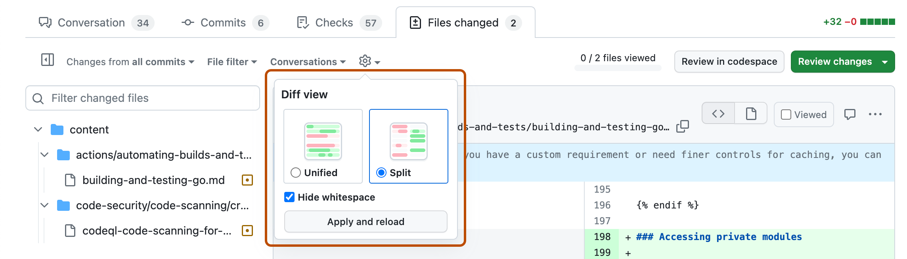

   You can also hide whitespace differences. The choice you make only applies to this pull request and will be remembered the next time you visit this page.
1. Optionally, filter the files to show only the files you want to review or use the file tree to navigate to a specific file.

1. Optionally, if you have access to , you can ask  about the changes in a file in a pull request by clicking  at the top right of the file, clicking **Ask  about this diff**, then typing a request such as "Explain these changes." See [AUTOTITLE](/enterprise-cloud@latest/copilot/how-tos/copilot-on-github/chat-with-copilot/chat-in-github#asking-questions-about-a-specific-pull-request).






1. When you're done, click **Start a review**. If you have already started a review, you can click **Add review comment**.

Before you submit your review, your line comments are _pending_ and only visible to you. You can edit pending comments anytime before you submit your review. To cancel a pending review, including all of its pending comments, click **Submit review**, then click **Discard review**.

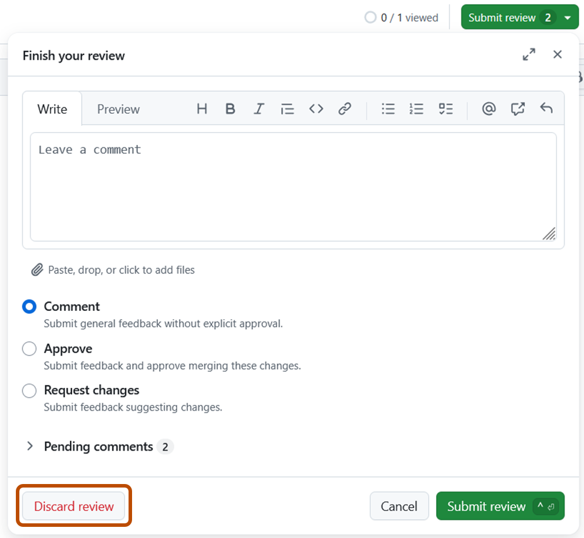






## Reviewing a pull request

You can use [](/codespaces/quickstart) to test, run, and review pull requests.

1. Open the pull request in a codespace, as described in [AUTOTITLE](/codespaces/developing-in-a-codespace/using-github-codespaces-for-pull-requests#opening-a-pull-request-in-codespaces).
1. In the Activity Bar, click the ** Pull Request** view. This view only appears when you open a pull request in a codespace.

   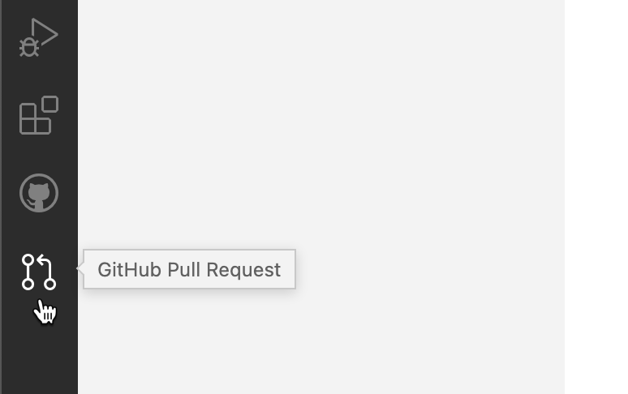

1. To review a specific file, click the **Open File** icon in the Side Bar.

   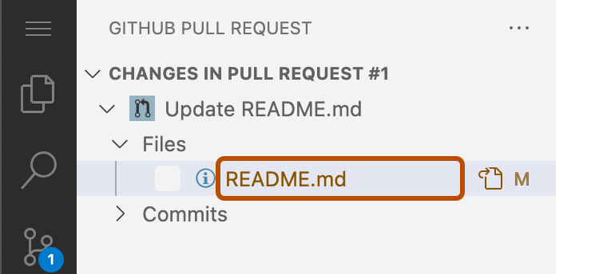

1. To add review comments, click the **+** icon next to the line number. Type your review comment and then click **Start Review**.

   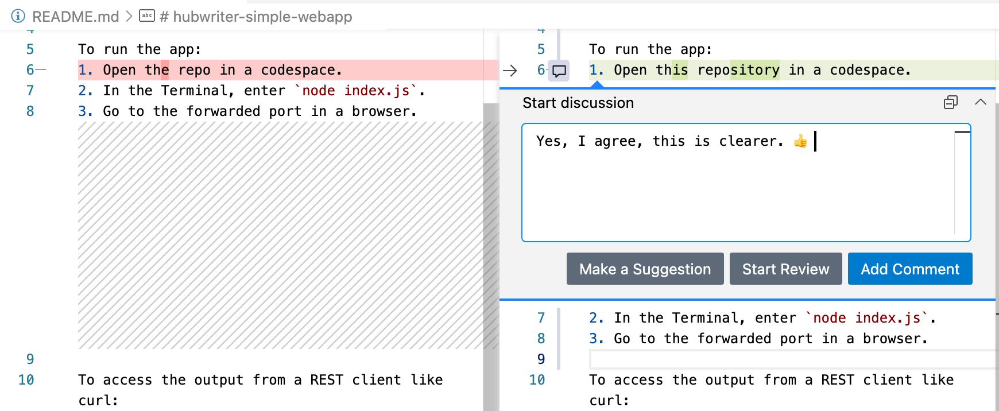



1. When you are finished adding review comments, from the Side Bar you can choose to either submit the comments, approve the changes, or request changes.

   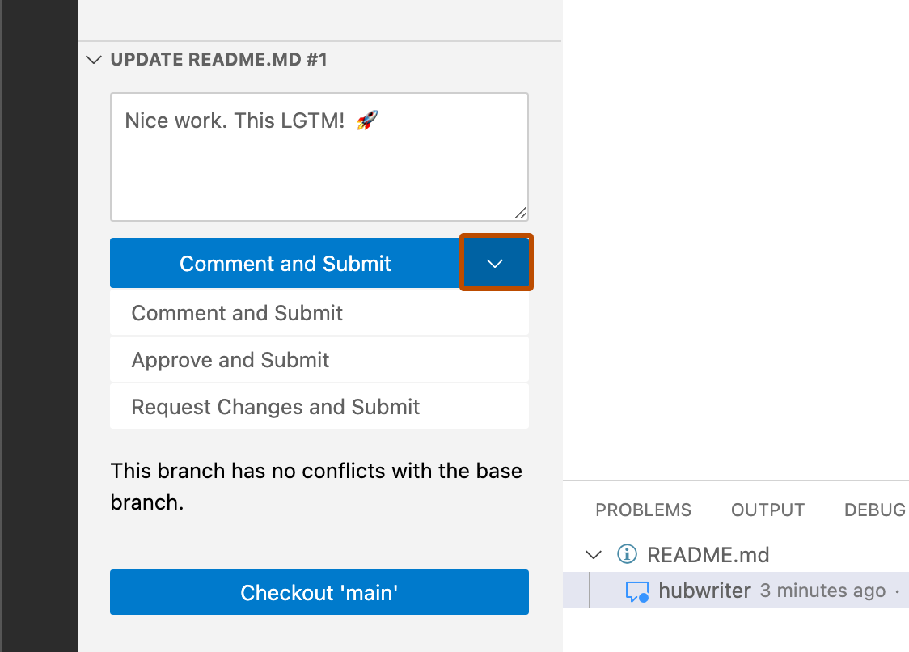

For more information on reviewing pull requests in , see [AUTOTITLE](/codespaces/developing-in-a-codespace/using-github-codespaces-for-pull-requests).








## Understanding changes in a pull request

> [!NOTE] 

 can help you quickly understand changes in a pull request by providing context and explanations for specific commits. If you’re unsure about the purpose of a particular change or need more details about how it fits into the broader codebase, you can ask  questions about individual commits.

1. Navigate to a commit on .



1. At the bottom of the  chat panel, in the "Ask " box, type a question and press <kbd>Enter</kbd>. For example, you could enter:

   * `Summarize the changes in this commit`
   * `Who committed these changes?`
   * `When was this commit made?`

   > [!TIP]
   > If you know the SHA for a commit, instead of navigating to the commit, you can ask  about the commit from any page in the repository on  by including the SHA in your message. For example, `What changed in commit a778e0eab?`





## Reviewing dependency changes

If the pull request contains changes to dependencies, you can use the dependency review for a manifest or lock file to see what has changed. You can also check whether the changes introduce security vulnerabilities. See [AUTOTITLE](/pull-requests/how-tos/review-pull-requests/reviewing-dependency-changes-in-a-pull-request).



1. On the right of the header for a manifest or lock file, display the dependency review by clicking the **** rich diff button.

   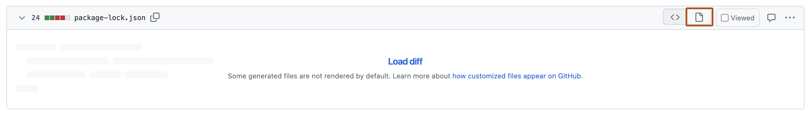



## Marking a file as viewed

After you finish reviewing a file, you can mark the file as viewed. The file will collapse. If the file changes after you view the file, it will be unmarked as viewed.


1. On the right of the header of the file you've finished reviewing, select **Viewed**.

   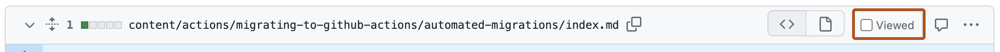

## Submitting your review

After you've finished reviewing all the files you want in the pull request, submit your review.




1. Select the type of review you'd like to leave:

    * Select **Comment** to leave general feedback without explicitly approving the changes or requesting additional changes.
    * Select **Approve** to submit your feedback and approve merging the changes proposed in the pull request.
    * Select **Request changes** to submit feedback that must be addressed before the pull request can be merged.






## Further reading

* [AUTOTITLE](/repositories/configuring-branches-and-merges-in-your-repository/managing-protected-branches/about-protected-branches#require-pull-request-reviews-before-merging)
* [AUTOTITLE](/issues/tracking-your-work-with-issues/using-issues/filtering-and-searching-issues-and-pull-requests)

---

## Included files

### `data/reusables/repositories/sidebar-pr.md`

````markdown
1. Under your repository name, click ** Pull requests**.
````

### `data/reusables/repositories/choose-pr-review.md`

````markdown
1. In the list of pull requests, click the pull request you'd like to review.
````

### `data/reusables/repositories/changed-files.md`

````markdown
1. On the pull request, click ** Files changed**.

   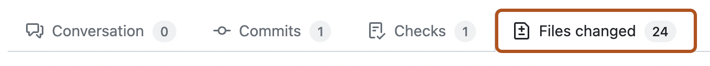
````

### `data/reusables/repositories/start-line-comment.md`

````markdown
1. Hover over the line of code where you'd like to add a comment, and click the blue comment icon.

   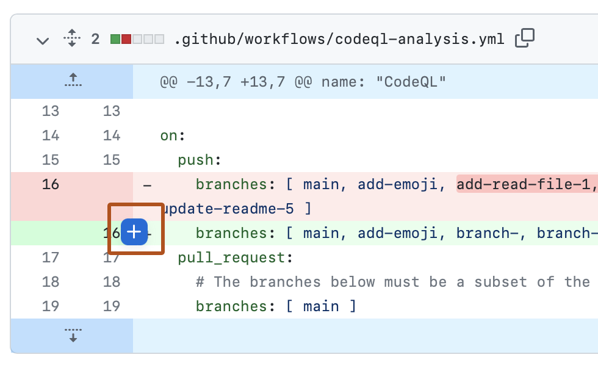
````

### `data/reusables/repositories/multiple-lines-comment.md`

````markdown
1. Optionally, you can add a comment on multiple lines. To select a range of lines, click the line number of the first line you want to comment on, then either drag down to the final line, or hold down <kbd>Shift</kbd> and click on the last line number. You can then click the blue comment icon on the last line you want to comment on. Alternatively, you can click the blue comment icon next to the first line you want to comment on, then drag down to the last line you want to comment on.
````

### `data/reusables/repositories/type-line-comment.md`

````markdown
1. In the comment field, type your comment.
````

### `data/reusables/repositories/suggest-changes.md`

````markdown
1. Optionally, to suggest a specific change to the line or lines, click , then edit the text within the suggestion block.

   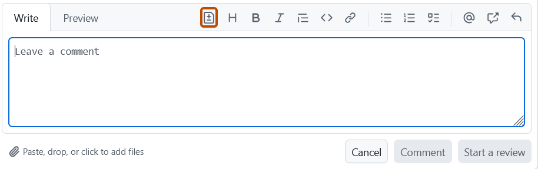
````

### `data/reusables/repositories/start-file-comment.md`

````markdown
1. To comment directly on a file, to the right of the file, click  and type your comment.

   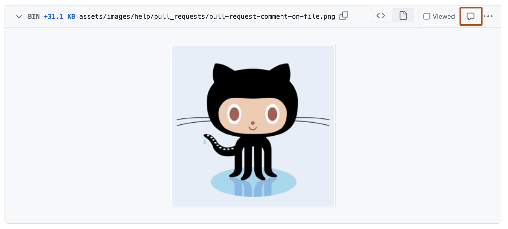
````

### `data/reusables/codespaces/reviewing-a-pr.md`

````markdown
1. Optionally, you can suggest a change that the author of the pull request can click to commit if they agree with your suggestion. To do this, click and hold the **+** sign next to the first line you want to suggest changing, then drag the **+** sign to the last line you want to suggest changing. Then click **Make a Suggestion** in the comment box that's displayed.

   The lines you selected are copied into the comment box, where you can edit them to suggest a change. You can add a comment above the line containing <code>```suggestion</code> to explain your suggested change.

   Click **Add Comment** to add your suggestion to the pull request.

   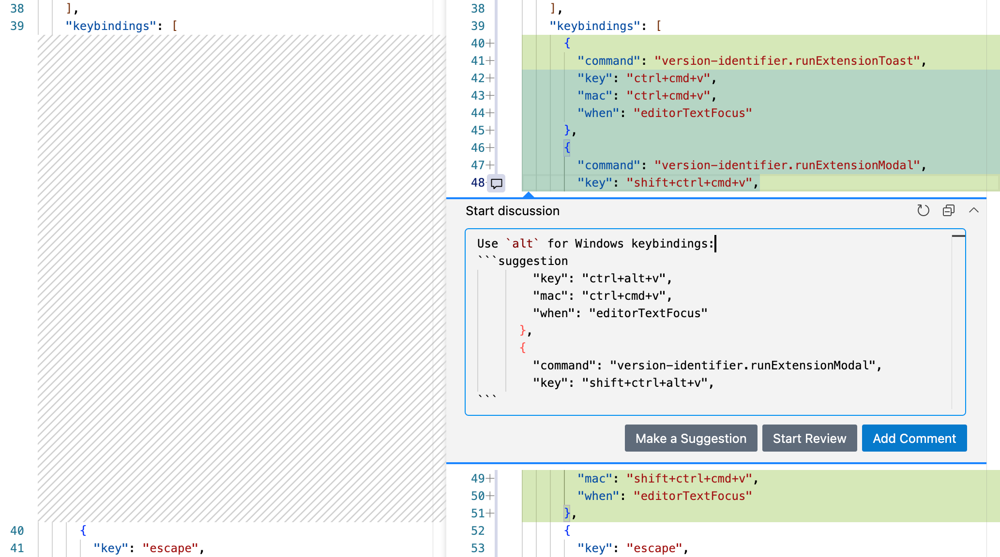
````

### `data/reusables/copilot/copilot-requires-subscription.md`

````markdown
You'll need access to . For more information, see [AUTOTITLE](/copilot/get-started/about-github-copilot#get-access).
````

### `data/reusables/copilot/open-copilot.md`

````markdown
1. In the top right of any page on , click the **** icon next to the search bar.

   The  panel is displayed. To resize the panel, click and drag the top or left edge.

1. If the panel contains a previous conversation you had with , click the  plus sign icon at the top right of the  panel to start a new conversation.
````

### `data/reusables/copilot/stop-response-generation.md`

````markdown
1. Optionally, after submitting a question, you can click  in the text box to stop the response.
````

### `data/reusables/repositories/return-to-source-diff.md`

````markdown
1. You may also want to review the source diff, because there could be changes to the manifest or lock file that don't change dependencies, or there could be dependencies that  can't parse and which, as a result, don't appear in the dependency review.

   To return to the source diff view, click the **** button.

   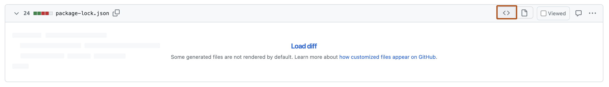
````

### `data/reusables/repositories/review-changes.md`

````markdown
1. Above the changed code, click **Review changes**.

   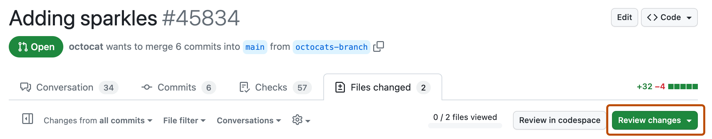
````

### `data/reusables/repositories/review-summary-comment.md`

````markdown
1. Type a comment summarizing your feedback on the proposed changes.
````

### `data/reusables/repositories/submit-review.md`

````markdown
1. Click **Submit review**.
````

### `data/reusables/repositories/request-changes-tips.md`

````markdown
> [!TIP]
> * The **Request changes** option is purely informational and will not prevent merging unless a ruleset or classic branch protection rule is configured with the "require a pull request" option. If configured and a collaborator with `admin`, `owner`, or `write` access to the repository submits a review requesting changes, the pull request cannot be merged until the same collaborator submits another review approving the changes in the pull request.
> * Repository owners and administrators can merge a pull request even if it hasn't received an approving review, or if a reviewer who requested changes has left the organization or is unavailable.
> * If both required reviews and stale review dismissal are enabled and a code-modifying commit is pushed to the branch of an approved pull request, the approval is dismissed. The pull request must be reviewed and approved again before it can be merged.
> * When several open pull requests each have a head branch pointing to the same commit, you won’t be able to merge them if one or both have a pending or rejected review. 
> * If your repository requires approving reviews from people with write or admin permissions, the reviewers sidebar groups approvals by permission level. Approvals can appear in two sections:
>     * The **top section** mostly contains approvals from people with write or admin permissions that count toward merge requirements. Approvals by  also appear in this section even though  reviews do not count toward those requirements.
>     * The **collapsible section (if present)** shows approvals from reviewers whose reviews do not affect whether the pull request can be merged. 
> * Pull request authors cannot approve their own pull requests. You will also not be able to approve a pull request that was raised by  if it was you who assigned  to the issue to which the pull request relates.
````

### `data/features/copilot.yml`

````yaml
versions:
  fpt: '*'
  ghec: '*'
````

## Variable values

From `data/variables/*.yml` at the same commit ([folder](https://github.com/github/docs/tree/dae83f7d28f3b8e10015bd6b6d8b72267cedceca/data/variables)).

| Tag | Value |
|-----|-------|
| `` | GitHub Copilot |
| `` | Copilot |
| `` | Copilot Chat |
| `` | GitHub Copilot Enterprise |
| `` | GitHub Codespaces |
| `` | GitHub |
| `` | VS Code |
| `` | GitHub |
| `` | GitHub Copilot Chat |
