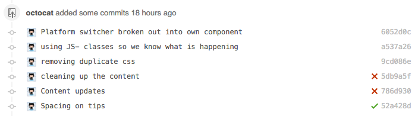
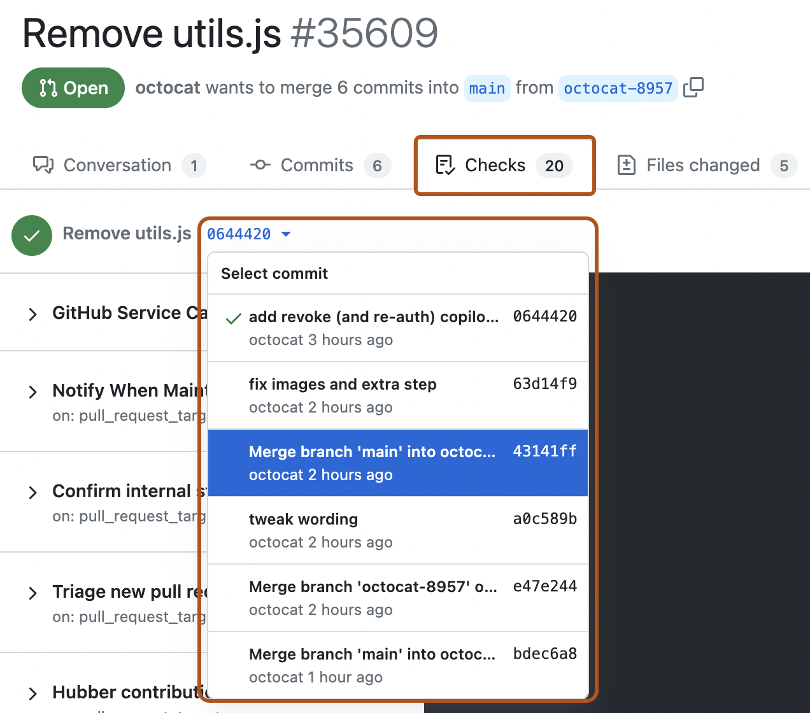

# Source Snapshot: Status checks

- **Accessed:** 2026-10-19
- **Type:** official documentation (GitHub Docs)
- **URL:** https://docs.github.com/en/pull-requests/reference/status-checks
- **Upstream file:** [`github/docs` → `content/pull-requests/reference/status-checks.md`](https://github.com/github/docs/blob/dae83f7d28f3b8e10015bd6b6d8b72267cedceca/content/pull-requests/reference/status-checks.md) at commit `dae83f7` (2026-10-16)
- **Version shown:** GitHub.com "Free, Pro & Team" (`fpt`). The page source uses Liquid: `` blocks select text per product version; the site shows the `fpt` branch of each block.
- **Included files:** the published page pulls in text with `` tags and decides `` blocks with feature flags. These files are appended verbatim after the page, under "Included files", from the same commit: [`data/reusables/actions/workflows/skipped-job-status-checks-passing.md`](https://github.com/github/docs/blob/dae83f7d28f3b8e10015bd6b6d8b72267cedceca/data/reusables/actions/workflows/skipped-job-status-checks-passing.md); [`data/reusables/commits/about-commit-cleanup.md`](https://github.com/github/docs/blob/dae83f7d28f3b8e10015bd6b6d8b72267cedceca/data/reusables/commits/about-commit-cleanup.md); [`data/reusables/pull_requests/retention-checks-data.md`](https://github.com/github/docs/blob/dae83f7d28f3b8e10015bd6b6d8b72267cedceca/data/reusables/pull_requests/retention-checks-data.md)
- **Variables:** `` tags render short values from `data/variables/*.yml`; the values used on this page are listed under "Variable values" at the end.

---

---
title: Status checks
intro: Understand how status checks ensure commits meet repository conditions, assist pull request reviews, and manage validations like builds, tests, and deployments.
redirect_from:
  - /pull-requests/concepts/about-status-checks
  - /github/collaborating-with-issues-and-pull-requests/collaborating-on-repositories-with-code-quality-features/about-status-checks
  - /articles/about-statuses
  - /articles/about-status-checks
  - /github/collaborating-with-issues-and-pull-requests/about-status-checks
  - /github/collaborating-with-pull-requests/collaborating-on-repositories-with-code-quality-features/about-status-checks
  - /pull-requests/collaborating-with-pull-requests/collaborating-on-repositories-with-code-quality-features/about-status-checks
versions:
  fpt: '*'
  ghes: '*'
  ghec: '*'
category:
  - Merge and close pull requests
contentType: reference
---

Status checks show whether commits meet the conditions set for a repository. They are usually created by external systems, such as continuous integration builds, tests, code scanning, or deployment checks.

Status checks help reviewers and maintainers understand whether a pull request is ready to merge. A check can show that work is still running, that changes passed validation, or that something needs attention.



Anyone with write permissions to a repository can set the state for any status check in the repository.

If status checks are required for a protected branch, they must pass before the pull request can be merged. See [AUTOTITLE](/repositories/configuring-branches-and-merges-in-your-repository/managing-protected-branches/about-protected-branches#require-status-checks-before-merging).



## Types of status checks on 

There are two types of status checks on :

| Type | Detail level | Created by |
| --- | --- | --- |
| Checks | Detailed output, annotations, and messages. | , including . |
| Commit statuses | A simpler status for a commit. | External services and integrations. |

> [!NOTE]
>  generates checks, not commit statuses, when workflows are run.

Organization owners and users with push access to a repository can create checks and commit statuses with 's API. See [AUTOTITLE](/rest/checks) and [AUTOTITLE](/rest/commits/statuses).

## Checks

Checks can include build logs, test results, annotations, and links to more detail. In a pull request, the **Checks** tab helps you understand which validations ran and why a check passed or failed.



> [!NOTE]
> The **Checks** tab is populated for pull requests only if you set up _checks_, not _commit statuses_, for the repository.

When a check points to a specific line, details can also appear in the **Files** tab of the pull request. This helps reviewers connect automated feedback to the code being changed.

## Skipping and requesting checks for individual commits

Some repositories allow checks to be skipped or requested for individual commits. This can be useful when a check is not relevant to a specific change, or when checks are not requested automatically.

For  workflows, you can skip workflow runs triggered by the `push` and `pull_request` events by including a skip instruction in your commit message. See [AUTOTITLE](/actions/how-tos/manage-workflow-runs/skip-workflow-runs).

Alternatively, to skip or request _all_ checks for your commit, add one of the following trailer lines to the end of your commit message:

* To _skip checks_ for a commit, type your commit message and a short, meaningful description of your changes. After your commit description, before the closing quotation, add two empty lines followed by `skip-checks: true`:

  ```shell
  $ git commit -m "Update README
  >
  >
  skip-checks: true"
  ```

* To _request_ checks for a commit, type your commit message and a short, meaningful description of your changes. After your commit description, before the closing quotation, add two empty lines followed by `request-checks: true`:

  ```shell
  $ git commit -m "Refactor usability tests
  >
  >
  request-checks: true"
  ```



## Check statuses and conclusions

Checks move through statuses as they run, then receive a conclusion when they finish. Some statuses cannot be set manually and are reserved for .

| Status | Description |  only? |
| --- | --- | --- |
| `completed` | The check run completed and has a conclusion (see below). | No |
| `expected` | The check run is waiting for a status to be reported. | Yes |
| `failure` | The check run failed. | No |
| `in_progress` | The check run is in progress. | No |
| `pending` | The check run is at the front of the queue but the [group-based concurrency](/actions/how-tos/write-workflows/choose-when-workflows-run/control-workflow-concurrency) limit has been reached. | Yes |
| `queued` | The check run has been queued. | No |
| `requested` | The check run has been created but has not been queued. | Yes |
| `startup_failure` | The check suite failed during startup. This status is not applicable to check runs. | Yes |
| `waiting` | The check run is waiting for a [deployment protection rule](/actions/how-tos/deploy/configure-and-manage-deployments/manage-environments) to be satisfied. | Yes |

When a check has a status of `completed`, it has a conclusion. A successful conclusion usually means the check does not block merging. A failure, timeout, or action-required conclusion usually means someone must review the details before the pull request can merge.

| Conclusion | Description |
| --- | --- |
| `action_required` | The check run provided required actions upon its completion.  For more information, see [AUTOTITLE](/rest/guides/using-the-rest-api-to-interact-with-checks#check-runs-and-requested-actions). |
| `cancelled` | The check run was cancelled before it completed. |
| `failure` | The check run failed. |
| `neutral` | The check run completed with a neutral result. This is treated as a success for dependent checks in . |
| `skipped` | The check run was skipped. This is treated as a success for dependent checks in . |
| `stale` | The check run was marked stale by  because it took too long. |
| `success` | The check run completed successfully. |
| `timed_out` | The check run timed out. |

## Retention of checks



---

## Included files

### `data/reusables/actions/workflows/skipped-job-status-checks-passing.md`

````markdown
> [!NOTE]
> A job that is skipped will report its status as "Success". It will not prevent a pull request from merging, even if it is a required check.
````

### `data/reusables/commits/about-commit-cleanup.md`

````markdown
By default, Git automatically removes consecutive newlines. To leave the commit message exactly as you entered it, use the `--cleanup=verbatim` option on your commit. For more information, see [`--cleanup=<mode>`](https://git-scm.com/docs/git-commit#Documentation/git-commit.txt---cleanupltmodegt) in the Git documentation.
````

### `data/reusables/pull_requests/retention-checks-data.md`

````markdown


 retains checks data based on the retention setting configured for checks, workflow runs, statuses, artifacts, and logs. After the configured retention period has elapsed, the data is permanently deleted.



Site administrators can control the retention policy for checks data on . For more information, see [AUTOTITLE](/admin/configuring-settings/configuring-user-applications-for-your-enterprise/configuring-applications#enabling-retention-policy-for-checks).

To merge a pull request with checks that are both required and archived, you must rerun the checks.


````

## Variable values

From `data/variables/*.yml` at the same commit ([folder](https://github.com/github/docs/tree/dae83f7d28f3b8e10015bd6b6d8b72267cedceca/data/variables)).

| Tag | Value |
|-----|-------|
| `` | GitHub |
| `` | GitHub Apps |
| `` | GitHub Actions |
| `` | GitHub |
| `` | your GitHub Enterprise Server instanceGitHub.com |
