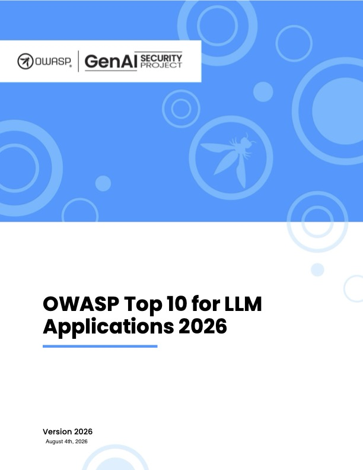
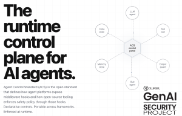
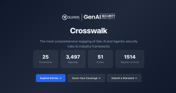
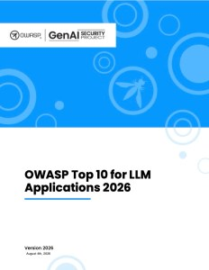

# Source Snapshot: OWASP GenAI LLM Top 10 2026 — OWASP Gen AI Security Project

- **Accessed:** 2026-10-19
- **Type:** official documentation
- **URL:** https://genai.owasp.org/resource/owasp-genai-llm-top-10-2026/
- **Author / publisher:** OWASP Gen AI Security Project
- **Published / updated:** August 3, 2026 (date shown on the page)
- **Capture method:** fetched with `curl` on 2026-10-19; the page's main content (`<main>` element, without scripts, navigation, header, and footer) was converted from HTML to Markdown with `markdownify`. The document itself is behind a download form (the download link returned a 'No Access' page on 2026-10-19), so only this description page could be read.
- **License:** Creative Commons Attribution-ShareAlike 4.0 International (CC BY-SA 4.0) — the site footer states "Unless otherwise specified, all content on the site is Creative Commons Attribution-ShareAlike v4.0". See [LICENSE-owasp-llm-top-10](LICENSE-owasp-llm-top-10). Full main-content text reproduced below this line, except image paths (see Images).
- **Images:** downloaded on the access date into [`assets/`](assets/). Only the image paths in the text below were changed to point to these copies. Copies: [`2026-OWASP-GenAI-LLM-Top-10-v1.0.jpg`](assets/2026-OWASP-GenAI-LLM-Top-10-v1.0.jpg) ← https://genai.owasp.org/wp-content/uploads/2026/08/2026-OWASP-GenAI-LLM-Top-10-v1.0.jpg; [`ACS-Image-300x192.png`](assets/ACS-Image-300x192.png) ← https://genai.owasp.org/wp-content/uploads/2026/09/ACS-Image-300x192.png; [`crosswalk-screen-300x160.png`](assets/crosswalk-screen-300x160.png) ← https://genai.owasp.org/wp-content/uploads/2026/09/crosswalk-screen-300x160.png; [`2026-OWASP-GenAI-LLM-Top-10-v1.0-232x300.jpg`](assets/2026-OWASP-GenAI-LLM-Top-10-v1.0-232x300.jpg) ← https://genai.owasp.org/wp-content/uploads/2026/08/2026-OWASP-GenAI-LLM-Top-10-v1.0-232x300.jpg

---

* GEN AI SECURITY
* resources

* Whitepapers/Guides

## OWASP GenAI LLM Top 10 2026

* August 3, 2026

## About

OWASP Top 10 for LLM Applications 2026 is the latest community-driven guide to the most critical security risks facing applications powered by large language models. Developed by hundreds of AI security experts, this edition introduces updated rankings, expanded threat coverage, and new research grounded in thousands of real-world AI security incidents. The guide provides practical explanations, attack scenarios, and actionable mitigations for developers, architects, security teams, and CISOs, while mapping risks to leading industry frameworks including NIST, MITRE ATLAS, CWE, and the OWASP Top 10 for Agentic Applications, making it an essential resource for building and securing modern AI

[Download](https://genai.owasp.org/download/56857/?tmstv=1785822482)

## Additional Resources

* September 1, 2026
* [Resources](https://genai.owasp.org/category/resources/)

[## Agent Control Standard (ACS)](https://genai.owasp.org/resource/agent-control-standard-acs/)

* September 1, 2026
* [Resources](https://genai.owasp.org/category/resources/)

[## GenAI Security Industry Framework Crosswalk](https://genai.owasp.org/resource/genai-security-industry-framework-crosswalk/)

* August 3, 2026
* [Resources](https://genai.owasp.org/category/resources/)

[## OWASP GenAI LLM Top 10 2026](https://genai.owasp.org/resource/owasp-genai-llm-top-10-2026/)
