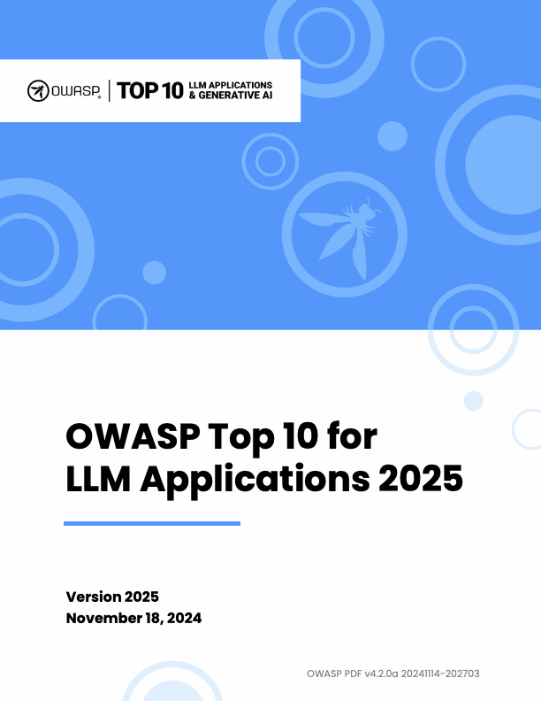

# Source Snapshot: OWASP Top 10 for LLM Applications 2025 — OWASP Gen AI Security Project

- **Accessed:** 2026-10-19
- **Type:** official documentation
- **URL:** https://genaisecurityproject.com/resource/owasp-top-10-for-llm-applications-2025/
- **Author / publisher:** OWASP Gen AI Security Project
- **Published / updated:** November 17, 2024 (date shown on the page)
- **Capture method:** fetched with `curl` on 2026-10-19; the page's main content (`<main>` element, without scripts, navigation, header, and footer) was converted from HTML to Markdown with `markdownify`. The URL redirects to genai.owasp.org.
- **License:** Creative Commons Attribution-ShareAlike 4.0 International (CC BY-SA 4.0) — the site footer states "Unless otherwise specified, all content on the site is Creative Commons Attribution-ShareAlike v4.0". See [LICENSE-owasp-llm-top-10](LICENSE-owasp-llm-top-10). Full main-content text reproduced below this line, except image paths (see Images).
- **Images:** downloaded on the access date into [`assets/`](assets/). Only the image paths in the text below were changed to point to these copies. Copies: [`LLMAll_en-US_FINAL-Cover.png`](assets/LLMAll_en-US_FINAL-Cover.png) ← https://genai.owasp.org/wp-content/uploads/2024/04/LLMAll_en-US_FINAL-Cover.png; [`ACS-Image-300x192.png`](assets/ACS-Image-300x192.png) ← https://genai.owasp.org/wp-content/uploads/2026/09/ACS-Image-300x192.png; [`crosswalk-screen-300x160.png`](assets/crosswalk-screen-300x160.png) ← https://genai.owasp.org/wp-content/uploads/2026/09/crosswalk-screen-300x160.png; [`2026-OWASP-GenAI-LLM-Top-10-v1.0-232x300.jpg`](assets/2026-OWASP-GenAI-LLM-Top-10-v1.0-232x300.jpg) ← https://genai.owasp.org/wp-content/uploads/2026/08/2026-OWASP-GenAI-LLM-Top-10-v1.0-232x300.jpg

---

* GEN AI SECURITY
* resources

* Whitepapers/Guides

## OWASP Top 10 for LLM Applications 2025

* November 17, 2024

## About

The OWASP Top 10 for Large Language Model Applications started in 2023 as a community-driven effort to highlight and address security issues specific to AI applications. Since then, the technology has continued to spread across industries and applications, and so have the associated risks. As LLMs are embedded more deeply in everything from customer interactions to internal operations, developers and security professionals are discovering new vulnerabilities—and ways to counter them.

[Download](https://genai.owasp.org/download/43299/?tmstv=1731900559)

## Additional Resources

* September 1, 2026
* [Resources](https://genai.owasp.org/category/resources/)

[## Agent Control Standard (ACS)](https://genai.owasp.org/resource/agent-control-standard-acs/)

* September 1, 2026
* [Resources](https://genai.owasp.org/category/resources/)

[## GenAI Security Industry Framework Crosswalk](https://genai.owasp.org/resource/genai-security-industry-framework-crosswalk/)

* August 3, 2026
* [Resources](https://genai.owasp.org/category/resources/)

[## OWASP GenAI LLM Top 10 2026](https://genai.owasp.org/resource/owasp-genai-llm-top-10-2026/)
