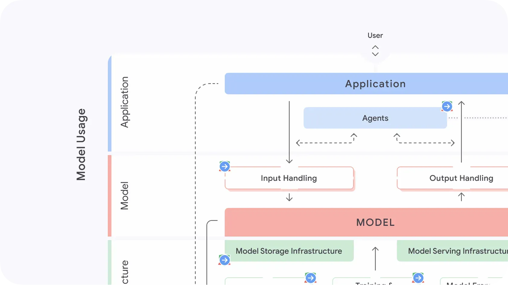

# Source Snapshot: Secure AI Framework - SAIF (SAIF map)

- **Accessed:** 2026-10-19
- **Type:** official documentation
- **URL:** https://saif.google/secure-ai-framework
- **Author / publisher:** Google (saif.google)
- **Published / updated:** no date shown on the page
- **Capture method:** fetched with `curl` on 2026-10-19; the page's main content (`<main>` element, without scripts, navigation, header, and footer) was converted from HTML to Markdown with `markdownify`. 

---

# SAIF map

The SAIF Map is a visual guide for navigating AI security and is at the heart of understanding SAIF as a security framework.
  
  
Many AI risks are new to developers, such as Prompt Injection, Data Poisoning, or Rogue Actions. The SAIF Map shows the AI development process to locate the risks—and crucially, potential controls for those risks.

[Explore the map](./../../secure-ai-framework/saif-map)

To help make AI safer for everyone, we’ve shared the SAIF Risk Assessment, SAIF Risk Map, and the associated risks, controls, and components descriptions with the [Coalition for Secure AI (CoSAI)](https://github.com/cosai-oasis/secure-ai-tooling/tree/main/risk-map). We hope this contribution accelerates the development of open-source security solutions, making it easier for any organization to build more secure AI systems.

## How to use the SAIF Risk Map

You can use the SAIF map to:

* follow a single risk throughout the AI development process
* see the specific risks that affect a certain component area or type of organization
* or better understand how your own organization’s development structure might be affected by AI risks

The SAIF map is divided into four component areas: Data, Infrastructure, Model, and Application. Some approaches to AI security focus primarily on the model, whereas SAIF addresses risks and controls throughout the entire AI development lifecycle. For advanced systems like AI agents, SAIF also offers a second, [specialized diagram](https://gweb-saif-stg.appspot.com/focus-on-agents#map) that goes into greater detail on the unique risks they introduce.

The top half of the map shows the path a model takes to deployment in an application and how a user queries the model through that application. This content is most relevant to Model Consumers—those who use AI models to build AI-powered products and applications.

The bottom half of the map shows the path to developing a model and is most relevant to Model Creators—those who train or finetune models for use by themselves or others.

Depending on how you use AI, certain risks may be more relevant to you than others. Use the SAIF Map and the Risk Self Assessment to discover which risks you should investigate.

* [

  Components

  Explore more details on the components that make up the SAIF Map, from Data Sources to Applications.](./../../secure-ai-framework/components)
* [

  Risks

  Learn about AI-specific risks, including descriptions of how the risk evolves across the AI development lifecycle, real-life examples, and suggested controls for mitigation.](./../../secure-ai-framework/risks)
* [

  Controls

  Discover controls for secure AI development, each mapped to specific AI risks.](./../../secure-ai-framework/controls)
* [

  AI Development Primer

  Introduction to the AI development lifecycle, highlighting the security and data protection risks that can emerge at each stage.](./../../ai-development-primer)
* [

  Risk Self Assessment

  Developed for security practitioners, to help identify which AI risks may be most relevant to you.](./../../risk-self-assessment)

* 
