# Source Snapshot: Top Risks of Generative AI Systems - SAIF

- **Accessed:** 2026-10-19
- **Type:** official documentation
- **URL:** https://saif.google/secure-ai-framework/risks
- **Author / publisher:** Google (saif.google)
- **Published / updated:** no date shown on the page
- **Capture method:** fetched with `curl` on 2026-10-19; the page's main content (`<main>` element, without scripts, navigation, header, and footer) was converted from HTML to Markdown with `markdownify`. Each risk section on the live page appears twice in the HTML (collapsed and expanded views), so headings and some paragraphs repeat.
- **License:** Google website content; no open license stated. Publicly accessible page, copied for non-commercial reference with attribution; all rights remain with the copyright holder. Full main-content text reproduced below this line, except image paths (see Images).
- **Images:** downloaded on the access date into [`assets/`](assets/). Only the image paths in the text below were changed to point to these copies. Copies: [`risks-icon.svg`](assets/risks-icon.svg) ← https://www.gstatic.com/marketing-cms/assets/images/03/74/d750d9b440878c14b5e50591fb22/risks-icon.svg; [`dp-int.webp`](assets/dp-int.webp) ← https://www.gstatic.com/marketing-cms/assets/images/2b/d1/66279eb84b98b2cd96c9599643cc/dp-int.webp; [`dp-exp.webp`](assets/dp-exp.webp) ← https://www.gstatic.com/marketing-cms/assets/images/3c/cc/df60eaf84ed5b9d872339fab58d2/dp-exp.webp; [`dp-mit.webp`](assets/dp-mit.webp) ← https://www.gstatic.com/marketing-cms/assets/images/49/2d/ac7ea4864fcb91dd5c052f5a1a6a/dp-mit.webp; [`utd-int.webp`](assets/utd-int.webp) ← https://www.gstatic.com/marketing-cms/assets/images/59/7c/9474fe664bc7b14b54f137366b3f/utd-int.webp; [`utd-exp.webp`](assets/utd-exp.webp) ← https://www.gstatic.com/marketing-cms/assets/images/8f/df/02680ea74e8e863f890e455d9440/utd-exp.webp; [`utd-mit.webp`](assets/utd-mit.webp) ← https://www.gstatic.com/marketing-cms/assets/images/f9/01/c8ffea244e4585fec5a6a233adf1/utd-mit.webp; [`mst-int.webp`](assets/mst-int.webp) ← https://www.gstatic.com/marketing-cms/assets/images/ba/b7/c738b28e4bfd9bf85d7e6ae14d00/mst-int.webp; [`mst-exp.webp`](assets/mst-exp.webp) ← https://www.gstatic.com/marketing-cms/assets/images/fd/12/49c93eb84971966165321d02813d/mst-exp.webp; [`mst-mit.webp`](assets/mst-mit.webp) ← https://www.gstatic.com/marketing-cms/assets/images/14/e2/863c0133449abcdfc3bd9b1643e8/mst-mit.webp; [`edh-int.webp`](assets/edh-int.webp) ← https://www.gstatic.com/marketing-cms/assets/images/86/32/d3ae365a451184cd8cea447e8325/edh-int.webp; [`edh-exp.webp`](assets/edh-exp.webp) ← https://www.gstatic.com/marketing-cms/assets/images/a4/af/011fb6b6439fafeb9b1c486480a4/edh-exp.webp; [`edh-mit.webp`](assets/edh-mit.webp) ← https://www.gstatic.com/marketing-cms/assets/images/a5/5a/6a47ed4e4927b8f002c1ddfef615/edh-mit.webp; [`mxf-int.webp`](assets/mxf-int.webp) ← https://www.gstatic.com/marketing-cms/assets/images/08/0a/bceaecdc46f7bdfad695e83d2dcf/mxf-int.webp; [`mxf-exp.webp`](assets/mxf-exp.webp) ← https://www.gstatic.com/marketing-cms/assets/images/a7/ed/075a4e954630a8a0cce8f79322e4/mxf-exp.webp; [`mxf-mit.webp`](assets/mxf-mit.webp) ← https://www.gstatic.com/marketing-cms/assets/images/f2/dd/3c0f3a4c4d888fd6726cdb2c26ba/mxf-mit.webp; [`mdt-int.webp`](assets/mdt-int.webp) ← https://www.gstatic.com/marketing-cms/assets/images/2e/c5/569f80f046f7bebfc8a890e24700/mdt-int.webp; [`mdt-exp.webp`](assets/mdt-exp.webp) ← https://www.gstatic.com/marketing-cms/assets/images/96/55/32a038484d61a29bbffeb32ba6fa/mdt-exp.webp; [`mdt-mit.webp`](assets/mdt-mit.webp) ← https://www.gstatic.com/marketing-cms/assets/images/b5/d0/d5ade52e4c23b5b7417d40b3b474/mdt-mit.webp; [`dms-int.webp`](assets/dms-int.webp) ← https://www.gstatic.com/marketing-cms/assets/images/c0/c4/6581f660491d98f0c05c8677aca5/dms-int.webp; [`dms-exp.webp`](assets/dms-exp.webp) ← https://www.gstatic.com/marketing-cms/assets/images/e1/74/23beeb28440b9cf60dc3f89c644b/dms-exp.webp; [`dms-mit.webp`](assets/dms-mit.webp) ← https://www.gstatic.com/marketing-cms/assets/images/f9/7f/2a9de27a4559bad46a9a28e0f85e/dms-mit.webp; [`mre-int.webp`](assets/mre-int.webp) ← https://www.gstatic.com/marketing-cms/assets/images/3e/74/b0b525054b4eb49ec538f1711eaf/mre-int.webp; [`mre-exp.webp`](assets/mre-exp.webp) ← https://www.gstatic.com/marketing-cms/assets/images/f3/f5/3739a0c14011822a85a6b0687dbd/mre-exp.webp; [`mre-mit.webp`](assets/mre-mit.webp) ← https://www.gstatic.com/marketing-cms/assets/images/b6/16/51b30169401398ddbb9bb95f30aa/mre-mit.webp; [`iic-int.webp`](assets/iic-int.webp) ← https://www.gstatic.com/marketing-cms/assets/images/22/57/7c5acbea44c488a9b2c47d853f10/iic-int.webp; [`iic-exp.webp`](assets/iic-exp.webp) ← https://www.gstatic.com/marketing-cms/assets/images/6b/6f/be6cb6884314af4780a097079ef1/iic-exp.webp; [`iic-mit.webp`](assets/iic-mit.webp) ← https://www.gstatic.com/marketing-cms/assets/images/1f/e3/7b2a77714f3f9958107aa1e16775/iic-mit.webp; [`pij-int.webp`](assets/pij-int.webp) ← https://www.gstatic.com/marketing-cms/assets/images/01/ea/3ea7e67f4998a399e716fd093cbd/pij-int.webp; [`pij-exp.webp`](assets/pij-exp.webp) ← https://www.gstatic.com/marketing-cms/assets/images/e9/c8/8f09a42a4a589e7a03e0931438db/pij-exp.webp; [`pij-mit.webp`](assets/pij-mit.webp) ← https://www.gstatic.com/marketing-cms/assets/images/0b/e0/24ba81bb408c8103af4d9ef541a1/pij-mit.webp; [`mev-int.webp`](assets/mev-int.webp) ← https://www.gstatic.com/marketing-cms/assets/images/3f/a4/ec4df20e4c8f95620af9ec83a275/mev-int.webp; [`mev-exp.webp`](assets/mev-exp.webp) ← https://www.gstatic.com/marketing-cms/assets/images/db/3b/882aa1ba48ea8fabeccef2fa8299/mev-exp.webp; [`mev-mit.webp`](assets/mev-mit.webp) ← https://www.gstatic.com/marketing-cms/assets/images/a1/cc/a71a80a8496b9a0a3dc577117ef6/mev-mit.webp; [`sdd-int.webp`](assets/sdd-int.webp) ← https://www.gstatic.com/marketing-cms/assets/images/91/ef/aa19b3494920834fa31e4a1ba723/sdd-int.webp; [`sdd-exp.webp`](assets/sdd-exp.webp) ← https://www.gstatic.com/marketing-cms/assets/images/7b/ac/adc480d94c669bd9b323c3c62323/sdd-exp.webp; [`sdd-mit.webp`](assets/sdd-mit.webp) ← https://www.gstatic.com/marketing-cms/assets/images/85/64/f83797034328a5c3b840a08c6653/sdd-mit.webp; [`isd-int.webp`](assets/isd-int.webp) ← https://www.gstatic.com/marketing-cms/assets/images/1a/10/81107bf04f5ab411484ba65b7d48/isd-int.webp; [`isd-exp.webp`](assets/isd-exp.webp) ← https://www.gstatic.com/marketing-cms/assets/images/9e/d0/ec6a4cbc4cc299c79a1773967064/isd-exp.webp; [`isd-mit.webp`](assets/isd-mit.webp) ← https://www.gstatic.com/marketing-cms/assets/images/e7/32/d822b5dd4acdb72523146565552c/isd-mit.webp; [`imo-int.webp`](assets/imo-int.webp) ← https://www.gstatic.com/marketing-cms/assets/images/02/30/79f0b2a64291be41861d95f826bf/imo-int.webp; [`imo-exp.webp`](assets/imo-exp.webp) ← https://www.gstatic.com/marketing-cms/assets/images/5a/b2/758540ef437689dee7b408d9bf62/imo-exp.webp; [`imo-mit.webp`](assets/imo-mit.webp) ← https://www.gstatic.com/marketing-cms/assets/images/e6/f3/3ce9dd6442eeab6dd1ce22300668/imo-mit.webp; [`ra-int.webp`](assets/ra-int.webp) ← https://www.gstatic.com/marketing-cms/assets/images/0c/9c/6280cbbd4421b0b0f3c64c56f421/ra-int.webp; [`ra-exp.webp`](assets/ra-exp.webp) ← https://www.gstatic.com/marketing-cms/assets/images/58/54/89492c6949b1a10ac399e6ca70df/ra-exp.webp; [`ra-mit.webp`](assets/ra-mit.webp) ← https://www.gstatic.com/marketing-cms/assets/images/f9/be/d20a50b345019a78d44c5cdeebe7/ra-mit.webp; [`g-shield-lockup-footer.svg`](assets/g-shield-lockup-footer.svg) ← https://www.gstatic.com/marketing-cms/assets/images/e9/bc/394093d7467588f812f19c1b266d/g-shield-lockup-footer.svg

---

# Risks

The following section describes each risk in the SAIF Map, including causes, impact, potential mitigations, and examples of real-world exploitation.
  
  
Each risk is mapped to the relevant controls that can be enacted, and is associated with the Model Creator, the Model Consumer, or both, based on who is responsible for enacting the controls that can mitigate the risk:
  
  

* Model Creator: Those who train or develop AI models for use by themselves or others.
* Model Consumer: Those who use AI models to build AI-powered products and applications.

  
This mapping does not specify controls related to Assurance and Governance functions, since Assurance and Governance controls should be applied to all risks, by all parties, across the AI development lifecycle.
  
  
For a complete list of controls, see the Controls descriptions.

Expand all Collapse all

## Data Poisoning

## Data Poisoning

Altering data sources used during training or retraining (by deleting or modifying existing data as well as injecting adversarial data) to degrade model performance, skew results towards a specific outcome, or create hidden backdoors.

Data Poisoning can be considered comparable to maliciously modifying the logic of an application to change its behavior.

Data Poisoning attacks can happen during training or tuning, while data is held in storage, or even before the data is ingested into an organization. For example, foundation models are often trained on distributed web-scale datasets crawled from the Internet. An attack could [indirectly pollute a public data source](https://arxiv.org/pdf/2302.10149) that is eventually ingested. A malicious or compromised insider could also more directly poison the datasets while held in storage or during the training process, by submitting poisoned prompt-response examples for inclusion in the tuning data, as demonstrated in a 2023 research paper on [poisoning models during instruction tuning](https://arxiv.org/pdf/2305.00944.pdf).

Data Poisoning attacks can also install backdoors by specific alterations of the training data. Backdoored models would continue to function normally, but alternate behaviors could be triggered under certain conditions to make the model behave maliciously.

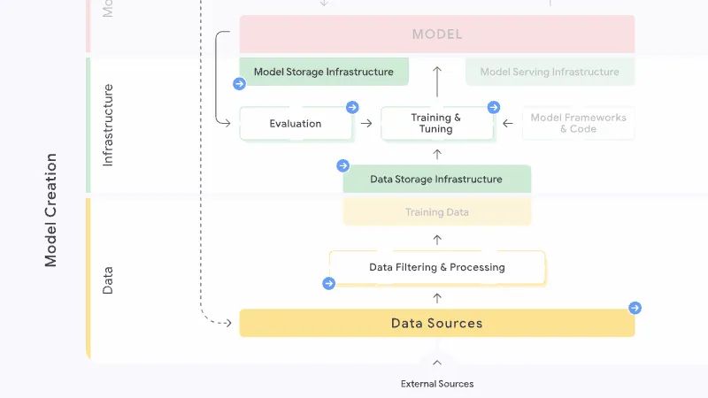

Data Poisoning poses a risk throughout the data lifecycle. Data can be poisoned before it is ingested, during processing or training, or while the data is in storage. This makes it a critical concern across all data handling systems.

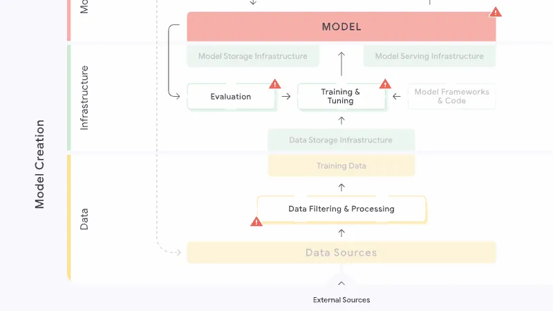

Data Poisoning is exposed during development in the data filtering and processing steps or the training, tuning, and evaluation stages. It’s also exposed in the model itself, when it produces inaccurate results, malicious outputs, or unexpected behavior.

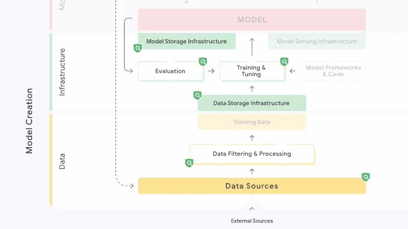

Proactive mitigation against Data Poisoning happens early in development. This includes data sanitization, secure systems and access controls, and mechanisms to ensure data and model integrity.

 

1

/

### Who can mitigate

Model Creators

Model Creators

### Controls

[Training Data Sanitization](./../../../secure-ai-framework/controls#training-data-sanitization), [Secure-by-Default ML Tooling](./../../../secure-ai-framework/controls#secure-by-default-ml-tooling), [Model and Data Integrity Management](./../../../secure-ai-framework/controls#model-and-data-integrity-management), [Model and Data Access Control](./../../../secure-ai-framework/controls#model-and-data-access-controls), [Model and Data Inventory Management](./../../../secure-ai-framework/controls#model-and-data-inventory-management)

[Training Data Sanitization](./../../../secure-ai-framework/controls#training-data-sanitization), [Secure-by-Default ML Tooling](./../../../secure-ai-framework/controls#secure-by-default-ml-tooling), [Model and Data Integrity Management](./../../../secure-ai-framework/controls#model-and-data-integrity-management), [Model and Data Access Control](./../../../secure-ai-framework/controls#model-and-data-access-controls), [Model and Data Inventory Management](./../../../secure-ai-framework/controls#model-and-data-inventory-management)

### Real examples

Researchers showed that they could [indirectly pollute popular data sources used for training models](https://arxiv.org/pdf/2302.10149) with minimal cost.

Researchers showed that they could [indirectly pollute popular data sources used for training models](https://arxiv.org/pdf/2302.10149) with minimal cost.

## Unauthorized Training Data

## Unauthorized Training Data

Training a model using data that is not authorized to be used for that model.

A model trained or fine tuned on unauthorized data could pose legal or ethical challenges. Unauthorized Training Data may include any data that violates policies, contracts, or regulations. Examples are user data that does not have appropriate user consent, unlicensed copyrighted data, or legally restricted data.

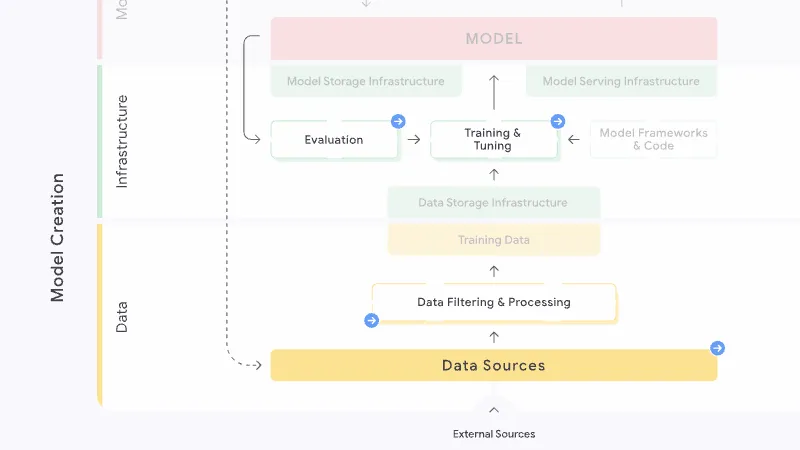

Unauthorized Training Data is introduced early in development if not properly filtered out during data ingestion, data processing, and model evaluation during training.

The risk is exposed during development, through data filtering and processing steps or training, tuning, and evaluation. It is also exposed during model use, when the model may produce inferences based on data it shouldn’t have access to.

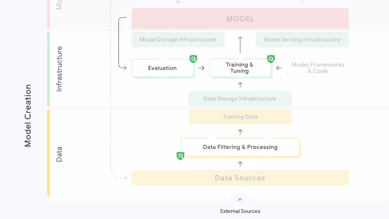

Mitigations for this risk start early, with careful data selection, filtering, and evaluation during training to catch any lingering issues.

 

1

/

### Who can mitigate

Model Creators

Model Creators

### Controls

[Training Data Sanitization](./../../../secure-ai-framework/controls#training-data-sanitization), [Training Data Management](./../../../secure-ai-framework/controls#training-data-management)

[Training Data Sanitization](./../../../secure-ai-framework/controls#training-data-sanitization), [Training Data Management](./../../../secure-ai-framework/controls#training-data-management)

### Real examples

In 2023, [Spotify removed multiple AI-generated tracks](https://aibusiness.com/ml/spotify-takes-down-thousands-of-ai-generated-tracks) that were generated by a model trained on unlicensed data.

In 2023, [Spotify removed multiple AI-generated tracks](https://aibusiness.com/ml/spotify-takes-down-thousands-of-ai-generated-tracks) that were generated by a model trained on unlicensed data.

## Model Source Tampering

## Model Source Tampering

Tampering with the model’s source code, dependencies, or weights, either by supply chain attacks or insider attacks.

Similar to tampering with traditional software code, Model Source Tampering can introduce vulnerabilities or unexpected behaviors.

Since model source code is used in the process of developing the model, code modifications can affect model behavior. As with traditional code, attacks on a dependency can affect the program that relies on that dependency, so the risks in this area are transitive, potentially through many layers of a model code’s dependency chain.

Another method of Model Source Tampering is model architecture backdoors, which are [backdoors embedded within the definition of the neural network architecture.](https://arxiv.org/pdf/2402.06957.pdf) Such backdoors can survive full retraining of a model.

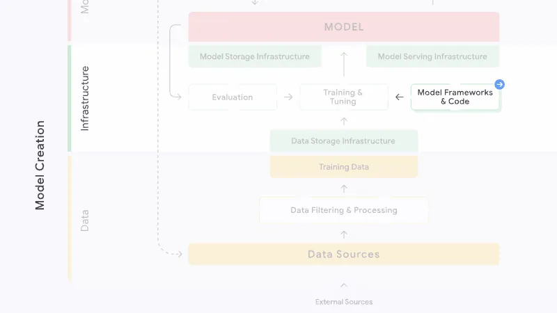

Model Source Tampering is a risk that’s introduced when model code, training frameworks, or model weights are not hardened against supply chain attacks and tampering.

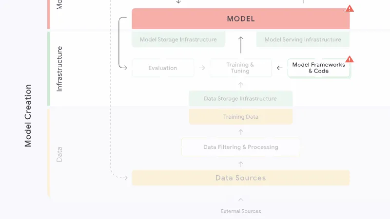

This risk is exposed in the model frameworks and code components, if the tampering is discovered at the source. Otherwise, the risk is exposed in the model, through its modified behavior during use.

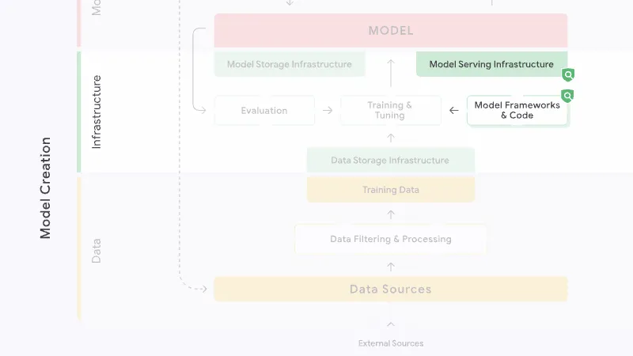

Safeguard against this risk by employing robust access controls and integrity management for model code and weights, comprehensive inventory tracking to monitor and verify models and code throughout systems, and secure-by-default infrastructure tools.

 

1

/

### Who can mitigate

Model Creators

Model Creators

### Controls

[Secure-by-Default ML Tooling](./../../../secure-ai-framework/controls#secure-by-default-ml-tooling), [Model and Data Integrity Management](./../../../secure-ai-framework/controls#model-and-data-integrity-management), [Model and Data Access Control](./../../../secure-ai-framework/controls#model-and-data-access-controls), [Model and Data Inventory Management](./../../../secure-ai-framework/controls#model-and-data-inventory-management)

[Secure-by-Default ML Tooling](./../../../secure-ai-framework/controls#secure-by-default-ml-tooling), [Model and Data Integrity Management](./../../../secure-ai-framework/controls#model-and-data-integrity-management), [Model and Data Access Control](./../../../secure-ai-framework/controls#model-and-data-access-controls), [Model and Data Inventory Management](./../../../secure-ai-framework/controls#model-and-data-inventory-management)

### Real examples

The nightly build of [PyTorch package was subjected to a supply chain attack](https://pytorch.org/blog/compromised-nightly-dependency/) (specifically, a dependency confusion attack that installed a compromised dependency that ran a malicious binary).

The nightly build of [PyTorch package was subjected to a supply chain attack](https://pytorch.org/blog/compromised-nightly-dependency/) (specifically, a dependency confusion attack that installed a compromised dependency that ran a malicious binary).

## Excessive Data Handling

## Excessive Data Handling

Collection, retention, processing, or sharing of user data beyond what is allowed by relevant policies.

Excessive Data Handling can create both policy and legal challenges.

In the context of models, user data might include user queries, text inputs and interactions, personalizations and preferences, and models derived from such data.

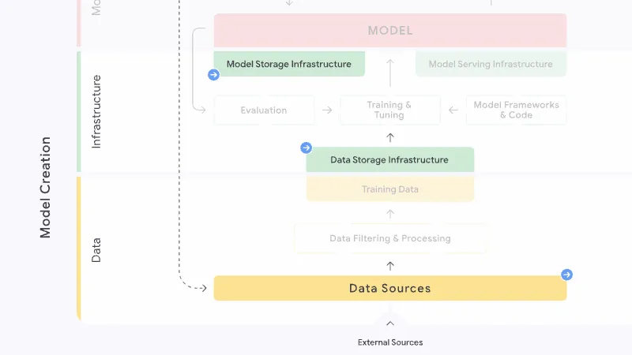

The risk of Excessive Data Handling is introduced when data sources lack proper metadata tagging for effective management or when model and data storage infrastructure isn't designed to address data lifecycle concerns.

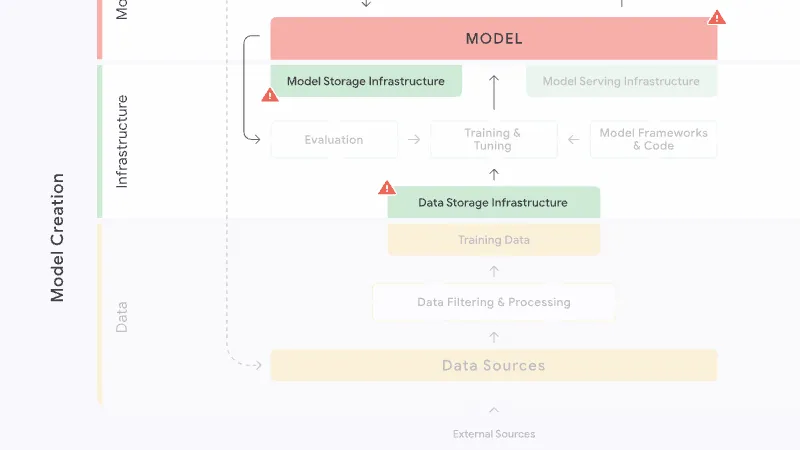

This risk is exposed in both the model and in storage components, leading to data retention or usage beyond permissible limits.

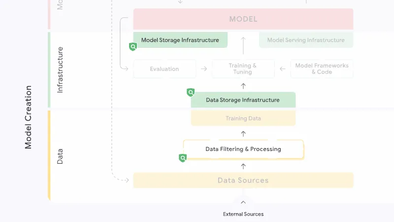

Mitigate this risk with data filtering and processing, along with automation for data archiving, deletion, or issuing alerts for models trained with outdated data.

 

1

/

### Who can mitigate

Model Creators

Model Creators

### Controls

[User Data Management](./../../../secure-ai-framework/controls#user-data-management)

[User Data Management](./../../../secure-ai-framework/controls#user-data-management)

### Real examples

[Samsung banned usage of ChatGPT](https://www.forbes.com/sites/siladityaray/2023/05/02/samsung-bans-chatgpt-and-other-chatbots-for-employees-after-sensitive-code-leak/) after discovering private code source has leaked via using it in GenAI prompts.

[Samsung banned usage of ChatGPT](https://www.forbes.com/sites/siladityaray/2023/05/02/samsung-bans-chatgpt-and-other-chatbots-for-employees-after-sensitive-code-leak/) after discovering private code source has leaked via using it in GenAI prompts.

## Model Exfiltration

## Model Exfiltration

Unauthorized appropriation of an AI model, for replicating functionality or to extract intellectual property.

Similar to stealing code, this threat has intellectual property, security, and privacy implications.

For example, someone could hack into a cloud environment and steal a generative AI model; the model size when serialized is fairly modest and not a major obstacle for this. Models, and related data such as weights, are also at risk of theft in the internal development, build, deployment, and production environments by insiders and external attackers that have taken over privileged insider accounts.

These risks also extend to on-device models, where an attacker has access to hardware.

This risk is distinct from the related [Model Reverse Engineering](./../../../secure-ai-framework/risks#model-reverse-engineering).

Model Exfiltration is introduced when storage or serving infrastructure lacks adequate security against attacks.

This risk is exposed if attackers target vulnerabilities in serving or storage systems to steal model code or weights.

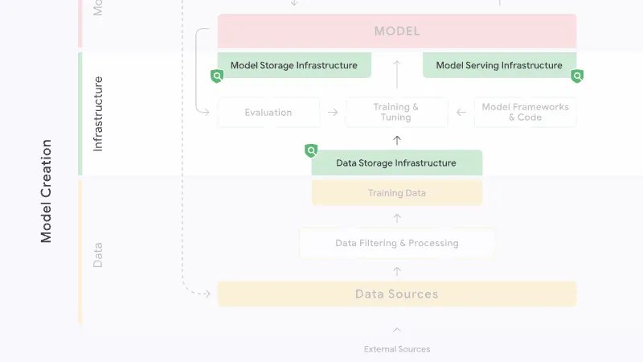

Mitigate this risk by hardening both storage and serving systems to prevent unauthorized access and protect against model theft.

 

1

/

### Who can mitigate

Model Creators, Model Consumers

Model Creators, Model Consumers

### Controls

[Model and Data Inventory Management](./../../../secure-ai-framework/controls#model-and-data-inventory-management), [Model and Data Access Control](./../../../secure-ai-framework/controls#model-and-data-access-controls), [Secure-by-Default ML Tooling](./../../../secure-ai-framework/controls#secure-by-default-ml-tooling)

[Model and Data Inventory Management](./../../../secure-ai-framework/controls#model-and-data-inventory-management), [Model and Data Access Control](./../../../secure-ai-framework/controls#model-and-data-access-controls), [Secure-by-Default ML Tooling](./../../../secure-ai-framework/controls#secure-by-default-ml-tooling)

### Real examples

[Meta's Llama model was leaked online](https://www.theverge.com/2023/3/8/23629362/meta-ai-language-model-llama-leak-online-misuse), bypassing Meta's license acceptance review process.

[Meta's Llama model was leaked online](https://www.theverge.com/2023/3/8/23629362/meta-ai-language-model-llama-leak-online-misuse), bypassing Meta's license acceptance review process.

## Model Deployment Tampering

## Model Deployment Tampering

Unauthorized modification of components used for deploying a model, whether by tampering with the source code supply chain or exploiting known vulnerabilities in common tools.

Such modifications can result in changes to model behavior.

One type of Model Deployment Tampering is candidate model modification where the attacker is modifying the deployment workflow or processes to maliciously alter the way the model operates post-deployment.

A second type is compromise of the model serving infrastructure. For example, it was reported that [PyTorch models were vulnerable to remote code execution](https://thehackernews.com/2023/10/warning-pytorch-models-vulnerable-to.html) due to multiple critical security flaws in the **TorchServe** tool that is widely used for serving the models. This is an attack on a serving infrastructure for PyTorch, TorchServe, whereas the [PyTorch example of Model Source Tampering](https://pytorch.org/blog/compromised-nightly-dependency/) was about a supply chain attack on dependency code for PyTorch itself.

The risk of Model Deployment Tampering is introduced within the model serving components, specifically when the serving infrastructure is vulnerable to manipulation.

This risk is exposed if attackers tamper with production models within the model serving component.

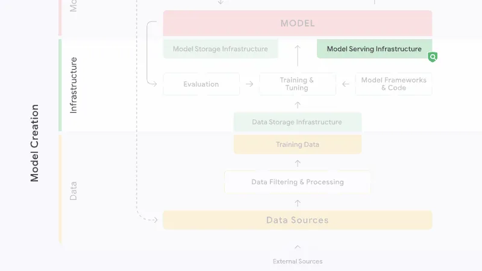

Mitigation focuses on hardening the model serving infrastructure with with secure-by-default tooling.

 

1

/

### Who can mitigate

Model Creators, Model Consumers

Model Creators, Model Consumers

### Controls

[Secure-by-Default ML Tooling](./../../../secure-ai-framework/controls#secure-by-default-ml-tooling)

[Secure-by-Default ML Tooling](./../../../secure-ai-framework/controls#secure-by-default-ml-tooling)

### Real examples

[Researchers discovered that models on HuggingFace were using a shared infrastructure for inference](https://www.wiz.io/blog/wiz-and-hugging-face-address-risks-to-ai-infrastructure#what-did-we-find-11), which allowed a malicious model to tamper with any other model.

[Researchers discovered that models on HuggingFace were using a shared infrastructure for inference](https://www.wiz.io/blog/wiz-and-hugging-face-address-risks-to-ai-infrastructure#what-did-we-find-11), which allowed a malicious model to tamper with any other model.

## Denial of ML Service

## Denial of ML Service

Reducing the availability of ML systems and denying service by issuing queries that take too many resources.

Examples of attacks include traditional Denial of Service or spamming a system with abusive material to overload automated or manual review processes. If an API-gated model does not have appropriate rate limiting or load balancing, the repeated queries can take the model offline, making it unavailable to other users.

There are also [energy-latency attacks](https://arxiv.org/pdf/2006.03463.pdf): attackers can carefully craft “sponge examples” (also known as queries of death), which are inputs designed to maximize energy consumption and latency, pushing ML systems towards their worst-case performance. Adversaries might use their own tools to accelerate construction of such sponge examples. These attacks are especially relevant for on-device models, since the increased energy consumption can drain batteries and make the model unavailable.

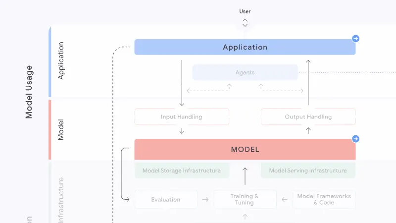

The risk of Denial of ML Service arises in the application component when a model is exposed to excessive access. Additionally, some types of Denial of ML Service (such as energy-latency attacks) stem from the fundamental functioning of the model itself.

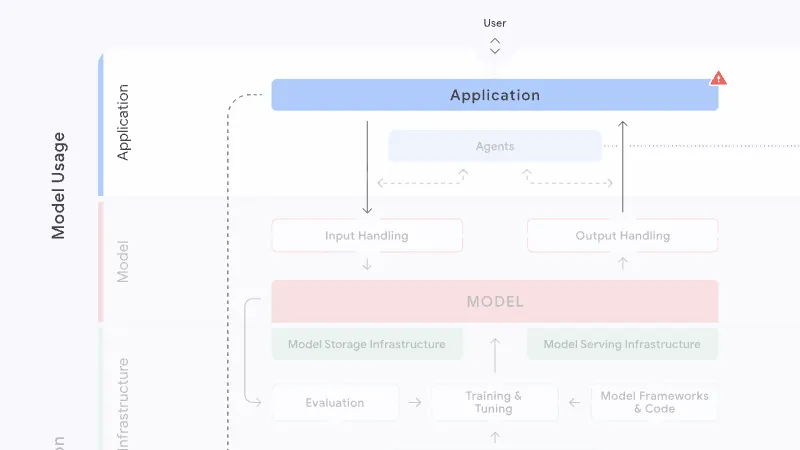

This risk is exposed during application use, when attackers either overwhelm the model with excessive calls or use carefully crafted "sponge examples" that take advantage of model weaknesses to degrade performance.

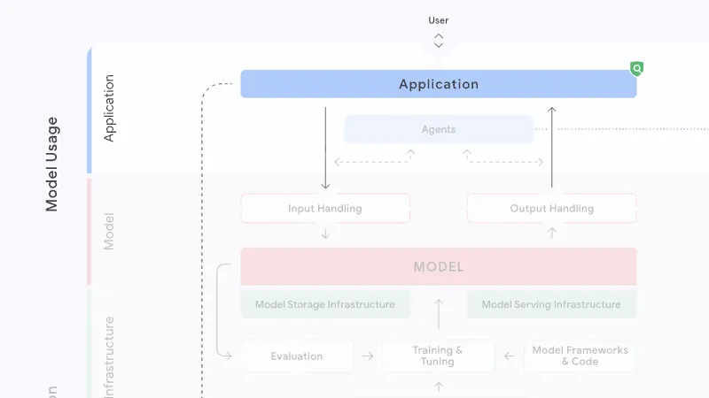

Mitigation occurs at the application level, using input filtering and employing rate limiting and load balancing to control the volume of calls to the model.

 

1

/

### Who can mitigate

Model Consumers

Model Consumers

### Controls

[Application Access Management](./../../../secure-ai-framework/controls#application-access-management)

[Application Access Management](./../../../secure-ai-framework/controls#application-access-management)

### Real examples

Researchers have proven how slight perturbation to images [can cause denial of service on object detection models](https://arxiv.org/pdf/2205.13618).

Researchers have proven how slight perturbation to images [can cause denial of service on object detection models](https://arxiv.org/pdf/2205.13618).

## Model Reverse Engineering

## Model Reverse Engineering

Cloning or recreating a model by analyzing a model's inputs, outputs, and behaviors.

The stolen or cloned model can be used for building imitation products or developing [adversarial attacks](https://arxiv.org/pdf/2004.15015) on the original model.

If a model API does not have rate limits, one method of Model Reverse Engineering is repeatedly calling the API to gather responses in order to create a dataset of thousands of input/output pairs from a target LLM. This dataset can be leveraged to reconstruct a copycat or distilled model more cheaply than developing the original foundation model.

These risks also extend to on-device models, where an attacker has access to hardware. See also [Model Exfiltration](./../../../secure-ai-framework/risks#model-exfiltration).

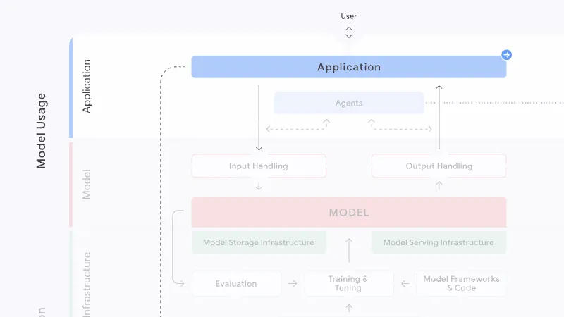

The risk of Model Reverse Engineering arises within the application component when excessive access to the model is granted for queries.

This risk is exposed if attackers send excessive queries to the model and leverage the responses to reverse engineer its weights.

Mitigate this risk with rate limiting within the application API or using other protective measures at the application level to prevent excessive model access.

 

1

/

### Who can mitigate

Model Consumers

Model Consumers

### Controls

[Application Access Management](./../../../secure-ai-framework/controls#application-access-management)

[Application Access Management](./../../../secure-ai-framework/controls#application-access-management)

### Real examples

A Stanford University research team created [Alpaca 7B](https://crfm.stanford.edu/2023/03/13/alpaca.html), a model fine-tuned from the LLaMA 7B model based on 52,000 instruction-following examples.

A Stanford University research team created [Alpaca 7B](https://crfm.stanford.edu/2023/03/13/alpaca.html), a model fine-tuned from the LLaMA 7B model based on 52,000 instruction-following examples.

## Insecure Integrated Component

## Insecure Integrated Component

Vulnerabilities in software interacting with AI models, such as a plugin, library, or application, that can be leveraged by attackers to gain unauthorized access to models, introduce malicious code, or compromise system operations.

Given the level of autonomy expected to be granted to agents and applications, insecure integrated components represent a broad swath of threats to user trust and safety, privacy and security concerns, and ethical and legal challenges.

This risk can come from manipulation of both inputs to and outputs from integrations:

* Manipulation of **model output** to include malicious instructions fed as **input to the integrated component or system**. For example, a plugin that accepts freeform text instead of structured and validated input could be exploited to construct inputs that cause the plugin to behave maliciously. Likewise, a plugin that accepts input without authentication and authorization can be exploited since it trusts input as coming from an authorized user.
* Manipulation of the **output from an integrated component or system** that is fed as **input to a model.** For example, when a plugin calls other systems, especially 3rd party services, sites, or plugins, and uses content obtained from those to construct output to a model, opening up potential for indirect prompt injection. A similar case exists for an integrated application that calls another service and uses content from that service to construct an input to a model.

Insecure Integrated Component is related to [Prompt Injection](./../../../secure-ai-framework/risks#prompt-injection) but these are different. Although attacks exploiting an Insecure Integrated Component often involve prompt injection, those could be also done via other means such as Poisoning and Evasion. In addition, prompt injection is possible even when the integrated components are secure.

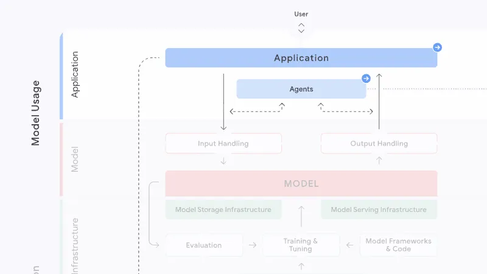

The risk of Insecure Integrated Components is introduced in the application and agent components, specifically through integrations that permit manipulation of inputs or outputs.

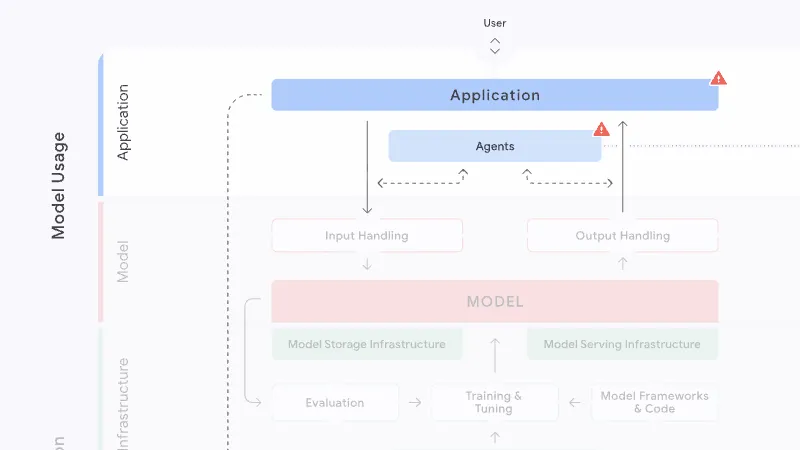

This risk is exposed within the application or agent components, if attackers exploit the security vulnerability to gain unauthorized model access, insert malicious code, or compromise systems.

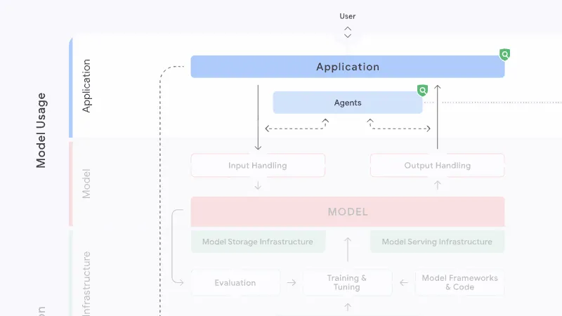

Mitigate this risk by addressing vulnerabilities directly within the application and agent components, and by enforcing strict permissions for agents and plugins.

 

1

/

### Who can mitigate

Model Consumers

Model Consumers

### Controls

[Agent Permissions](./../../../secure-ai-framework/controls#agent-permissions)

[Agent Permissions](./../../../secure-ai-framework/controls#agent-permissions)

### Real examples

By uploading a malicious Alexa skill / Google action (plugins), [attackers were able to eavesdrop on user conversations](https://www.theverge.com/2019/10/21/20924886/alexa-google-home-security-vulnerability-srlabs-phishing-eavesdropping) that occurred near Alexa / Google Home devices.

By uploading a malicious Alexa skill / Google action (plugins), [attackers were able to eavesdrop on user conversations](https://www.theverge.com/2019/10/21/20924886/alexa-google-home-security-vulnerability-srlabs-phishing-eavesdropping) that occurred near Alexa / Google Home devices.

## Prompt Injection

## Prompt Injection

Causing a model to execute commands “injected” inside a prompt.

Prompt Injection takes advantage of the blurry boundary between “instructions” and “input data” in a prompt, resulting in a change to the model’s behavior. These attacks can be both direct (entered directly by the user) or indirect (read from other sources such as a doc, email, or website).

[Jailbreaks](https://arxiv.org/pdf/2307.02483.pdf) are one type of Prompt Injection attack, causing the model to behave in ways that they’ve been trained to avoid, such as outputting unsafe content or leaking personally identifiable information. These are well-known vulnerabilities such as "ignore your previous instructions" or “Do Anything Now” (DAN).

Aside from jailbreaks, [Prompt Injections](https://arxiv.org/pdf/2302.12173.pdf) generally cause the LLM to execute malicious “injected” instructions as part of data that were not meant to be executed by the LLM. The blast radius of such attacks can become much bigger in the presence of other risks such as [Insecure Integrated Component](./../../../secure-ai-framework/risks#insecure-integrated-component) and [Rogue Actions](./../../../secure-ai-framework/risks#rogue-actions).

With foundation models becoming multi-modal, multi-modal prompt injection has also become possible. These attacks use injection inputs other than text to trigger the intended model behavior.

Prompt Injection is an inherent risk in AI models, because of the potential confusion between instructions and input data.

This risk is exposed during model usage, specifically within the model input handling and model components. Attackers may inject commands within prompts, potentially causing unintended model actions.

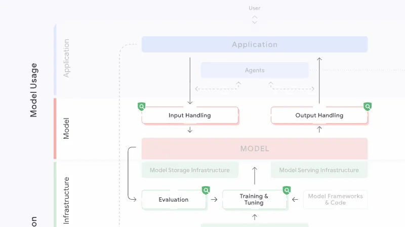

Mitigation involves robust filtering and processing of inputs and outputs. Additionally, thorough training, tuning, and evaluation processes help fortify the model against prompt injection attacks.

 

1

/

### Who can mitigate

Model Creators, Model Consumers

Model Creators, Model Consumers

### Controls

[Input Validation and Sanitization](./../../../secure-ai-framework/controls#input-validation-and-sanitization), [Adversarial Training and Testing](./../../../secure-ai-framework/controls#adversarial-training-and-testing), [Output Validation and Sanitization](./../../../secure-ai-framework/controls#output-validation-and-sanitization)

[Input Validation and Sanitization](./../../../secure-ai-framework/controls#input-validation-and-sanitization), [Adversarial Training and Testing](./../../../secure-ai-framework/controls#adversarial-training-and-testing), [Output Validation and Sanitization](./../../../secure-ai-framework/controls#output-validation-and-sanitization)

### Real examples

An example of indirect Prompt Injection was performed by [planting malicious data inside a resource fed into the LLM’s prompt](https://arxiv.org/pdf/2302.12173). In another example, a [multi-modal prompt injection image attacks against GPT-4V](https://simonwillison.net/2023/Oct/14/multi-modal-prompt-injection/) showed that images can contain text that triggers a Prompt Injection attack when the model is asked to describe the image.

An example of indirect Prompt Injection was performed by [planting malicious data inside a resource fed into the LLM’s prompt](https://arxiv.org/pdf/2302.12173). In another example, a [multi-modal prompt injection image attacks against GPT-4V](https://simonwillison.net/2023/Oct/14/multi-modal-prompt-injection/) showed that images can contain text that triggers a Prompt Injection attack when the model is asked to describe the image.

## Model Evasion

## Model Evasion

Causing a model to produce incorrect inferences by slightly perturbing the prompt input.

Model Evasion can result in reputational or legal challenges and trigger other downstream risks, such as to security or privacy systems.

A classic example is placing stickers on a stop sign to obscure the visual inputs to model piloting a self-driving car. Because of the change to the typical visual presentation of the sign, the model might not correctly infer its presence. Similarly, normal wear and tear on a stop sign could lead to misidentification if the model is not trained on images of signs in varying degrees of disrepair.

In some cases, an attacker might gain clues about how to perturb inputs by discovering the underlying foundation model’s family, i.e., by knowing the particular architecture and evolution of a specific model. In other situations, an attacker might repeatedly probe the model (see [Model Reverse Engineering](./../../../secure-ai-framework/risks#model-reverse-engineering)) to figure out inference patterns in order to craft examples that evade those inferences. Adversarial examples might be constructed by perturbations to inputs that will provide the output the attacker wants while looking unaltered otherwise. This could be used, for example, for evading a classifier that serves as an important safeguard.

Not all examples of model evasion attacks are necessarily visible to the naked eye. The inputs might be perturbed in such a way to appear unaltered, but still produce the output the attacker wants. For example, a homoglyph attack involves slight changes to typefaces that the human eye doesn’t perceive as a different letter, but could trigger unexpected inferences in the mode. Another example could be sending an image in the prompt but using steganography to encode text within the image pixels. This text would be part of the prompt for the LLM, but the user won’t see it.

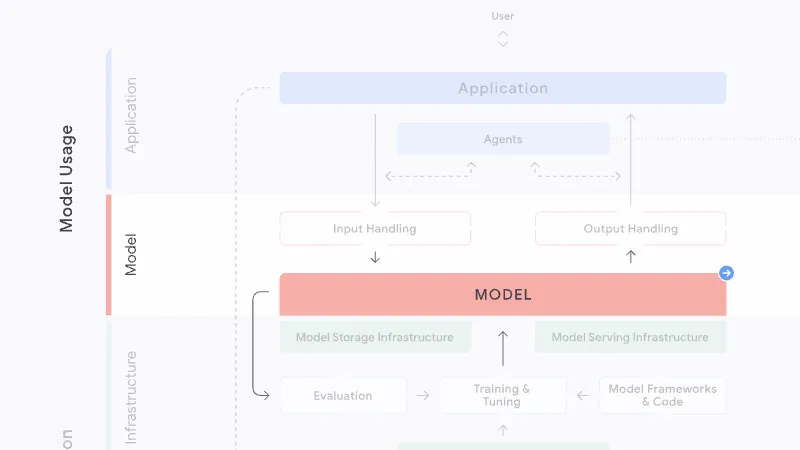

Model Evasion is an inherent risk in AI models, as their core functionality relies on distinguishing between inputs to trigger specific inferences.

This risk is exposed within the model component itself during its usage.

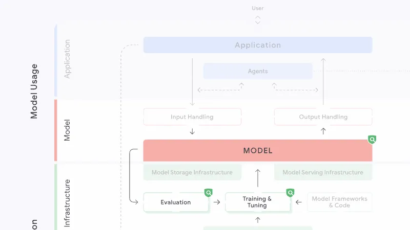

Mitigation occurs in the training, tuning, and evaluation phases, where robust models can be developed using extensive and diverse data to better withstand such attacks.

 

1

/

### Who can mitigate

Model Creators, Model Consumers

Model Creators, Model Consumers

### Controls

[Adversarial Training and Testing](./../../../secure-ai-framework/controls#adversarial-training-and-testing)

[Adversarial Training and Testing](./../../../secure-ai-framework/controls#adversarial-training-and-testing)

### Real examples

Adversarial images have been used to [modify street signs to confuse self-driving cars](https://spectrum.ieee.org/slight-street-sign-modifications-can-fool-machine-learning-algorithms).

Adversarial images have been used to [modify street signs to confuse self-driving cars](https://spectrum.ieee.org/slight-street-sign-modifications-can-fool-machine-learning-algorithms).

## Sensitive Data Disclosure

## Sensitive Data Disclosure

Disclosure of private or confidential data through querying of the model or agent.

For non-agentic systems, this data might include memorized training/tuning data, user chat history, and confidential data in the prompt preamble. Agentic systems magnify this risk, as they may be granted privileged access to a user's email, files, or even an entire computer, creating the potential to exfiltrate vast amounts of personal or corporate data like source code and internal documents. Sensitive data disclosure is a risk to user privacy, organizational reputation, and intellectual property.

Sensitive information is generally disclosed in two ways: leakage of data provided to the model or agent during use (such as user input and data that passes through integrated systems, like emails, texts, or system prompts) and leakage of data used for training and tuning of the model.

* **Models**: Models can leak sensitive data in two primary ways: from the information provided by the user and from the data used for the model's own training. Similar to how a leaked web query can reveal user information, LLM prompts risk data leakage at time of use, a threat that is heightened because prompts often contain confidential data like entire emails or blocks of proprietary code. This exposure can occur through several vectors: application logs may store entire interactions, including data retrieved from integrated tools, and user conversations may be retained for model retraining, creating a vulnerable database of sensitive information. Beyond leaking user-provided data, attackers can actively [steal system instructions through iterative queries](https://arxiv.org/abs/2307.06865), or a model may inadvertently leak the data it was trained on. This phenomenon, known as memorization, occurs when a model reveals parts of its training dataset, potentially exposing sensitive information like names, addresses, or other personally identifiable information (PII).
* **Agents**: For agentic systems, the risk of sensitive data disclosure is exponentially multiplied, since agents may access user data that passes through integrated systems, like emails, texts, or proprietary organizational information. In extreme cases, agents can even reveal credentials and API keys they have been trusted with. Additionally, agents may use tools to not only access sensitive data on behalf of the user, but also use those tools to leak sensitive data. For example, an agent can leak information by creating and sharing a document with an attacker, writing an email, opening a website and leaking information in the URL [or a markdown image](https://www.aim.security/aim-labs/aim-labs-echoleak-blogpost), or through any tool that allows it to pass information to the outside world. [Context-hijacking attacks](https://arxiv.org/abs/2405.05175) show that an adversary can confuse the agent to reveal data that is not appropriate for a specific context, such as sharing health history when the agent should be booking a restaurant reservation.

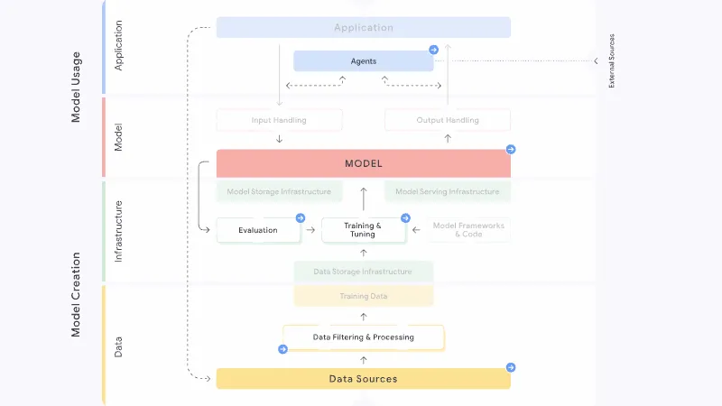

The risk of Sensitive Data Disclosure is introduced in several components. It can also be inherent to models due to their non-deterministic nature. This risk is amplified by data handling practices that fail to filter sensitive information, or by training processes that neglect to evaluate the model's potential for disclosure. In agentic contexts, the risk is introduced when an agent uses its privileged access and integrated tools to disclose sensitive information from a user's emails, files, or other connected systems.

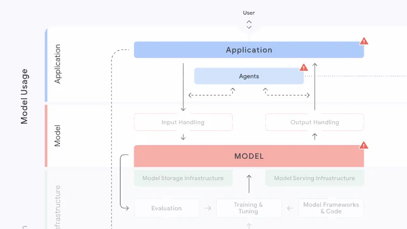

This risk is exposed within the application, when the model inadvertently reveals sensitive data it shouldn't. In agentic systems, the risk is magnified when an agent uses its privileged access and integrated tools to reveal sensitive data in interactions with a third party.

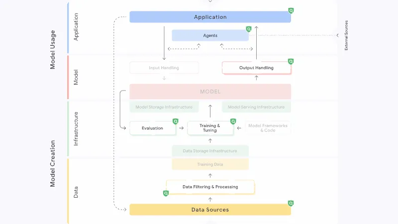

Mitigate sensitive data disclosure by: filtering model outputs, rigorously testing the model during training, tuning, and evaluation, and removing or labeling sensitive data during sourcing, filtering, and processing before it's used for training. For agents, implement controls at multiple levels of the system, including enforcing permissions on the agent’s access to tools and sensitive data, safely rendering agent outputs, and using application-level warnings to get user confirmation before executing actions that may disclose sensitive information.

 

1

/

### Who can mitigate

Model Creators, Model Consumers

Model Creators, Model Consumers

### Controls

[Privacy Enhancing Technologies](./../../../secure-ai-framework/controls#privacy-enhancing-technologies), [User Data Management](./../../../secure-ai-framework/controls#user-data-management), [Output Validation and Sanitization](./../../../secure-ai-framework/controls#output-validation-and-sanitization), [Agent Permissions](./../../../secure-ai-framework/controls#agent-permissions), [Agent User Control](./../../../secure-ai-framework/controls#agent-user-control), [Agent Observability](./../../../secure-ai-framework/controls#agent-observability)

[Privacy Enhancing Technologies](./../../../secure-ai-framework/controls#privacy-enhancing-technologies), [User Data Management](./../../../secure-ai-framework/controls#user-data-management), [Output Validation and Sanitization](./../../../secure-ai-framework/controls#output-validation-and-sanitization), [Agent Permissions](./../../../secure-ai-framework/controls#agent-permissions), [Agent User Control](./../../../secure-ai-framework/controls#agent-user-control), [Agent Observability](./../../../secure-ai-framework/controls#agent-observability)

### Real examples

One study showed that [recitation checkers that scan for verbatim repetition of training data](https://arxiv.org/pdf/2210.17546) may be insufficient.
  
  
An example of [membership inference attacks](https://arxiv.org/pdf/1610.05820.pdf) showed the possibility of inferring whether a specific user or data point was used to train or tune the model.

One study showed that [recitation checkers that scan for verbatim repetition of training data](https://arxiv.org/pdf/2210.17546) may be insufficient.  
  
An example of [membership inference attacks](https://arxiv.org/pdf/1610.05820.pdf) showed the possibility of inferring whether a specific user or data point was used to train or tune the model.

## Inferred Sensitive Data

## Inferred Sensitive Data

Models inferring sensitive information about people that is not contained in the model’s training data.

Inferred information that turns out to be true, even if produced as part of a hallucination, can be considered a data privacy incident, whereas the same information when false would be treated as a factuality issue.

For example, a model may be able to infer information about people (gender, political affiliation, or sexual orientation) based on their inputs and responses from integrated plugins, such as a social media plugin that accesses a public account’s liked pages or followed accounts. Though the data used for inference may be public, this type of inference poses two related risks: that a user may be alarmed if a model infers sensitive data about them, and that one user may use a model to infer sensitive data about someone *else.*

This risk differs from [Sensitive Data Disclosure](./../../../secure-ai-framework/risks#sensitive-data-disclosure) which involves sensitive data specifically from training, tuning or prompt data.

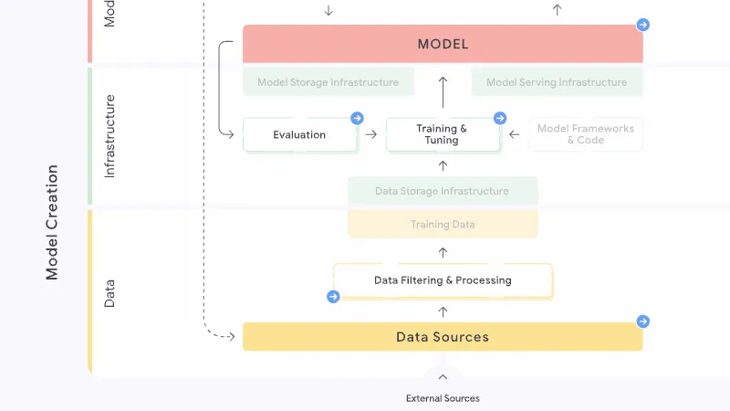

The risk of Inferred Sensitive Data is introduced in several components. It's inherent to models due to their non-deterministic nature and is amplified by inadequate data handling practices that fail to filter sensitive information. It can also be due to training processes that neglect to evaluate the model's potential for sensitive inferences.

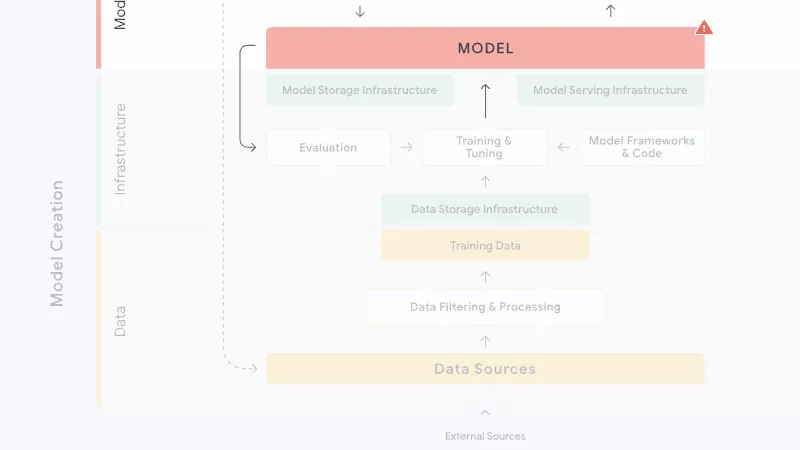

This risk is exposed within the model when it generates a response containing inferred sensitive data that it shouldn't.

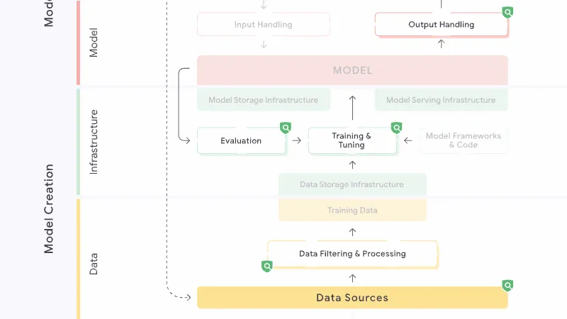

Mitigation is multi-pronged: filtering model outputs to prevent revealing inferred sensitive data, rigorously testing the model during training, tuning, and evaluation to prevent sensitive inferences, and proactively removing or labeling data that could lead to such inferences during sourcing, filtering, and processing before training.

 

1

/

### Who can mitigate

Model Creators, Model Consumers

Model Creators, Model Consumers

### Controls

[Training Data Management](./../../../secure-ai-framework/controls#training-data-management), [Output Validation and Sanitization](./../../../secure-ai-framework/controls#output-validation-and-sanitization)

[Training Data Management](./../../../secure-ai-framework/controls#training-data-management), [Output Validation and Sanitization](./../../../secure-ai-framework/controls#output-validation-and-sanitization)

### Real examples

Examples include papers on [AI inferences about sexual orientation](https://osf.io/preprints/psyarxiv/hv28a) or [criminal record from faces](https://confilegal.com/wp-content/uploads/2016/11/ESTUDIO-UNIVERSIDAD-DE-JIAO-TONG-SHANGHAI.pdf).

Examples include papers on [AI inferences about sexual orientation](https://osf.io/preprints/psyarxiv/hv28a) or [criminal record from faces](https://confilegal.com/wp-content/uploads/2016/11/ESTUDIO-UNIVERSIDAD-DE-JIAO-TONG-SHANGHAI.pdf).

## Insecure Model Output

## Insecure Model Output

Model output that is not appropriately validated, rewritten, or formatted before being passed to downstream systems or the user.

Whether accidentally triggered or actively exploited, Insecure Model Output poses risks to organizational reputation, security, and user safety.

For example, a user who asks an LLM to generate an email for their business’s promotion would be harmed if the model produces text that unexpectedly includes a link to a URL that delivers malware. Alternatively, a malicious actor could intentionally trigger insecure content, such as requesting the LLM to produce a phishing email based on specific details about the target.

The risk of Insecure Model Output is inherent to AI models due to their non-deterministic nature, which can lead to unexpected and potentially harmful outputs.

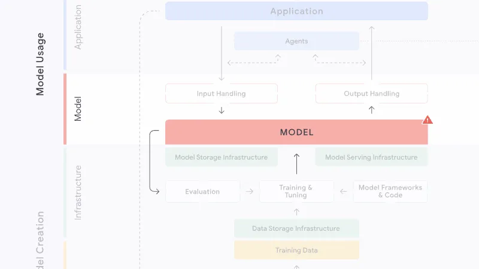

This risk is exposed within the model itself during usage, either through accidental triggers or deliberate exploitation.

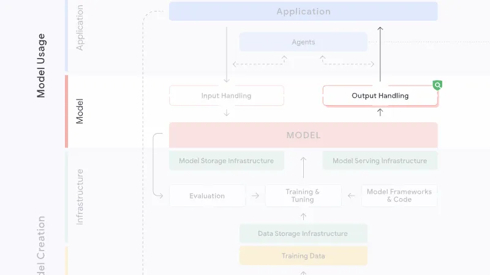

Mitigation includes robust model validation and sanitization processes within the model output handling component to screen and filter for insecure responses.

 

1

/

### Who can mitigate

Model Consumers

Model Consumers

### Controls

[Output Validation and Sanitization](./../../../secure-ai-framework/controls#output-validation-and-sanitization)

[Output Validation and Sanitization](./../../../secure-ai-framework/controls#output-validation-and-sanitization)

### Real examples

[Attackers can compromise users by creating fake malicious packages with names inspired by LLM hallucinations](https://www.theregister.com/2024/03/28/ai_bots_hallucinate_software_packages/).

[Attackers can compromise users by creating fake malicious packages with names inspired by LLM hallucinations](https://www.theregister.com/2024/03/28/ai_bots_hallucinate_software_packages/).

## Rogue Actions

## Rogue Actions

Unintended actions executed by a model-based agent, whether accidental or malicious. Given the projected ability for advanced generative AI models to not only understand their environment, but also to initiate actions with varying levels of autonomy, Rogue Actions have the potential to become a serious risk to organizational reputation, user trust, security, and safety.

* Accidental rogue actions: This risk, sometimes known as misalignment, could be due to mistakes in task planning, reasoning, or environment sensing, and might be exacerbated by the inherent variability in LLM responses. Prompt engineering shows the spacing and ordering of examples can have a significant impact on the response, so varying input (even when not maliciously planted) could result in unexpected outcomes. [Even simple ambiguity](https://www.arxiv.org/abs/2506.12241) can cause rogue actions, such as an agent emailing the wrong "Mike," unintentionally sharing private data.
* Malicious rogue actions: This risk could include manipulating model output using attacks such as indirect prompt injection, poisoning, or evasion. The threat can be amplified in multi-agent systems, where the attacker can [hijack the communication between two agents](https://arxiv.org/pdf/2503.12188) to execute arbitrary malicious code, even if the individual agents are secured against direct attacks. Malicious actions may also be asynchronous. An attacker can plant a dormant "named trigger" that activates later during an unrelated task—for instance, a rule hidden [in a calendar invite](https://www.wired.com/story/google-gemini-calendar-invite-hijack-smart-home/) that opens the front door whenever the user says an unrelated keyword. Other actions may be time-based, occurring after a set number of interactions, making the rogue action appear spontaneous and disconnected from the malicious source.

Rogue Actions are related to [Insecure Integrated Components](./../../../secure-ai-framework/risks#insecure-integrated-component), but differ by the degree of model functionality or agency. The severity of a rogue action is directly proportional to the agent's capabilities, and the possibility that an agent has excessive functionality or permissions available to it increases the risk and blast radius of Rogue Actions when compared to Insecure Integrated Components.

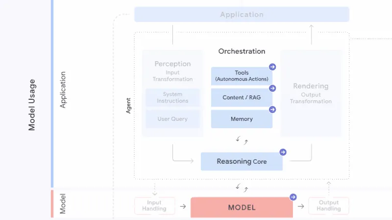

Integrating agents into an AI system introduces the risk of Rogue Actions by dramatically expanding the model's ability to trigger real-world actions and consequences. This risk is introduced through a failure of the reasoning core to align with the user’s intent, or through the poisoning of orchestration components like tools, memory, and retrieved data.

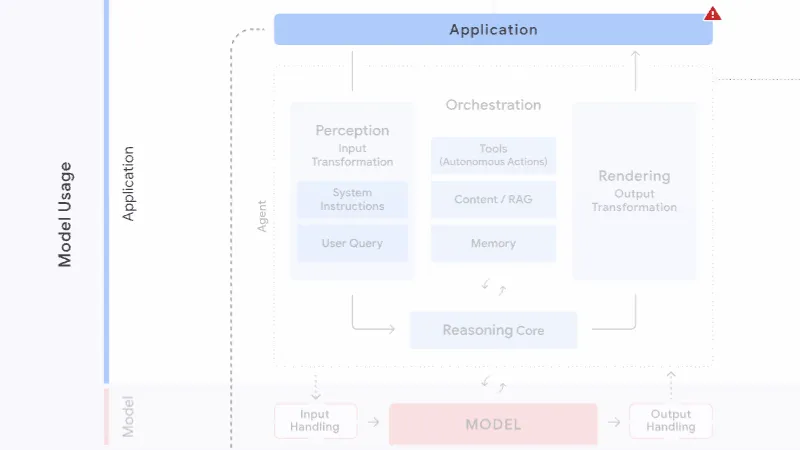

This vulnerability is exposed during application usage when the model inadvertently triggers an unintended action.

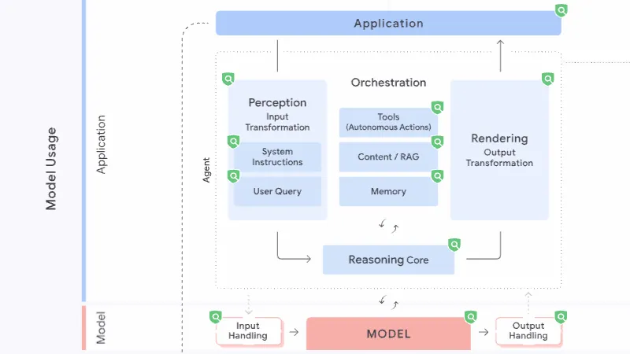

Mitigating Rogue Actions requires a multi-layered defense, starting with filtering and standardizing all inputs before they reach the model and defining tool limitations in the agent’s system instructions. Harden the reasoning core and model themselves with adversarial training to recognize prompt injection. Within orchestration, govern the agent’s capabilities with observability, policy engines, and credentialed tool access, implementing contextual agent security. Finally, normalize and sanitize outputs during rendering, and implement user-facing notifications and other safeguards tailored to the specific application or platform to prevent exploitation.

 

1

/

### Who can mitigate

Model Consumers

Model Consumers

### Controls

[Agent Permissions](./../../../secure-ai-framework/controls#agent-permissions), [Agent User Control](./../../../secure-ai-framework/controls#agent-user-control), [Agent Observability](./../../../secure-ai-framework/controls#agent-observability), [Output Validation and Sanitization](./../../../secure-ai-framework/controls#output-validation-and-sanitization)

[Agent Permissions](./../../../secure-ai-framework/controls#agent-permissions), [Agent User Control](./../../../secure-ai-framework/controls#agent-user-control), [Agent Observability](./../../../secure-ai-framework/controls#agent-observability), [Output Validation and Sanitization](./../../../secure-ai-framework/controls#output-validation-and-sanitization)

### Real examples

An attack on ChatGPT plugins was described in [Plugin Vulnerabilities: Visit a Website and Have Your Source Code Stolen](https://embracethered.com/blog/posts/2023/chatgpt-plugin-vulns-chat-with-code/).

An attack on ChatGPT plugins was described in [Plugin Vulnerabilities: Visit a Website and Have Your Source Code Stolen](https://embracethered.com/blog/posts/2023/chatgpt-plugin-vulns-chat-with-code/).

* 
