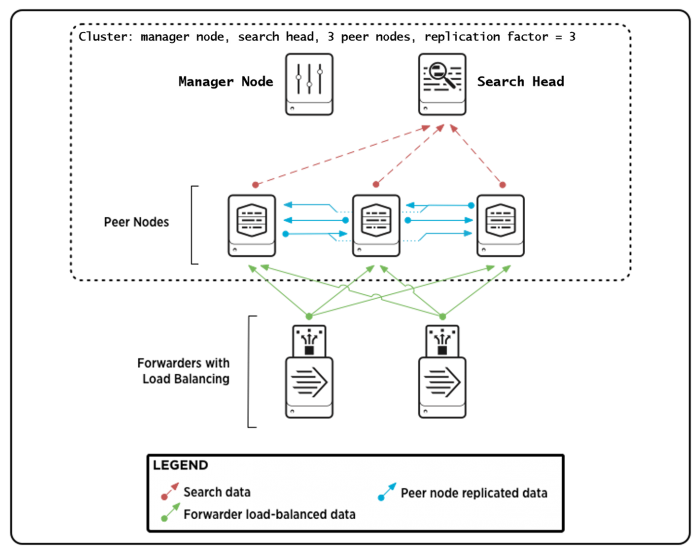
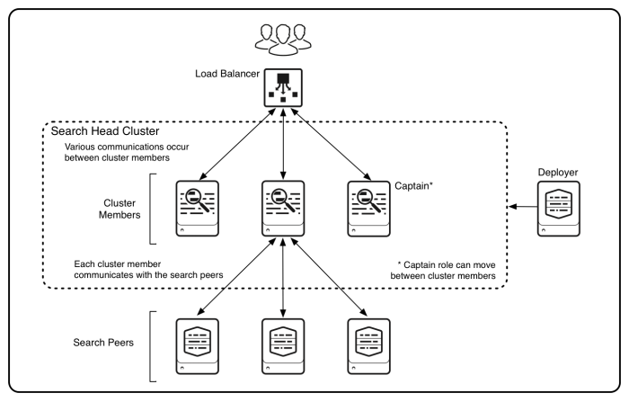
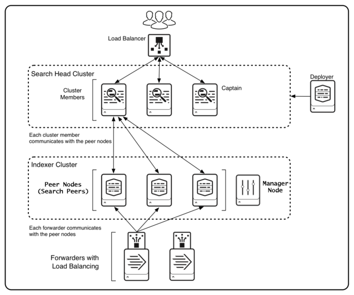

# Source Snapshot: Deployment topologies | Splunk Enterprise

- **Accessed:** 2026-10-19
- **Type:** official documentation
- **URL:** https://help.splunk.com/en/splunk-enterprise/administer/inherit-a-splunk-deployment/10.4/inherited-deployment-tasks/deployment-topologies
- **Author / publisher:** Splunk (Splunk Help portal, Splunk Enterprise 10.4)
- **Published / updated:** last updated 2026-05-09 (page title metadata)
- **Capture method:** fetched with `curl` on 2026-10-19; the page's main content (`<main>` element, without scripts, navigation, header, and footer) was converted from HTML to Markdown with `markdownify`. 

---

# Deployment topologies

To support a department-sized environment, you might need only a single Splunk Enterprise instance, running on a single machine.

To support larger environments, however, where data originates on many machines and where many users need to search the data, you can scale the deployment by distributing multiple Splunk Enterprise instances across multiple machines, each instance configured to perform a specialized task.

The purpose of this topic, and the topics that immediately follow it, is to help you to determine what role each of the Splunk Enterprise instances in your current deployment performs. If you already have that information, or if your deployment consists of just a single instance, you can skip these topics.

This topic provides an overview of Splunk Enterprise deployments, with a description of the types of topologies and components that a deployment can include. It then outlines procedures that you can use to discover the specifics of your inherited deployment.

## Intended audience

The topology discovery processes, described in this topic and the topics that follow it, are intended for system administrators with little or no Splunk Enterprise experience.

The path to discovery, in its most basic form, requires only a few simple system tools, such as a file browser and a text editor.

There is also an alternative discovery process that uses the Splunk Enterprise monitoring console. The monitoring console provides a graphical overview of your deployment and is readily usable by new Splunk Enterprise administrators. However, its use as a discovery tool requires that the previous Splunk Enterprise administrator already configured it.

Experienced Splunk Enterprise administrators might prefer to use various Splunk-specific tools and methods, such as CLI commands, searches, inspection of log files, and so on, to perform the discovery process more quickly. These methods all require some prior experience with Splunk Enterprise, so they are not immediately usable by the new Splunk Enterprise administrator.

## How Splunk Enterprise scales

The material presented in this topic provides an overview of common Splunk Enterprise deployment topologies and the types of instances that compose them. For more detail, read the [*Distributed Deployment Manual*](/?resourceId=Splunk_Deploy_Distributedoverview).

Splunk Enterprise performs a number of functions as it processes data. These functions fall into these categories:

1. It ingests data from files, the network, or other sources.
2. It parses, indexes, and stores the data.
3. It runs searches on the indexed data.

To scale your system, you can distribute these functions across multiple specialized instances of Splunk Enterprise. These instances can range in number from just a few to many thousands, depending on the quantity of data, the number of users accessing the data, and other variables in your environment.

For example, your deployment might consist of hundreds of instances that only ingest data, several other instances that index and store the data, and a single instance that manages searches on the data.

## Splunk Enterprise components

A Splunk Enterprise [component](https://docs.splunk.com/Splexicon:Component) is a Splunk Enterprise instance that performs a specialized task, such as indexing data. There are several types of components, to match the types of tasks in a deployment.

Components fall into two broad categories:

* Processing components. These components handle the data.
* Management components. These components support the activities of the processing components.

### Processing components

The types of processing components are:

* Forwarders
* Indexers
* Search heads

[Forwarders](https://docs.splunk.com/Splexicon:Forwarder) ingest raw data and forward the data to another component, either another forwarder or an indexer.

Forwarders are usually co-located on machines running applications that generate data, such as web servers.

The [universal forwarder](https://docs.splunk.com/Splexicon:Universalforwarder) is the most common type of forwarder. Your deployment might also contain [heavy forwarders](https://docs.splunk.com/Splexicon:Heavyforwarder) and [light forwarders](https://docs.splunk.com/Splexicon:Lightforwarder).

Usually, forwarders ingest data and forward that data directly to indexers. In some topologies, however, groups of forwarders forward their data to intermediate forwarders, which then forward the consolidated data to indexers. Any type of forwarder can serve as an intermediate forwarder.

[Indexers](https://docs.splunk.com/Splexicon:Indexer) index and store data. They also search across the data.

Indexers usually reside on dedicated machines.

Indexers can be either independent (non-clustered) indexers or clustered indexers. Clustered indexers, also known as [peer nodes](https://docs.splunk.com/Splexicon:Peernode), are nodes in an [indexer cluster](https://docs.splunk.com/Splexicon:Indexercluster).

[Search heads](https://docs.splunk.com/Splexicon:Searchhead) manage searches. They handle search requests from users and distribute the requests across the set of indexers, which search their local data. The search head then consolidates the results from all of the indexers and serves them to the users. The search head provides the user with various tools, such as [dashboards](https://docs.splunk.com/Splexicon:Dashboard), to assist the search experience.

Search heads usually reside on dedicated machines.

Search heads can be independent search heads, [search head cluster members](https://docs.splunk.com/Splexicon:Clustermember), search head nodes in an indexer cluster, or [search head pool members](https://docs.splunk.com/Splexicon:Searchheadpooling).

The following diagram of a non-clustered distributed search topology provides a simple example of how the processing components work together to process data. It illustrates the type of deployment that might support the needs of a small enterprise.

The diagram shows the components that support the three main tiers of processing. Starting from the bottom of the diagram, these are the processing tiers:

* Data input. Data enters the system through forwarders, which ingest external data, perform a small amount of preprocessing on it, and then forward the data to the indexers. Depending on your data sources, you might have hundreds of forwarders ingesting data.

* Indexing. Two or three indexers receive, index, and store incoming data from the forwarders. The indexers also search that data, in response to requests from the search head.

* Search management. A single search head manages searches and interacts with users.

To scale the system, you can add more components to each tier. For ease of management, or to meet high availability requirements, you can group components into indexer clusters or search head clusters.

### Management components

Management components are specially configured versions of Splunk Enterprise instances that support the activities of the processing components. A deployment usually includes one or more of these management components:

* The monitoring console, available in Splunk Enterprise 6.2 and later, performs centralized monitoring of the entire deployment. See [Use the monitoring console to determine your topology](/en/splunk-enterprise/administer/inherit-a-splunk-deployment/10.4/inherited-deployment-tasks/use-the-monitoring-console-to-determine-your-topology#f28f92d2_fac6_4874_96a8_24d73c135562--en__Use_the_monitoring_console_to_determine_your_topology).

* The [deployment server](https://docs.splunk.com/Splexicon:Deploymentserver) distributes configuration updates and apps to some processing components, primarily forwarders.

* The [license manager](https://docs.splunk.com/Splexicon:Licensemanager) handles Splunk Enterprise licensing.

* The [indexer cluster manager node](https://docs.splunk.com/Splexicon:Managernode) coordinates the activities of an [indexer cluster](https://docs.splunk.com/Splexicon:Indexercluster). It also handles updates for the cluster.

* The [search head cluster deployer](https://docs.splunk.com/Splexicon:Deployer) handles updates for a [search head cluster](https://docs.splunk.com/Splexicon:Searchheadcluster).

Your deployment might include all or none of these components, depending on the scale and specifics of your deployment topology.

Multiple management components sometimes share a single Splunk Enterprise instance, perhaps along with a processing component. In large-scale deployments, however, each management component might reside on a dedicated instance.

## Common deployment topologies

The [distributed search](https://docs.splunk.com/Splexicon:Distributedsearch) topology provides a flexible way to scale your deployment. Distributed search has many variants, so that your deployment can fit the needs of your organization.

All Splunk Enterprise deployment topologies are variants on distributed search. The variants relate to whether the topology incorporates indexer clustering, search head clustering, or both. In all distributed topologies, forwarders handle data input.

* Basic distributed search. In basic distributed search, independent search heads manage searches for a group of independent indexers. See [Basic distributed search](/en/splunk-enterprise/administer/inherit-a-splunk-deployment/10.4/inherited-deployment-tasks/deployment-topologies#id_58f986bd_57ae_4805_af5f_8c1a9a9a8b21--en__Basic_distributed_search).
* Indexer cluster. In an [indexer cluster](https://docs.splunk.com/Splexicon:Indexercluster), a group of indexers replicate data among themselves to ensure high data availability. A manager node provides centralized management of the indexers. As in basic distributed search, forwarders and search heads handle data input and search management. See [Indexer cluster](/en/splunk-enterprise/administer/inherit-a-splunk-deployment/10.4/inherited-deployment-tasks/deployment-topologies#id_58f986bd_57ae_4805_af5f_8c1a9a9a8b21--en__Indexer_cluster).
* Search head cluster. In a [search head cluster](https://docs.splunk.com/Splexicon:Searchheadcluster), a group of search heads share search management responsibilities. They distribute searches to indexers, either independent indexers or nodes in an indexer cluster. See [Search head cluster](/en/splunk-enterprise/administer/inherit-a-splunk-deployment/10.4/inherited-deployment-tasks/deployment-topologies#id_58f986bd_57ae_4805_af5f_8c1a9a9a8b21--en__Search_head_cluster).
* Combined indexer cluster and search head cluster. This topology is common in larger deployments. It follows the pattern of an indexer cluster, except that the search management function is handled by a search head cluster instead of individual search heads. See [Combined indexer cluster and search head cluster](/en/splunk-enterprise/administer/inherit-a-splunk-deployment/10.4/inherited-deployment-tasks/deployment-topologies#id_58f986bd_57ae_4805_af5f_8c1a9a9a8b21--en__Combined_indexer_cluster_and_search_head_cluster).

The [*Distributed Deployment Manual*](/?resourceId=Splunk_Deploy_Distributedoverview) provides extensive descriptions and examples of the full range of deployment topologies.

Note: There is one other distinct topology, [search head pooling](https://docs.splunk.com/Splexicon:Searchheadpooling). In this topology, search heads use shared storage for configuration and user data. This topology is uncommon and has been deprecated in favor of search head clustering, but you might find that your inherited deployment uses search head pooling.

### Basic distributed search

This diagram shows a simple distributed search topology, with one search head and three indexers:

The diagram does not show the forwarders, which ingest the external data and send it to the indexers. Here is a diagram of forwarders employing load balancing to send data to multiple indexers:

For details on distributed search, see [About distributed search](/?resourceId=Splunk_DistSearch_Whatisdistributedsearch) and the topics that follow it, in *Distributed Search*.

### Indexer cluster

This diagram shows a simple indexer cluster, with one search head and three indexers (peer nodes). A manager (master) node controls the interactions among nodes. As in all distributed topologies, forwarders send data to the indexers.

For details on indexer clusters, see [About indexer clusters and index replication](/?resourceId=Splunk_Indexer_Aboutclusters) in *Managing Indexers and Clusters of Indexers*.

### Search head cluster

This diagram shows a simple search head cluster, with three search heads, or "members." The search heads coordinate with three independent indexers, or "search peers."

As in all distributed topologies, forwarders (not shown) ingest the external data and send it to the indexers.

A [deployer](https://docs.splunk.com/Splexicon:Deployer) resides outside the search head cluster and handles certain updates to cluster configurations.

For details on search head clusters, see [About search head clustering](/?resourceId=Splunk_DistSearch_AboutSHC) and the topics that follow it, in *Distributed Search*.

### Combined indexer cluster and search head cluster

In this diagram, a search head cluster manages searches across an indexer cluster:

For details on combining an indexer cluster with a search head cluster, see [Integrate the search head cluster with an indexer cluster](/?resourceId=Splunk_DistSearch_SHCandindexercluster) in *Distributed Search*.

## Path to discovery

To determine your deployment topology, you must identify the components and their relationships.

Discovery involves these steps:

1. Locate your Splunk Enterprise and universal forwarder instances.

   Determine which machines contain instances of your deployment. Although it is possible for a single machine to host multiple instances, such a configuration is unusual except in test environments. In production environments, each Splunk Enterprise instance usually resides on its own machine.
2. Identify your components.

   For each instance, identify the components that it hosts. Components define the roles that the instances play in the deployment. A single instance can host multiple components.
3. Identify the relationships between components.

   Determine how the components participate in the overall deployment topology.

It can be helpful to draw a diagram of your deployment, as you go about the discovery process. See [Draw a diagram of your deployment](/en/splunk-enterprise/administer/inherit-a-splunk-deployment/10.4/inherited-deployment-tasks/draw-a-diagram-of-your-deployment#d8f54ec6fa67c4c569ef3a1f408bea561--en__Draw_a_diagram_of_your_deployment).

### 1. Locate your Splunk Enterprise and universal forwarder instances

The first step is to locate the Splunk Enterprise and universal forwarder instances on your machines. Note these points:

* All components run on Splunk Enterprise instances, except for the universal forwarder. The universal forwarder is a lightweight version of Splunk Enterprise with its own executable.
* Splunk Enterprise instances usually reside on dedicated machines, as a best practice. However, you might discover an instance running on a machine that is also performing some entirely different function.
* Universal forwarder instances usually reside on machines that host other applications, such as web servers. The forwarders ingest data produced by those applications.
* A single machine can host multiple instances, although the best practice is for each instance to reside on its own machine.
* The absence of [Splunk Web](https://docs.splunk.com/Splexicon:Splunkweb), the Splunk graphical user interface, is not a reliable indicator that the machine does not host a Splunk Enterprise instance. On most deployments, only a subset of Splunk Enterprise instances, such as search heads and some management components, have a running web interface.

You can identify machines hosting Splunk Enterprise and universal forwarder instances by looking for the presence of Splunk subdirectories on the machines' file systems.

Splunk documentation refers to the base directory for the Splunk file system as `$SPLUNK_HOME`.

Instances typically reside under these locations on a file system:

| Operating system | Locations for Splunk Enterprise $SPLUNK\_HOME | Locations for universal forwarder $SPLUNK\_HOME |
| --- | --- | --- |
| Windows | `\Program Files\Splunk`   `C:\Splunk`   `C:\SPL` | `\Program Files\SplunkUniversalForwarder`    `C:\SplunkUniversalForwarder` |
| Linux   Solaris   AIX  HP-UX  FreeBSD | `/opt/splunk` | `/opt/splunkforwarder` |
| Mac OS X | `/Applications/splunk` | `/Applications/splunkforwarder` |

Caution: This table shows default or typical locations for `$SPLUNK_HOME`. However, the installation process permits the user to install to any location and to change the name of the base directory. Therefore, if you cannot immediately identify `$SPLUNK_HOME`, look for a directory that contains a set of Splunk subdirectories. These subdirectories include `bin, etc, include, lib, openssl, share`, and `var.`

You can also verify that the machine hosts `$SPLUNK_HOME` by looking for a `bin` subdirectory that contains the `splunk, splunkd`, and `btool` executables, among others. The parent of that `bin` subdirectory is `$SPLUNK_HOME`.

Once you identify a machine with an installed instance, confirm that the instance is currently running. Use a system tool such as `ps` or Task Manager to look for the `splunkd` process.

### 2. Identify your components

You can identify your components with either of these methods:

* Use the monitoring console.
* Examine each instance's configuration files.

If your Splunk Enterprise deployment has a monitoring console running, use it to discover the components and their relationships. See [Use the monitoring console to determine your topology](/en/splunk-enterprise/administer/inherit-a-splunk-deployment/10.4/inherited-deployment-tasks/use-the-monitoring-console-to-determine-your-topology#f28f92d2_fac6_4874_96a8_24d73c135562--en__Use_the_monitoring_console_to_determine_your_topology).

If your Splunk Enterprise deployment does not have a monitoring console, you must examine each instance's configurations. Browse its set of configuration files, which are text files that hold all of the instance's configurations. See [Examine configuration files to determine your topology](/en/splunk-enterprise/administer/inherit-a-splunk-deployment/10.4/inherited-deployment-tasks/examine-configuration-files-to-determine-your-topology#id_55b68799_c453_458e_ab9d_1c7619bf82d4--en__Examine_configuration_files_to_determine_your_topology).

See [Splunk Enterprise components](/en/splunk-enterprise/administer/inherit-a-splunk-deployment/10.4/inherited-deployment-tasks/deployment-topologies#id_8129d0c9_d6a4_4491_855c_b1275ea5885b--en__Splunk_Enterprise_components).

### 3. Identify the relationships between components

When you know the components, the relationships between them are usually apparent. For example, if you have a search head and three indexers in a non-clustered environment, each indexer is a [search peer](https://docs.splunk.com/Splexicon:Searchpeer) of the search head, meaning that the indexer processes search requests for the search head. Similarly, if you find that you have components of an indexer cluster, then your deployment contains an indexer cluster.

If your deployment has a monitoring console, you can use it to identify the relationships, as well as the components themselves.

Your deployment topology will usually fall into one of these broad categories:

* Basic distributed search
* Indexer cluster
* Search head cluster
* Combined indexer cluster and search head cluster

See [Common deployment topologies](/en/splunk-enterprise/administer/inherit-a-splunk-deployment/10.4/inherited-deployment-tasks/deployment-topologies#id_58f986bd_57ae_4805_af5f_8c1a9a9a8b21--en__Common_deployment_topologies).

### Summary of component types

This summary outlines the main points to keep in mind as you perform the component discovery process.

A Splunk Enterprise deployment consists of instances that function as processing and management components. A deployment usually contains only a subset of possible component types. In the discovery process, you identify the components that reside on each instance.

An instance ordinarily hosts at most a single processing component, although a processing component can also perform a secondary processing function. For example, some search heads forwards their internal data to indexers. The forwarding function on a search head is strictly secondary to its main function, however, as the forwarding involves internal data only.

Management components are frequently co-located on an instance with a processing component or other management components.

Some of the processing component types have variants. For example, an indexer can be independent or a peer node of an indexer cluster.

These are the processing components and their variants:

* Search head, which can be any of these types:
  + Independent search head
  + A search head node of an indexer cluster
  + A member of a search head cluster
  + A search head node of an indexer cluster and a member of a search head cluster
  + A member of a search head pool
* Indexer, which can be any of these types:
  + Independent indexer
  + A peer node of an indexer cluster
* Forwarder, which can be any of these types:
  + Universal forwarders
  + Heavy forwarders
  + Light forwarders
  + Intermediate forwarders (secondary characteristic for any type of forwarder)

These are the management components:

* Monitoring console
* Deployment server
* License manager
* Indexer cluster manager
* Search head cluster deployer
